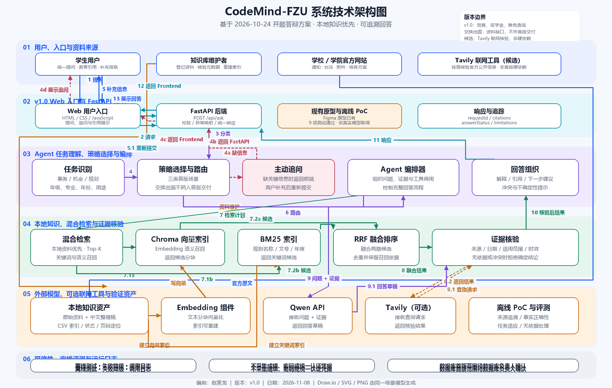

# CodeMind-FZU

**面向福州大学计算机与大数据学院学生的校园事务与发展信息智能助手**

> AgentX 团队 · 福州大学 2026 秋《软件工程与软件工程实践》团队项目  
> **项目阶段：原型与概要设计已完成，v1.0 核心功能开发中** · **内部验收目标：2026-12-06**

CodeMind-FZU 希望解决校园政策和发展信息**分散、查找耗时、适用条件复杂、难以核对来源**的问题。项目以福州大学校院两级公开资料为主要依据，规划通过领域知识库与 Agent 将自然语言问题转化为可检索、可核验、可追溯的回答；当缺少年级、学院、政策年份或可靠依据时，优先追问或说明不确定性，而不是猜测政策结论。

本仓库目前以**需求与设计成果、交互原型、知识库资料和数据库建模**为主。下述 Agent、Web 问答、混合检索及部署能力属于 v1.0 **开发计划**，不表示已经完成或上线。

## 一、项目定位与应用场景

服务对象主要为福州大学计算机与大数据学院（软件学院）本科生，首版围绕以下四个业务方向建设统一信息入口：

| 业务方向 | 典型问题 |
| --- | --- |
| 政策与事务办理 | 奖学金申请条件、评优评奖、办事流程与所需材料 |
| 升学与就业发展 | 推免基本条件、培养要求和阶段性准备事项 |
| 竞赛与科研信息 | 竞赛目录、认定类别、创新学分和科研机会信息 |
| 学院资源导航 | 培养方案、学院通知、实验室和办事渠道 |

**三个优先演示场景**：竞赛认定、奖学金申请、推免条件。个人成长档案与长期规划是后续方向，不纳入本阶段必要交付；交换、出国交流等信息可逐步扩充，但不作为首版验收必需项。

**设计原则**：官方来源优先、适用范围明确、政策版本可追溯、证据不足不编造、用户数据最小化。

## 二、规划中的核心功能

1. **自然语言政策问答**：学生直接描述问题，系统识别事项和必要条件。
2. **追问澄清**：缺少年份、年级、学院、竞赛名称或申请用途时先追问，避免误判。
3. **知识库混合检索**：规划使用 Chroma 语义召回与 BM25 关键词检索，采用 RRF 融合候选证据。
4. **证据核验与可溯源回答**：生成前检查来源、时效和适用范围；调用 Qwen 组织答案后，再复核引用与结论；回答展示对应资料及其版本。
5. **明确的异常与不足提示**：在资料缺失、版本冲突、检索失败或模型调用失败时返回可解释状态。
6. **知识资料维护**：规划实现最小化的资料导入、人工核验、索引构建、测试与版本更新流程。

Tavily 联网检索为**可选扩展**，只能作为经核验的补充来源；完整后台 Web 管理系统、历史成长档案和自动执行复杂任务不属于本阶段必须交付的功能。

## 三、技术方案（设计基线）

| 层次 | 计划技术 / 职责 |
| --- | --- |
| 学生端 Web | HTML / CSS / JavaScript；问答输入、条件补充、引用与异常状态展示 |
| 后端 API | Python、FastAPI；请求校验、Agent 调用、统一响应 |
| Agent 编排 | 任务识别、Clarifier 追问、检索调度、证据核验、回答复核 |
| 本地检索 | Chroma + BM25 + RRF；两路召回、融合排序与去重 |
| 大模型 | Qwen API；基于已核验证据生成回答 |
| 知识资料 | 学校与学院官方网页、附件、整理稿和版本元数据 |
| 关系数据库设计 | PostgreSQL 16 + SQLAlchemy 2.0 为**候选技术基线**，是否纳入 v1.0 实际部署待定 |
| 可选联网核验 | Tavily；本地证据不足时辅助查找官方公开来源 |

规划中的核心链路：

```text
学生提出问题
    ↓
FastAPI → Agent 任务识别 → 必要时追问澄清
    ↓
Chroma / BM25 并行检索 → RRF 融合排序
    ↓
生成前证据核验 → Qwen 生成回答草稿 → 生成后回答复核
    ↓
回答 + 引用来源 + 适用范围 / 不确定性提示 → Web 展示
```

<details>
<summary>查看系统架构图（设计成果）</summary>



</details>

**实现边界**：上述技术架构是目标方案，不等于各组件均已开发或完成联调。关系模型已做离线建模验证，但尚未以 PostgreSQL 实库完成部署和端到端测试。

## 四、已完成的设计与资料成果

| 成果 | 当前状态 | 查看 |
| --- | --- | --- |
| 学生端与管理端交互原型 | 已完成设计 | [原型目录](docs/assignment-02/prototype/) |
| 系统概要设计、UML、Agent 流程 | 已完成设计 | [系统设计目录](docs/assignment-02/system-design/) |
| 系统设计说明书 | 正式 PDF 已提交 | [AgentX_系统设计说明书.pdf](docs/assignment-02/system-design/AgentX_系统设计说明书.pdf) |
| 数据库概念、逻辑及详细设计 | 已完成设计 | [数据库设计目录](docs/assignment-02/database-design/) |
| 数据库设计说明书 | V1.3 正式 PDF 已提交 | [AgentX_数据库设计说明书.pdf](docs/assignment-02/database-design/AgentX_数据库设计说明书.pdf) |
| 领域知识库资料整理 | 已登记并整理部分资料，仍待持续核验 | [知识库目录](knowledge_base/) |
| 团队设计成果及协作记录 | 已归档 | [第二次团队作业](docs/assignment-02/) |

知识库当前的设计基准为 **44 条政策/通知资料登记、149 条文件记录**。这些数字表示**设计与资料登记规模**，不等于全部文件已可用或全部政策已通过联网时效核验。数据库设计包括 **23 张关系表、233 个字段、40 组外键**，已有 **21 项单元测试和 SQLite 离线建表/部分资料导入验证记录**；这些不代表 PostgreSQL 已部署，更不代表 Agent 与数据库已端到端集成。

### 在线原型

- [学生端 Figma 演示](https://www.figma.com/proto/Wan3sZFRzZyAo8JtW3olYV/agent?node-id=9-40)
- [后台管理端 Figma 演示](https://www.figma.com/proto/Wan3sZFRzZyAo8JtW3olYV/agent?node-id=135-2058)

> 原型中的政策示例、统计数字、对话结果属于交互展示内容，不应直接作为实际政策依据。

## 五、仓库结构

```text
CodeMind-FZU/
├── README.md                       # 项目简介与开发路线
├── knowledge_base/                 # 官方资料登记、整理稿、索引与采集工具
└── docs/
    └── assignment-02/
        ├── prototype/              # 学生端、管理端与交互流程原型
        ├── system-design/          # 系统设计说明书、架构与 UML 图
        ├── database-design/        # ER 图、关系模型、DDL、ORM、数据字典
        ├── collaboration/          # 团队协作记录
        └── blog/                   # 课程团队博客内容
```

目前没有可供用户直接安装启动的完整 v1.0 Agent 应用。后端与前端运行说明将在对应功能代码提交后补充；本仓库中的数据库生成、核验工具有各自的说明文档，请按子目录 README 操作。

## 六、v1.0 开发计划（四周）

经与课程助教确认，开发阶段在 **2026 年 12 月初**结束。暂以 **12 月 6 日**作为团队内部交付节点；如课程正式通知更早截止，将相应前移。目标是优先完成三个典型场景的**可运行、可测试、可演示**的问答闭环。

| 周次 | 日期 | 开发重点 | 牵头 / 配合 | 可验收里程碑 |
| --- | --- | --- | --- | --- |
| W1 | 11/10—11/16 | 前后端骨架、API 契约、测试环境；并行整理首批官方资料、提取分块和基础索引 | 赵紫龙、林世颖、吴欣键、王智洋；薛锦荣、丁晓炜、罗宇泽 | **M1**：本地启动；`/api/health` 可访问；`/api/ask` 模拟响应可展示；首批资料可检索 |
| W2 | 11/17—11/23 | Chroma/BM25 检索与 RRF；任务识别、追问、证据核验、Qwen 接口及回答复核 | 吴诗莹、赵紫龙、王智洋、丁晓炜；雷葭雨、颜俊宇 | **M2**：后端完成带引用的问答闭环，能处理资料不足和基础异常 |
| W3 | 11/24—11/30 | 学生端与 Agent 联调、引用展开、反馈和异常态；最小资料维护工具；三场景演示 | 吴欣键、林世颖、洪添军、林彦翔；吴诗莹、王智洋、赵紫龙 | **M3**：竞赛认定、奖学金、推免三个代表性场景可通过 Web 完整演示 |
| W4 | 12/01—12/06 | 单元与集成测试、缺陷修复；部署或可复现打包、操作说明、性能检查与验收材料 | 颜俊宇、雷葭雨、罗宇泽、薛锦荣；洪添军、赵紫龙及全体模块负责人 | **M4**：可启动或可访问的 v1.0 演示版本、测试记录、部署说明和验收材料 |

**里程碑约束**：11 月 30 日前原则上完成核心功能开发；12 月初以稳定性、测试、修复和交付为主，不在最终验收阶段临时扩展完整后台、长期个人档案或其他大规模功能。进度以仓库实际提交、测试报告及 PR 为准，以上里程碑均为**计划目标**，不是已完成声明。

## 七、团队协作与贡献

项目由福州大学 **AgentX 12 人团队**合作完成，采用 GitHub 分支、Pull Request 和代码审核方式协作。

- **项目统筹与集成**：罗宇泽
- **后端、架构与接口**：赵紫龙；**系统文档与构建**：薛锦荣
- **Agent 逻辑**：吴诗莹；**业务规则与测试**：雷葭雨、颜俊宇
- **前端结构、学生端及交互演示**：林世颖、吴欣键、洪添军
- **资料维护与后台原型**：林彦翔
- **数据库、知识数据与检索**：丁晓炜、王智洋

相关设计和协作过程以 [Pull Requests](https://github.com/yz-Yezi-Genm/CodeMind-FZU/pulls?q=is%3Apr) 为准。新功能建议通过功能分支提交，附上实现说明、必要测试及截图；涉及政策数据时必须标明来源、适用范围和核验状态。

## 八、项目资料与注意事项

- [第二次团队作业及设计成果目录](docs/assignment-02/)
- [知识库设计方案](knowledge_base/知识库设计方案.md)
- [系统设计说明书](docs/assignment-02/system-design/AgentX_系统设计说明书.pdf)
- [数据库设计说明书](docs/assignment-02/database-design/AgentX_数据库设计说明书.pdf)
- [团队仓库 PR 历史](https://github.com/yz-Yezi-Genm/CodeMind-FZU/pulls?q=is%3Apr)

**资料使用声明**：本项目为课程学习与软件工程实践用途。政策查询必须以福州大学及相关部门最新官方发布信息为准；项目中的原型、整理稿和模型输出不能替代正式通知或学校认定结论。

---

**维护团队：AgentX · 项目：CodeMind-FZU**
