# 2026秋软工实践 AgentX——项目原型设计+概要设计

| 项目 | 内容 |
|:--|:--|
| 作业所属课程 | [H202601 软件工程与软件工程实践](https://edu.cnblogs.com/campus/fzu/2026-01SoftwareEngineeringandSoftwareEngineeringPractice) |
| 作业要求 | [2026 秋软工实践团队作业（二）：原型设计 + 概要设计](https://edu.cnblogs.com/campus/fzu/2026-01SoftwareEngineeringandSoftwareEngineeringPractice/homework/16774) |
| 作业的目标 | 结合第一次团队作业的需求分析，完成用户与管理端交互原型、系统架构与 UML、数据库概念及逻辑设计，说明领域 Agent 的集成方式和团队后续开发安排。 |
| 团队名称 | AgentX（项目：CodeMind-FZU） |
| 团队成员学号-名字 | 102401125-罗宇泽；【学号待填】-薛锦荣；【学号待填】-颜俊宇；【学号待填】-林世颖；【学号待填】-吴欣键；【学号待填】-林彦翔；102401209-洪添军；【学号待填】-雷葭雨；【学号待填】-吴诗莹；【学号待填】-赵紫龙；【学号待填】-丁晓炜；【学号待填】-王智洋 |

## 一、项目简介

CodeMind-FZU 面向福州大学计算机与大数据学院学生，围绕竞赛认定、奖学金申请、推免条件和学院资源等校园事务，提供一个基于官方资料的统一信息查询入口。与泛化的聊天工具相比，本项目更重视**适用范围、政策版本和信息来源**：资料不足时先追问、提示或建议核实，而不是给出没有依据的结论。

本次为第二次团队作业，重点从第一次的需求分析推进到**可交互原型、概要设计、数据库设计和团队协作计划**，并不宣称系统全部功能已开发上线。

## 二、原型设计

### 2.1 设计工具与原型范围

本次原型使用 **Figma** 绘制，包含学生端应用界面和后台管理端概念原型。我们将第一次作业得到的需求转化为可视化页面，重点验证“学生提问—Agent 追问与检索—解释结果与展示依据”和“管理员维护资料—核验—发布索引”两条关键流程。

学生端整理了 **52 个页面与弹窗的完整流程索引**，其中既有首版核心场景，也有面向后续迭代的探索页面；后台管理端提交了 **17 个页面、7 个交互弹窗**。这些数量指设计稿规模，**不等于全部功能已开发完成**。

- **学生端在线原型**：[Figma 演示入口](https://www.figma.com/proto/Wan3sZFRzZyAo8JtW3olYV/agent?node-id=9-40)
- **后台管理端原型**：[Figma 演示入口](https://www.figma.com/proto/Wan3sZFRzZyAo8JtW3olYV/agent?node-id=135-2058)
- **页面清单**：[学生端页面说明](https://github.com/yz-Yezi-Genm/CodeMind-FZU/blob/main/docs/assignment-02/prototype/student/%E5%AD%A6%E7%94%9F%E7%AB%AF%E9%A1%B5%E9%9D%A2%E8%AF%B4%E6%98%8E.md)、[后台管理端 README](https://github.com/yz-Yezi-Genm/CodeMind-FZU/blob/main/docs/assignment-02/prototype/admin/README.md)

> **在线访问核查说明**：原型负责人在 PR #11 的交付文档中记录了未登录 Edge 浏览器访问与核心跳转实测结果。正式发布前仍应以非成员账号复核。

### 2.2 学生端：围绕校园信息查询组织界面

学生端以统一问答入口为核心，按**政策与事务办理、升学与就业发展、竞赛与科研信息、学院资源导航**四个首版优先方向组织信息；“个人成长档案与长期规划”作为后续迭代方向。五个业务方向是整体规划，智能问答、追问澄清、来源展示属于跨方向的共用能力。

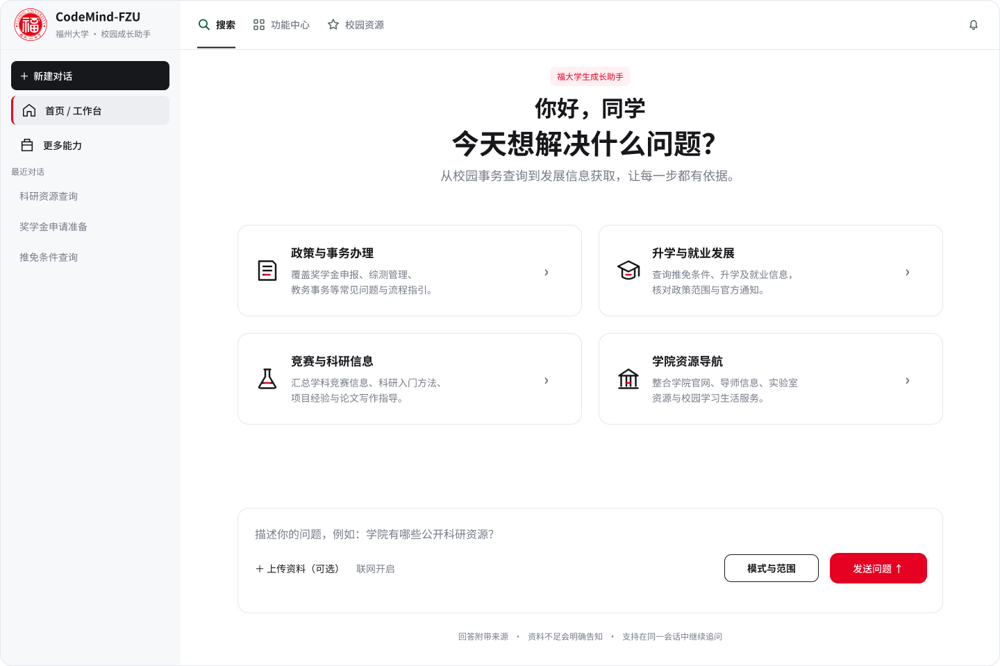

*图 2-1 学生端首页*

提供自然语言查询入口与主要功能导航。

**以奖学金申请为例**，学生输入申请问题后，界面展示检索状态、条件与材料整理结果，并允许展开引用依据。用户不仅能看到“需要做什么”，还能核对“依据出自哪里、适用于哪个年度和人群”。

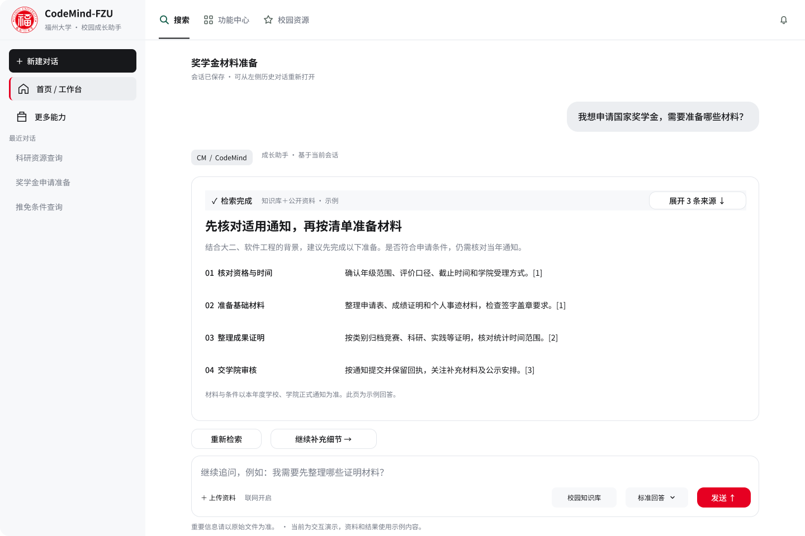

*图 2-2 奖学金咨询结果*

回答按条件、材料与办理环节组织，并附示例引用编号。

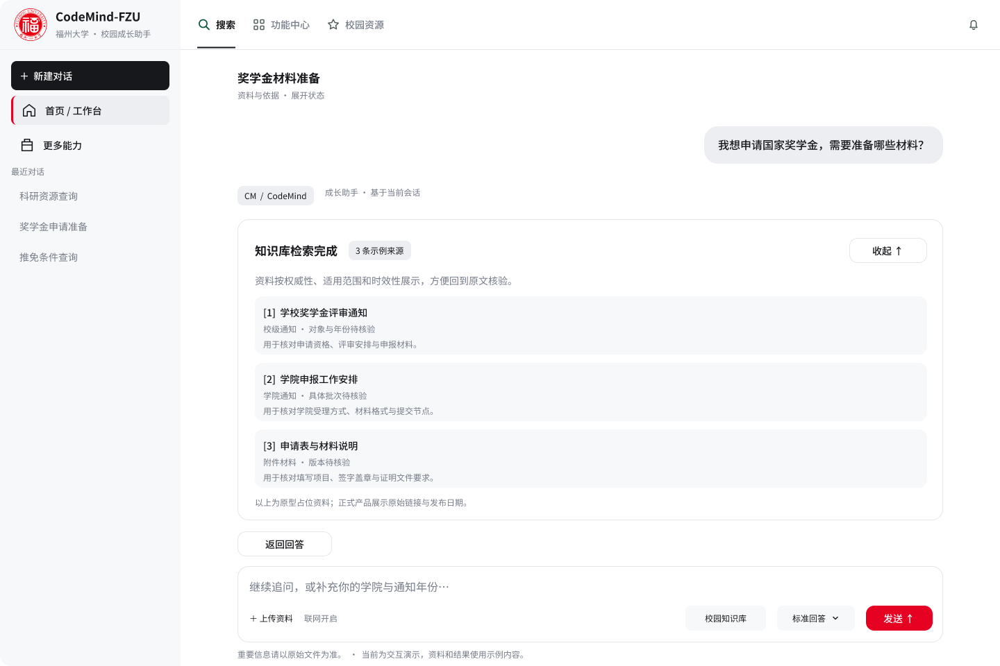

*图 2-3 来源依据展开*

显示支持回答的资料名称、来源角色和后续需核验项。

**当条件不完整或者资料不足时**，系统不应虚构截止日期和申请条件。原型中会提示用户补充学院、年份和申请事项，也允许用户继续提供官方通知进行当前会话核验。补充背景只服务于当前查询，不默认保存为长期成长档案；上传文件也不会自动进入公共知识库。

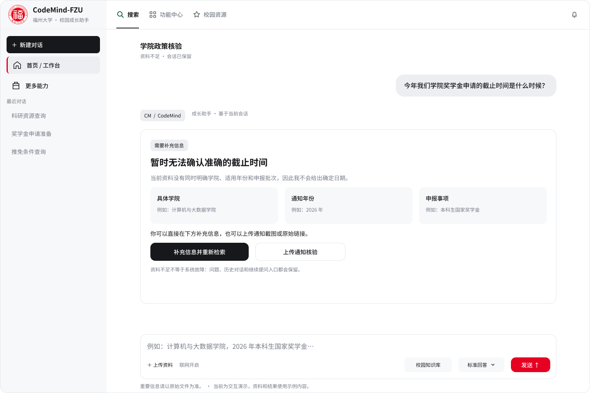

*图 2-4 资料不足与追问状态*

展示无法确认时的解释、补充条件和重新检索入口。

针对竞赛认定查询，我们进一步区分“竞赛目录中存在某项赛事”与“该赛事能否用于学院加分或推免认定”。即使目录条目匹配，缺少学院当年认定细则时，原型仍明确标记尚不能确认，避免直接推断个人资格。

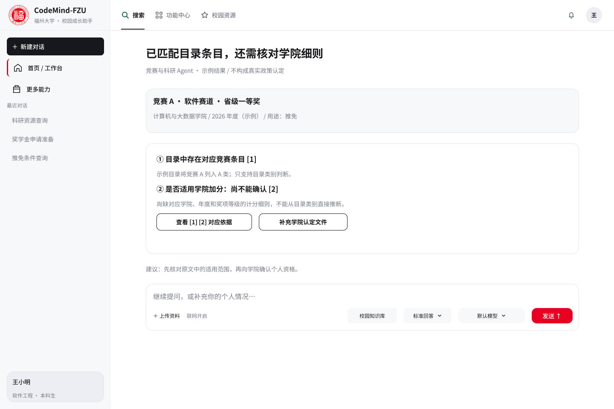

*图 2-5 竞赛认定的分项结论*

分别展示目录匹配结果与尚未确认的学院规则。

页面还包括当前会话内追问、回答反馈以及可选的资料检索入口。**历史任务持久化、代码执行、个人长期档案、完整任务规划与模型切换等画板属于后续设计**，不视为 v1.0 已完成功能。页面中的示例政策、人物、统计值和引用为交互演示内容，不作为真实政策认定结果。

### 2.3 后台管理端：展示知识维护与发布闭环

后台原型主要围绕资料审核、来源管理、数据质量、用户数据请求和操作审计展开。在资料详情中，管理员可以查看来源、文号、适用范围、原文快照和核验记录，并处理通过、拒绝、发布失败重试等状态。

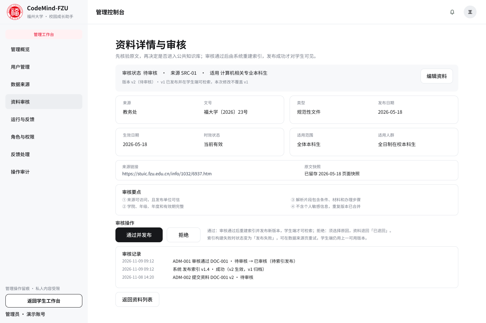

*图 2-6 资料详情与审核*

演示“审核通过”和“索引发布成功”是两个不同环节。

**审核通过不等于资料立即可供学生检索**。设计要求新资料经过检索索引构建与测试后，才切换为可用版本；新版本失败时保留上一版可用索引。数据质量页面展示了解析、检索测试、版本回滚的操作设计。

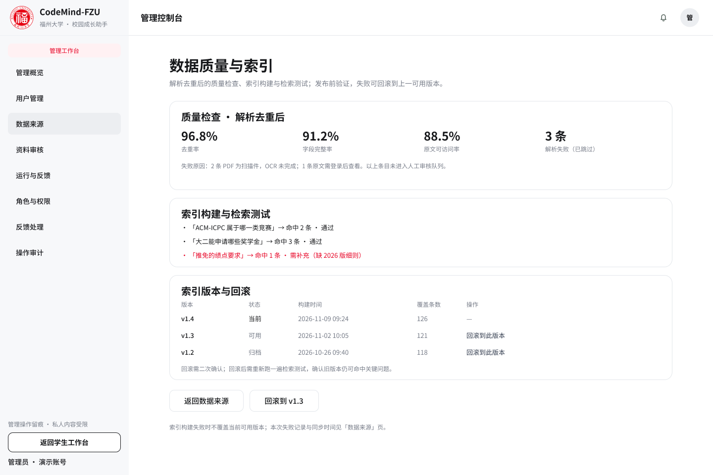

*图 2-7 数据质量与索引管理*

展示质量检查、问题查询测试及索引版本回滚入口。

针对个人数据删除申请，原型设置了申请处理与二次确认弹窗，并明确业务数据删除边界、审核轨迹和审计记录的区别；管理端运行记录采用任务编号与来源状态的方式表达，不默认展示用户完整私人对话。

**实现边界说明**：本次提交的是后台概念原型。首版资料维护主要计划通过脚本和人工审核实现，完整后台 Web 管理系统属于后续迭代；原型内的质量百分比、运行编号、版本和用户记录均为展示示例，不代表线上实测或生产运行。

### 2.4 Agent 与界面的结合

| 用户操作 | Agent/后端应执行的任务 | 对应界面反馈 |
|---|---|---|
| 输入竞赛、奖学金或推免问题 | 识别任务和必要条件 | 显示处理中状态或提出追问 |
| 补充年份、学院、事项等信息 | 更新当前查询上下文，重新检索 | 继续当前查询，不重新填写全部信息 |
| 检索本地资料 | 混合召回、融合排序、核验证据 | 返回可解释的结论与引用 |
| 找不到可靠依据 | 返回证据不足状态，可选在线核验官方来源 | 明确提示无法确认或请求补充官方资料 |
| 点击查看依据 | 从回答引用定位到知识文档及版本 | 展示来源、发布时间、适用范围 |
| 对答案进行反馈 | 记录与回答关联的反馈信息 | 给予反馈结果提示；必要时进入核查待办 |

这样，Agent 并不是独立于软件界面的聊天窗口，而是围绕校园事项的条件追问、资料检索、证据约束和可追溯展示，与学生端及管理端共同构成业务闭环。

## 三、系统概要设计

### 3.1 总体架构与功能模块

在第一次团队作业需求分析的基础上，我们采用前后端分离的 Web 形态。系统从功能上分为**学生端服务、Agent 核心服务、后台管理端**三个模块，并使用独立的**领域知识库数据资源层**支撑问答；FastAPI / Ask API 是接口支撑，不作为额外的一级业务模块。

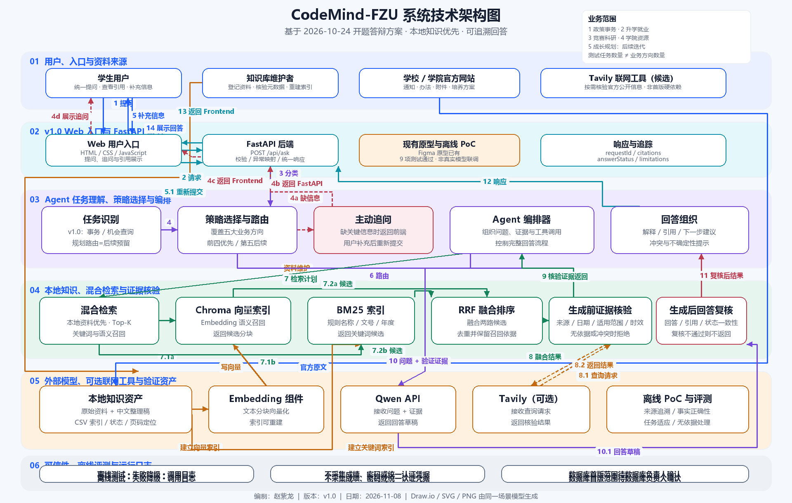

*图 3-1 系统技术架构图*

展示 Web 前端、FastAPI、Agent 编排、检索索引、外部 Qwen 与知识库之间的分工。

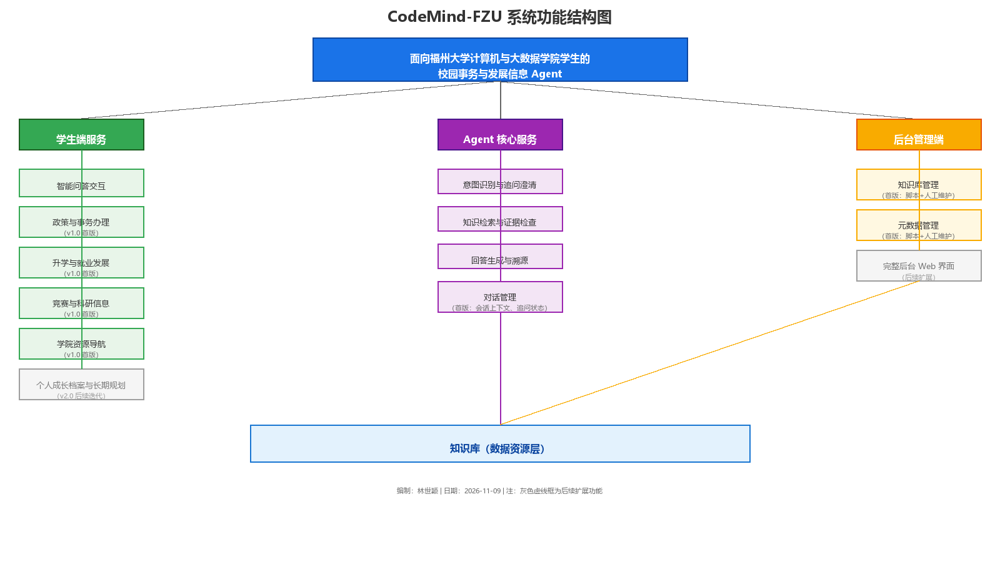

*图 3-2 系统功能结构图*

展示三大功能模块、四个首版业务方向及独立的数据资源层。

| 逻辑部分 | 主要职责 | 首版定位 |
|---|---|---|
| 学生端 | 输入问题、呈现追问、展示答案和引用、提交反馈 | 核心用户入口 |
| FastAPI / Ask API | 请求校验、接口、错误状态、调用 Agent、返回 HTTP 响应 | 单体后端服务内的接口层 |
| Agent 核心服务 | 意图识别、追问澄清、检索调度、证据核验、回答组织 | 问答主链路 |
| 领域知识库 | 原始资料、文档版本、元数据、分块和检索索引 | 事实依据及来源管理 |
| 管理维护 | 录入审核、来源核验、索引发布与回滚 | 首版以脚本和人工维护为主 |

**技术设计基线**：前端 HTML/CSS/JavaScript；后端 FastAPI；本地检索采用 Chroma 向量索引、BM25 关键词检索及 RRF 融合排序；外部生成服务为 Qwen API，Tavily 仅作为可选官方信息联网核验工具。概念上分为不同组件，**并不代表目前已将它们全部开发、部署或联调**。

### 3.2 用例分析

系统设置学生（查询者）、知识库管理员（内容维护者）两个参与者。UML 用例设计包含 1 个抽象基用例与 9 个具体用例，覆盖竞赛认定、奖学金申请、推免条件、学院资源查询，以及追问、依据查看、回答反馈、资料维护与核验。用例之间通过泛化、`extend`、`include` 等关系表达共性和依赖。

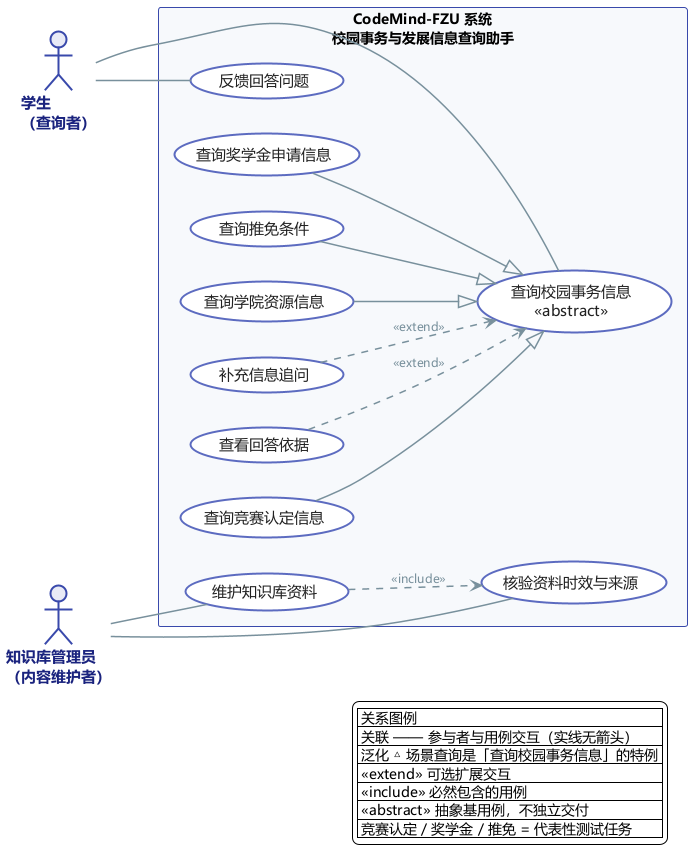

*图 3-3 系统用例图*

将学生查询用例与管理员维护用例放在统一系统边界中。

三个代表性测试任务是**竞赛认定类别及证明材料、奖学金申请条件与流程、推免基本条件**。它们用来验证共用 Agent 闭环，而不是把整体产品缩减成三个业务方向。

### 3.3 核心业务流程与 UML 活动图

学生端的主流程为：**提交问题 → 任务识别 → 必要时追问 → 检索候选资料 → 来源与时效核验 → 生成及复核回答 → 展示来源或不足提示**。在本地证据不足且有必要时，可以选择调用 Tavily 检索官方公开资料，但联网结果仍须返回证据核验，不允许直接作为确定答案。

后台侧的知识维护依次经过资料采集、解析、来源与时效核验、索引构建、质量检查、离线检索测试、人工审核、版本发布等环节；Chroma 与 BM25 需绑定同一知识版本，任何关键环节失败时保留上一版可用索引。

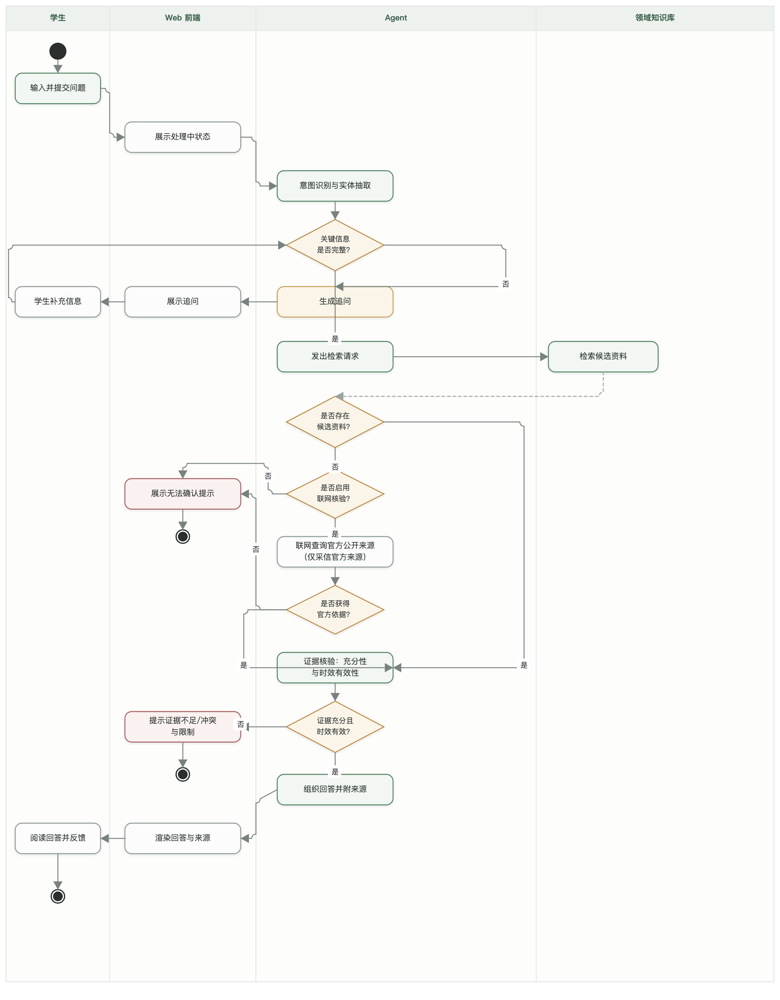

*图 3-4 学生政策咨询 UML 活动图*

通过泳道与判断分支表现追问、可选联网与证据不足处理。

对于竞赛认定等复合问题，设计上采用**分事项独立核验**：能够确认的部分给出依据，暂不能确认的部分明确解释缺失条件，不因某一事项缺少证据而把全部问题简单拒答。

### 3.4 Agent 任务编排与重要时序

在设计中，AgentOrchestrator 作为统一任务编排器：TaskRouter 识别任务并检查缺失条件；HybridRetriever 调用 Chroma 与 BM25；RRF 融合排序；EvidenceVerifier 在生成之前核验证据；LLMAdapter 调用 Qwen 生成回答草稿；AnswerVerifier 在生成之后检查引用与结论；AnswerComposer 组织最终响应，再经 FastAPI 返回前端。

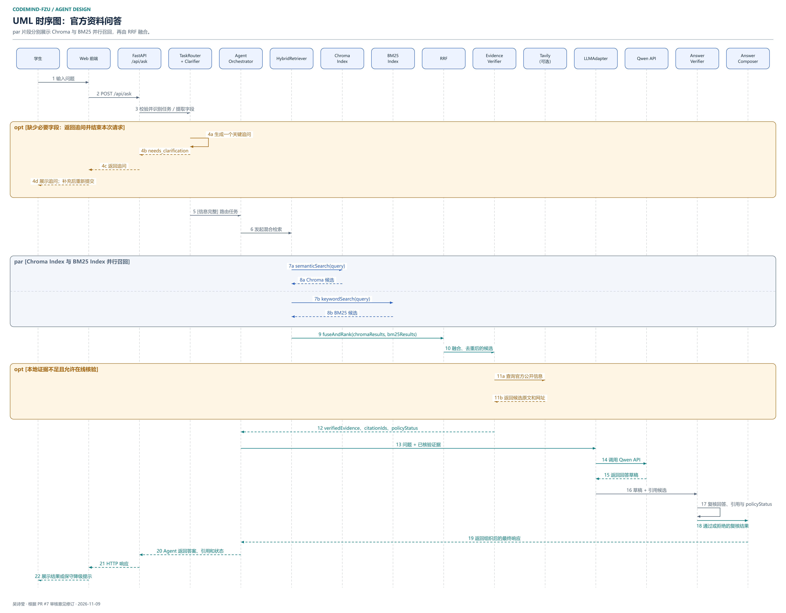

*图 3-5 Agent 问答 UML 时序图*

突出并行检索、可选外部工具调用、生成前后双重核验和 FastAPI 返回路径。

| 阶段 | 设计中的主要对象 | 输出或约束 |
|---|---|---|
| 意图识别 | TaskRouter、Clarifier | 任务类型和需要补充的信息 |
| 检索 | HybridRetriever、Chroma、BM25、RRF | 融合去重的候选证据 |
| 生成前核验 | EvidenceVerifier | `verifiedEvidence`、`citationIds`、`policyStatus` |
| 模型生成 | LLMAdapter、Qwen API | 基于核验证据的回答草稿 |
| 生成后复核 | AnswerVerifier | 对引用、范围、年份与政策状态的复核结论 |
| 响应 | AnswerComposer、AgentOrchestrator、FastAPI | 回答、来源、不确定性和状态标识 |

### 3.5 类图与通信图

**类图**用于表述领域实体和它们之间的关系，例如用户、会话、消息、Agent 任务、任务结果、文档版本与引用；实体属性应以最终数据库 ORM 模型为基准，避免把 API 状态字段误当数据库列。类图正在系统设计说明书整合 PR #10 中修订，博客定稿时使用审核通过的最终图。

**图 3-6 核心领域类图：待补。PR #10 尚未合并，最终类图须审核通过后补入。**

**UML 通信图**描述对象之间的协作关系与消息传递，分别对应“学生提问与回答返回”和“知识资料维护与索引更新”两类场景，补充时序图关注的消息路径。

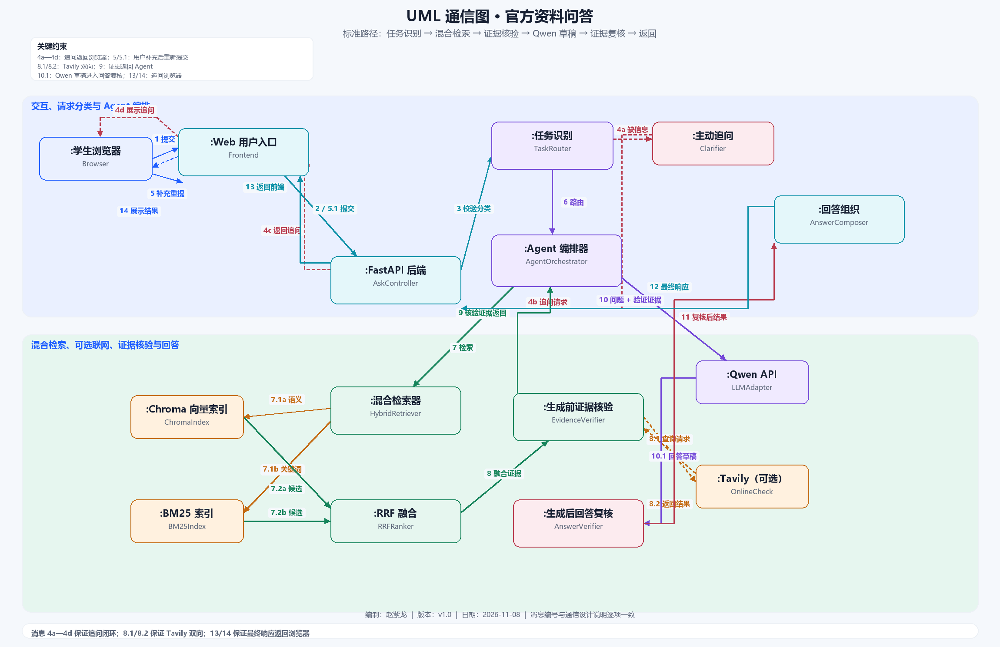

*图 3-7 关键对象通信图*

展示浏览器、Ask API、Agent、检索与外部服务的协作关系。

资料维护方向另绘有一张通信图，可通过[知识入库 UML 通信图](https://github.com/yz-Yezi-Genm/CodeMind-FZU/tree/main/docs/assignment-02/system-design/diagrams/uml/communication)查看。

### 3.6 可靠性、异常与隐私边界

系统将“找到文件”和“核实政策适用性”区分处理。对条件不完整、年份冲突、模型超时、联网失败、索引不可用等情况，应返回可解释的状态，不应自由编造确定结论。设计中 `grounded`、`needs_clarification`、`insufficient_evidence`、`conflict`、`degraded` 用于区分回答状态。用户敏感信息不默认入库，外部工具只接收必要的公开检索词。

以上均为本次概要设计中的预期行为，不表示已通过端到端线上验证。

## 四、数据库设计

### 4.1 从核心 ER 模型到完整关系模型

数据库概念设计围绕**知识分类、知识文档、文档版本、文档文件、适用规则、知识分块**六类知识库核心实体建立关系：同一逻辑文档可有多个版本，每个版本保存来源、日期、适用范围和核验状态，并与相应文件、分块建立可追溯的关联。

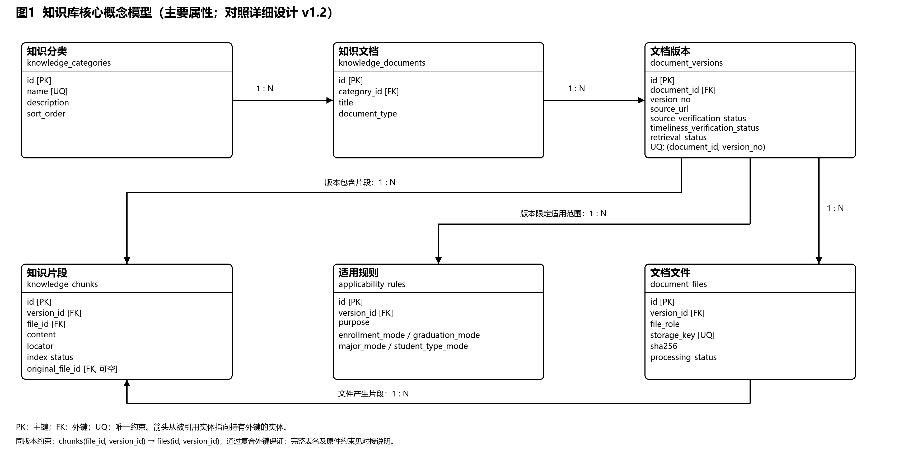

*图 4-1 核心知识库 ER 图*

展示核心实体以及一对多联系，主外键与关系含义见数据库说明书。

在核心 ER 模型上，详细设计进一步扩展到用户会话、交互消息、Agent 任务与结果、回答引用、用户反馈、资料核查和业务方向映射等数据，形成 **23 张表、233 个字段**的关系模型。对应交付包括关系数据模型、数据字典、主外键与复合约束、PostgreSQL DDL 设计和 SQLAlchemy ORM 模型。

### 4.2 关系模型与 ORM 映射

| 数据类别 | 代表实体/关系表 | 设计目的 |
|---|---|---|
| 知识分类与资料 | `knowledge_categories`、`knowledge_documents` | 分类查询与文档身份管理 |
| 文档版本与证据 | `document_versions`、`document_files`、`knowledge_chunks` | 保留版本、来源和原文定位 |
| 用户问答记录 | `conversation_sessions`、`interaction_messages` | 表达会话与单次交互，部署策略仍待确定 |
| Agent 执行结果 | `agent_tasks`、`task_results`、`result_citations` | 记录任务状态、结果与所用依据 |
| 反馈与核查 | `answer_feedback`、`verification_tasks` | 把用户反馈与内容复核衔接起来 |

对象关系映射（ORM）候选技术为 SQLAlchemy 2.0 命令式映射，实体类与数据库表按明确的字段、关系和约束对应；PostgreSQL 16 为数据库设计候选技术基线，**不代表系统已经部署 PostgreSQL 或将它确定为首版生产环境必需组件**。

### 4.3 领域知识与记录的存储管理

资料管理区分来源核验状态、时效核验状态、政策生命周期、正文提取状态以及是否允许检索等信息。记录“已登记”不等于“允许 Agent 检索”。当前设计以 **44 条资料、149 条文件记录**为基准，示例元数据与导入脚本可以用于复现建模校验，但资料仍需完成逐条核验及索引发布流程。

对于用户交互和任务结果，设计要求引用关联到具体文档版本；适用时再关联精确知识片段。用户背景仅用于当前必要查询，历史会话持久化和完整后台管理不作为首版已实现功能。

### 4.4 设计验证与实施边界

数据库相关提交包含 **21 项单元测试通过**的验证记录，以及 SQLite 全 23 张表建表、向其中 8 张核心资料表导入测试数据的离线验证；这不能替代 PostgreSQL 实库集成测试或 Agent—数据库端到端验证。

数据库的完整字段、约束、ORM 映射和 ER 图详见[数据库设计目录](https://github.com/yz-Yezi-Genm/CodeMind-FZU/tree/main/docs/assignment-02/database-design)，完整 PDF 以团队最终交付链接为准。

## 五、团队协作与项目管理

本次设计由 12 人分工开展，采用 GitHub 分支与 Pull Request（PR，拉取请求）协作。各模块负责人提交源文件、图片与说明材料，组长负责跨模块一致性检查、问题反馈与成果整合。PR 记录、提交历史和文件变更可作为过程证据；未查证的线下会议、群聊、演示不写成已发生。

### 5.1 已核验的 PR 成果

| PR | 负责人 | 交付成果 | 查询时状态 |
|---|---|---|---|
| [#1](https://github.com/yz-Yezi-Genm/CodeMind-FZU/pull/1) | 林世颖 | 功能结构图、模块职责 | 已合并 |
| [#2](https://github.com/yz-Yezi-Genm/CodeMind-FZU/pull/2) | 赵紫龙 | 系统架构、UML 通信图 | 已合并 |
| [#3](https://github.com/yz-Yezi-Genm/CodeMind-FZU/pull/3) | 雷葭雨 | 产品规划、业务流程、UML 活动图 | 已合并 |
| [#4](https://github.com/yz-Yezi-Genm/CodeMind-FZU/pull/4) | 颜俊宇 | UML 用例图与规约 | 已合并 |
| [#5](https://github.com/yz-Yezi-Genm/CodeMind-FZU/pull/5) | 丁晓炜 | ER 图与实体关系说明 | 已合并 |
| [#6](https://github.com/yz-Yezi-Genm/CodeMind-FZU/pull/6) | 林彦翔 | 后台原型与交互弹窗 | 已合并 |
| [#7](https://github.com/yz-Yezi-Genm/CodeMind-FZU/pull/7) | 吴诗莹 | Agent 流程、时序图与系统集成图 | 已合并 |
| [#8](https://github.com/yz-Yezi-Genm/CodeMind-FZU/pull/8) | 王智洋 | 数据库逻辑/详细设计、ORM 与测试 | 已合并 |
| [#9](https://github.com/yz-Yezi-Genm/CodeMind-FZU/pull/9) | 吴欣键 | 学生端原型与页面说明 | 已合并 |
| [#10](https://github.com/yz-Yezi-Genm/CodeMind-FZU/pull/10) | 薛锦荣 | 系统设计说明书 PDF 与构建脚本 | 审核中，待同步最终成果 |
| [#11](https://github.com/yz-Yezi-Genm/CodeMind-FZU/pull/11) | 洪添军 | 原型交互展示、流程索引、访问与交互核查记录 | 已合并 |

2026-11-09 经 GitHub 实时查询，PR #10 为 open、未合并，当前 2 次提交，头提交 `57dc34fd2c01144d031691b34779740c9e6ea5b7`；更新时间为北京时间 18:22:30。未提供此前头提交基准，不能判定是否相对上次新增提交。其说明仍要求同步 #3 后重建 PDF。

截至本次核验，**#1—#9 和 #11 已合并，#10 仍在审核中**。设计阶段有贡献的团队成员不等于每人都独立发起 PR；以真实作者、提交和交付文件为准。

### 5.2 实际协作过程

| 日期（北京时间） | 事项 | 过程与产出 | 证据 |
|---|---|---|---|
| 11 月 8—9 日 | 分模块提交与并行评审 | 功能、架构、业务、UML、ER、后台、Agent 和数据库等成果陆续建立 PR；#2 于 11 月 8 日晚合并，#5 于 11 月 9 日凌晨合并 | [PR 列表](https://github.com/yz-Yezi-Genm/CodeMind-FZU/pulls)、[#2](https://github.com/yz-Yezi-Genm/CodeMind-FZU/pull/2)、[#5](https://github.com/yz-Yezi-Genm/CodeMind-FZU/pull/5) |
| 11 月 9 日 | 原型与数据库集成 | 学生端、数据库详细设计、UML 用例和后台原型分别通过整改与合并 | [#9](https://github.com/yz-Yezi-Genm/CodeMind-FZU/pull/9)、[#8](https://github.com/yz-Yezi-Genm/CodeMind-FZU/pull/8)、[#4](https://github.com/yz-Yezi-Genm/CodeMind-FZU/pull/4)、[#6](https://github.com/yz-Yezi-Genm/CodeMind-FZU/pull/6) |
| 11 月 9 日 | 跨模块一致性修订 | #1 修正功能结构图 PNG 与 SVG/Draw.io 不一致；#3 调整业务范围及解决产品规划文档合并冲突；#7 补全 FastAPI 与工具返回链路 | [#1](https://github.com/yz-Yezi-Genm/CodeMind-FZU/pull/1)、[#3](https://github.com/yz-Yezi-Genm/CodeMind-FZU/pull/3)、[#7](https://github.com/yz-Yezi-Genm/CodeMind-FZU/pull/7) |
| 11 月 9 日 | 系统设计说明书整合 | #10 提交系统设计文档、类图和构建脚本；发现需要同步已合并的流程和类图模型口径，目前仍在审核 | [#10](https://github.com/yz-Yezi-Genm/CodeMind-FZU/pull/10) |
| 11 月 9 日 | 原型交互展示整改与合并 | #11 补充 52 个学生端页面与弹窗的索引、演示截图及未登录浏览器核查记录 | [#11](https://github.com/yz-Yezi-Genm/CodeMind-FZU/pull/11) |

### 5.3 典型问题与整改

1. **业务范围统一**：将五大业务方向、首版四个方向及三个代表性测试任务分开描述，避免将规划能力写成已实现功能，相关修改见 [#3](https://github.com/yz-Yezi-Genm/CodeMind-FZU/pull/3)、[#4](https://github.com/yz-Yezi-Genm/CodeMind-FZU/pull/4)。
2. **Agent 返回链路统一**：明确 `EvidenceVerifier → AgentOrchestrator` 的核验结果返回，以及 `AgentOrchestrator → FastAPI → Web 前端` 的最终响应；正式图经过多轮修改，见 [#7](https://github.com/yz-Yezi-Genm/CodeMind-FZU/pull/7)。
3. **管理端状态设计完善**：补齐资料发布与索引发布区别、版本回滚、数据删除申请 P06 及二次确认 P07，见 [#6](https://github.com/yz-Yezi-Genm/CodeMind-FZU/pull/6)。
4. **数据库设计可复现性**：补齐 44 条资料元数据 fixture、数据库模型与验证脚本；验证报告记录 21 项单元测试通过（属设计/离线验证，未代表真实生产环境部署），见 [#8](https://github.com/yz-Yezi-Genm/CodeMind-FZU/pull/8)。
5. **交付文件一致性**：#1 修正了文件扩展名为 PNG 但实际是 JPEG、以及图示内容与 SVG 不一致的问题，最终重新提交正确的 PNG，见 [#1](https://github.com/yz-Yezi-Genm/CodeMind-FZU/pull/1)。

### 5.4 协作证据

协作过程可查阅 [PR 全部记录](https://github.com/yz-Yezi-Genm/CodeMind-FZU/pulls?q=is%3Apr)、[#1 文件修订](https://github.com/yz-Yezi-Genm/CodeMind-FZU/pull/1/files)、[#7 提交记录](https://github.com/yz-Yezi-Genm/CodeMind-FZU/pull/7/commits)及 [#11 原型交付](https://github.com/yz-Yezi-Genm/CodeMind-FZU/pull/11)。截图操作清单随核验报告提供。

### 5.5 12 人本次设计分工与 GitHub 贡献

| 成员 | GitHub 用户名（已核实） | 本次已登记成果 | 证据链接 | 核查状态 |
|---|---|---|---|---|
| 罗宇泽 | `yz-Yezi-Genm` | 主分支合并、组织整合；具体审核痕迹以实际记录为准 | [团队仓库](https://github.com/yz-Yezi-Genm/CodeMind-FZU) | 仓库提交记录可查 |
| 薛锦荣 | `emiliaistureangle` | 系统设计说明书整合稿与构建脚本 | [#10](https://github.com/yz-Yezi-Genm/CodeMind-FZU/pull/10) | PR 已提交，尚未合并 |
| 颜俊宇 | `1cecream1` | 系统用例图、用例规约 | [#4](https://github.com/yz-Yezi-Genm/CodeMind-FZU/pull/4) | 已合并 |
| 林世颖 | `diahull` | 功能结构图、模块职责 | [#1](https://github.com/yz-Yezi-Genm/CodeMind-FZU/pull/1) | 已合并 |
| 吴欣键 | `baomihua1234` | 学生端原型 | [#9](https://github.com/yz-Yezi-Genm/CodeMind-FZU/pull/9) | 已合并 |
| 林彦翔 | `537-7` | 后台管理端原型 | [#6](https://github.com/yz-Yezi-Genm/CodeMind-FZU/pull/6) | 已合并 |
| 洪添军 | `xswlhtj` | 原型交互与展示、52个画板与弹窗索引、访问与交互核查记录 | [#11](https://github.com/yz-Yezi-Genm/CodeMind-FZU/pull/11) | 已合并 |
| 雷葭雨 | `lllee9033-lab` | 产品规划、流程、活动图 | [#3](https://github.com/yz-Yezi-Genm/CodeMind-FZU/pull/3) | 已合并 |
| 吴诗莹 | `zwoyyzy` | Agent 流程、系统集成、时序图 | [#7](https://github.com/yz-Yezi-Genm/CodeMind-FZU/pull/7) | 已合并 |
| 赵紫龙 | `zzl3141` | 系统技术架构、通信图 | [#2](https://github.com/yz-Yezi-Genm/CodeMind-FZU/pull/2) | 已合并 |
| 丁晓炜 | `ddxww` | ER 概念图、实体关系说明 | [#5](https://github.com/yz-Yezi-Genm/CodeMind-FZU/pull/5) | 已合并 |
| 王智洋 | `MieSheeeep` | 数据库关系模型、ORM、SQL、校验 | [#8](https://github.com/yz-Yezi-Genm/CodeMind-FZU/pull/8) | 已合并 |

说明：洪添军的贡献已通过 PR #11 验证；组长账号的合并/统筹记录不能替代其他成员的个人提交。

## 六、后续开发计划（拟议，全部安排待团队确认）

以上贡献表的姓名与账号对应沿用提交署名；未补齐的学号须本人确认。

### 6.1 逐周开发计划

本计划从本次作业截止后的 **2026-11-10** 开始，围绕 CodeMind-FZU 的 v1.0 核心能力逐步实现。项目技术基线：HTML/CSS/JavaScript Web 前端、FastAPI、Chroma + BM25 + RRF、Qwen API；Tavily 为可选能力。PostgreSQL/SQLAlchemy 已有设计与离线验证，但独立数据库部署是否纳入首版尚待决定，不能作为已完成能力。

| 周次 | 日期 | 本周开发目标 | 负责人（牵头/配合） | 里程碑及可验收产出 |
|---|---|---|---|---|
| W1 | 11/10—11/16 | 搭建前后端项目骨架、API 契约、测试配置与资料目录规范 | 赵紫龙、林世颖、吴欣键；薛锦荣、罗宇泽 | M1：前后端可本地启动；`/api/health` 可访问；`/api/ask` 模拟响应可展示 |
| W2 | 11/17—11/23 | 整理可用资料、文本提取与切片，搭建 Chroma/BM25 两路检索及 RRF | 王智洋、丁晓炜、吴诗莹；雷葭雨 | M2：基础索引可重建，有代表性查询的检索及来源验证记录 |
| W3 | 11/24—11/30 | 实现任务路由、必要信息追问、生成前证据核验、Qwen 适配与回答复核 | 吴诗莹、赵紫龙；颜俊宇、雷葭雨 | M3：后端完成一次带引用的问答闭环；对无依据问题能明确提示 |
| W4 | 12/01—12/07 | 学生端交互联调、引用展开、异常态和反馈；资料维护脚本、基础核验流程 | 吴欣键、林世颖、洪添军、林彦翔；王智洋 | M4：竞赛认定、奖学金、推免条件三个代表性场景可在 Web 完整演示 |
| W5 | 12/08—12/14 | 单元/集成测试，处理多版本冲突、模型失败、检索失败、隐私和引用问题 | 颜俊宇、雷葭雨、洪添军；全体模块负责人 | M5：自动测试与手工验收记录、缺陷清单、修复 PR |
| W6 | 12/15—12/21 | 部署或可复现交付、操作说明、性能检查、演示材料与验收 | 罗宇泽、薛锦荣、赵紫龙；全体成员 | M6：可启动或可访问的演示版本、安装/部署说明、测试报告与最终验收材料 |

**范围控制**：首版优先验证四类业务方向中已有官方依据的问题；个人成长档案、长期个性化规划、完整后台 Web、持续用户画像和独立数据库部署暂不作为必交功能。每周任务的完成状态需在执行后根据真实 PR/测试记录填写，不应在本计划中预先声称完成。

### 6.2 逐人开发职责

| 成员 | 后续开发角色 | 具体负责部分 | 验收/交付内容 |
|---|---|---|---|
| 罗宇泽 | 组长、集成与发布负责人 | 维护里程碑与 PR 规范、跨模块接口验收、集成回归、最终发布统筹 | 里程碑看板、合并记录、联调验收清单、发布说明 |
| 薛锦荣 | 工程文档与构建负责人 | 维护 API 契约、配置与运行文档、构建/打包脚本、设计与实现差异追踪 | 可复现构建脚本、部署说明、版本更新文档 |
| 颜俊宇 | 用例与自动化测试负责人 | 将用例规约转化为接口测试与异常分支测试，维护回归集 | 测试用例、自动化测试脚本、测试报告 |
| 林世颖 | 前端结构与导航负责人 | HTML/CSS/JS 前端骨架、四大业务入口、页面路由与结果容器 | 可运行前端页面、公共布局与业务导航 |
| 吴欣键 | 学生端功能负责人 | 实现问答输入、追问表单、回答与引用展示、反馈交互 | 学生端主要交互页面与前后端联调记录 |
| 林彦翔 | 资料审核工具负责人 | 首版资料录入与审核脚本、来源元数据维护、发布状态与审计记录；完整后台 Web 暂列后续 | 管理脚本或最小维护工具、核验操作说明 |
| 洪添军 | 前端交互与演示负责人 | 原型到页面的交互衔接、演示流程、界面异常态、浏览器端联调与验收 | 真实交互演示、交互测试记录、可访问演示入口 |
| 雷葭雨 | 业务规则与验收负责人 | 整理竞赛/奖学金/推免场景的适用条件、规则冲突及无依据问题，转化为验收样例 | 业务测试样例与规则核查清单 |
| 吴诗莹 | Agent 逻辑负责人 | 实现任务识别、追问澄清、Agent 编排、生成前证据核验和生成后回答复核 | Agent 核心模块及单元测试 |
| 赵紫龙 | 后端接口与架构负责人 | FastAPI 服务、`/api/ask` 与 `/api/health`、模型适配及模块接口集成 | FastAPI 项目、接口契约与集成测试 |
| 丁晓炜 | 数据库结构与约束负责人 | 将 ER/关系模型落实为结构核验、迁移脚本及版本关联约束测试 | 结构与外键测试、迁移方案及说明 |
| 王智洋 | 知识数据与检索管线负责人 | 资料导入、元数据与 ORM 映射、索引构建和版本验证，与双路检索组件协作 | 数据导入脚本、索引生成与复现报告 |

**注意**：以上为团队开发分工建议，发布前请完成内部确认；并在实施后按实际 PR 和验收成果更新状态。

## 七、本次设计总结与后续改进

本轮工作的重点不是增加功能数量，而是让同一项目的原型、业务流程、Agent 调用、数据库表结构采用统一口径。通过各成员分模块提交及多轮 PR 复核，逐步解决了首版与后续功能混淆、回答是否有依据、审核和索引发布的边界、图示调用方向、字段映射与跨模块文档版本不一致等问题。

后续实现阶段，团队将优先把竞赛认定、奖学金申请、推免基本条件三个代表性场景做成可运行、可追溯、可复现的问答闭环，再逐步扩展覆盖和交互体验。设计中展示的完整后台、个人成长档案与自动执行能力不作为已经实现的功能。

## 八、团队仓库、原型与文档链接

- **团队 GitHub 仓库**：[CodeMind-FZU](https://github.com/yz-Yezi-Genm/CodeMind-FZU)
- **原型交互展示与画板索引**：[GitHub 原型交互目录](https://github.com/yz-Yezi-Genm/CodeMind-FZU/tree/main/docs/assignment-02/prototype/flows)
- **学生端在线原型**：[Figma 演示链接](https://www.figma.com/proto/Wan3sZFRzZyAo8JtW3olYV/agent?node-id=9-40)
- **后台管理端原型**：[Figma 演示链接](https://www.figma.com/proto/Wan3sZFRzZyAo8JtW3olYV/agent?node-id=135-2058)
- **数据库设计说明书 PDF**：[CodeMind-FZU_数据库设计说明书.pdf](https://github.com/yz-Yezi-Genm/CodeMind-FZU/blob/main/docs/assignment-02/database-design/CodeMind-FZU_%E6%95%B0%E6%8D%AE%E5%BA%93%E8%AE%BE%E8%AE%A1%E8%AF%B4%E6%98%8E%E4%B9%A6.pdf)
- **系统设计说明书 PDF**：**【待补：PR #10 完成整改并合并后，将此处替换为 main 分支正式 PDF 链接】**（[目前 PR #10](https://github.com/yz-Yezi-Genm/CodeMind-FZU/pull/10)）
