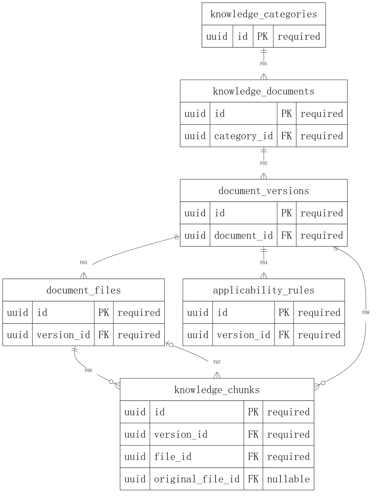
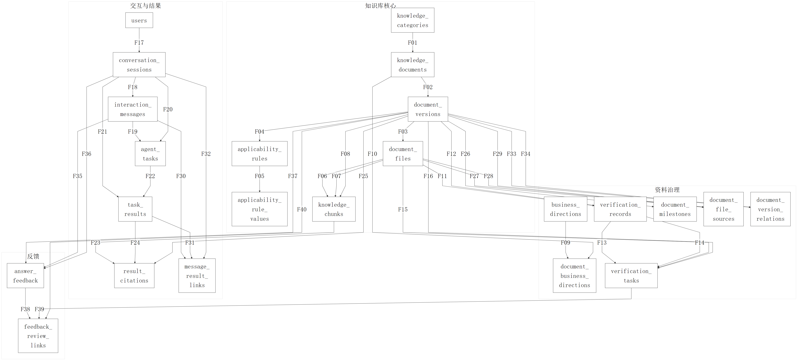
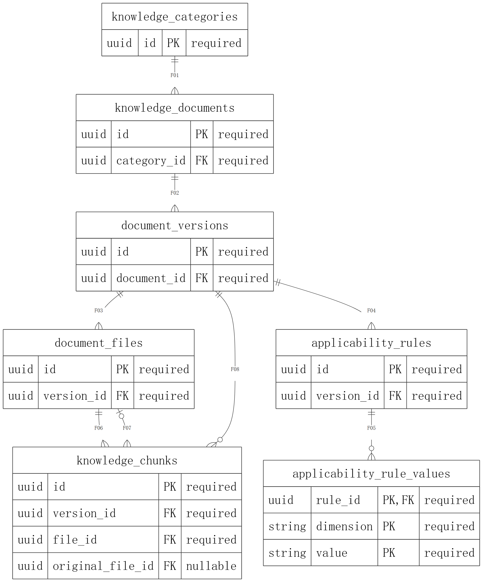
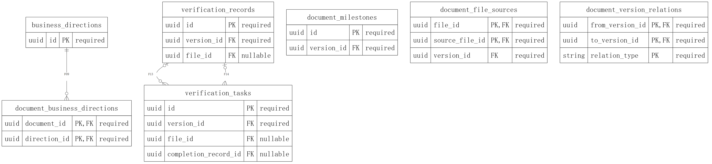
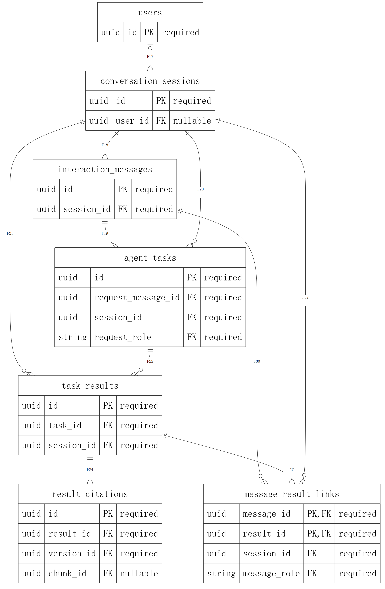
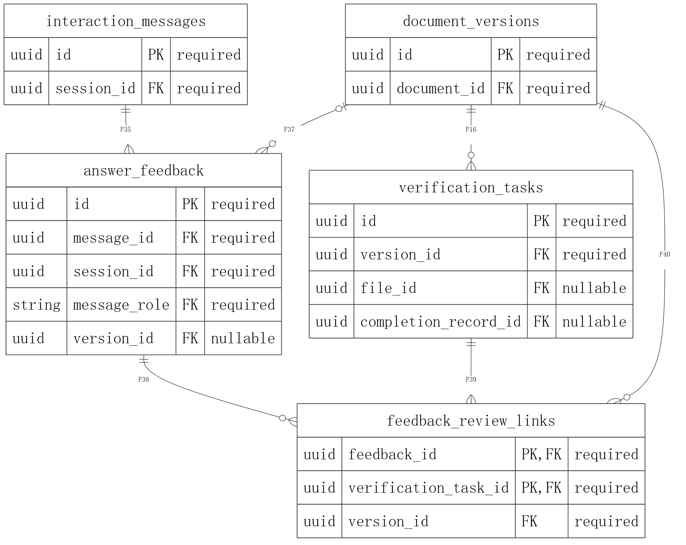

# CodeMind-FZU 数据库设计说明书

## 1 引言

### 1.1 编写目的

本文说明 AgentX 团队 CodeMind-FZU 项目的数据库概念结构、关系模型、物理结构、对象关系映射及数据管理规则，作为数据库详细设计的正式提交文件，供课程教师、项目审核人员和后续开发人员使用。正文解释设计思路，附录提供完整字段、约束、映射和验证依据。

本版在已经确认的 v1.2 技术成果上进行文档整理，修订为 v1.3。项目首版为 v1.0。数据库沿用23张表、233个字段及既有主外键、约束和 ORM 映射。

### 1.2 项目背景与适用范围

CodeMind-FZU 面向福州大学计算机相关专业本科生，提供校园政策、事务办理及发展信息的咨询与资源导航。数据库需要同时保存资料本身、资料版本及适用范围、核查证据、用户交互和任务结果，使回答能够追溯到确定版本的依据。

本说明书负责关系型数据设计。文件实际存放位置、Agent 编排、前端界面、身份认证和向量检索由对应系统模块实现；数据库保留必要的存储键、关联和状态接口。系统总体架构以团队《系统设计说明书》为上位设计输入。

### 1.3 编排依据与阅读约定

文档编排参考 GB/T 8567—2006《计算机软件文档编制规范》[^standard]，并与团队系统设计说明书的封面、章节层级、图表按章编号和页眉页脚保持一致。技术内容以仓库内已确认的模型、DDL、数据字典和既有验证记录为依据。

图号采用“图 章号-序号”，表号采用“表 章号-序号”；附录表号采用字母前缀。封面不显示页眉页脚，其后按 PDF 实际页序标页码，目录由 Word 自动生成。全库总览及资料治理子图采用横向折页，其余页面采用 A4。字段名和表名保持源码拼写。

### 1.4 术语与缩略语

表 1-1 术语与缩略语

| 术语 | 含义及本文用法 |
|---|---|
| ER | 实体—联系模型，用于描述对象及联系 |
| PK / FK / UQ | 主键 / 外键 / 唯一约束；复合约束按整组字段理解 |
| ORM | 对象关系映射；本设计采用 SQLAlchemy 2 命令式映射 |
| DDL | 数据定义语言；本文对应 PostgreSQL 候选方言的建表脚本 |
| UUID | 通用唯一标识符，由应用层或 ORM 调用端生成 |
| JSONB | PostgreSQL 二进制 JSON 类型，用于原始快照等可变结构数据 |
| fixture | 可重复使用的冻结测试输入；内置资料索引为44条、每条37列 |
| SHA-256 | 文件内容校验算法；物理文件不存在时不生成哈希 |
| OCR | 光学字符识别；扫描资料正文的识别仍为待办 |
| Agent | 智能体；本文只设计其交互、任务、结果和引用的存储接口 |
| UTC | 协调世界时；时刻字段按统一时区管理，日历日期单独保存 |

## 2 数据库概述

### 2.1 设计目标

数据库设计围绕“资料可追溯、状态可区分、交互可还原”展开。一份资料可以具有多个版本，一份版本可以关联多个原件和派生文件；回答引用固定版本及可选片段，保留回答时的依据。资料登记、正文提取、来源核验、时效核验和回答开放分别保存，共同支持回答资格判断。

设计使用明确的关系表表达业务多标签、多附件来源和消息结果关联；不使用 JSON 字段替代已经确定的多对多联系。结构化事实与原始记录并存，无法可靠转换的时间、适用条件和来源关系保留原文，不猜测填充。

### 2.2 业务范围

表 2-1 五大业务方向及首版边界

| 顺序 | 业务方向 | 数据库支持范围 | 交付阶段 |
|---|---|---|---|
| 1 | 政策与事务办理 | 奖学金、评优评奖、校园事务的资料、条件与流程 | v1.0优先 |
| 2 | 升学与就业发展 | 推免、升学及发展政策、阶段性准备事项 | v1.0优先 |
| 3 | 竞赛与科研信息 | 竞赛认定、创新学分、科研实践及机会资料 | v1.0优先 |
| 4 | 学院资源导航 | 培养方案、学习科研资源与办事渠道 | v1.0优先 |
| 5 | 个人成长档案与长期规划 | 仅保留方向代码，不建设专门成长档案库 | 后续迭代 |

七类原始资料分类和五大业务方向独立管理。一份资料可具有多个业务标签。交换、出国交流不列为首版必要场景；44条资料的原编号和原始核查记录保持不变。

### 2.3 技术基线与实施状态

PostgreSQL 16 和 SQLAlchemy 2 为数据库详细设计与建模验证的候选技术基线[^postgres][^sqlalchemy]。DDL、字段类型和命令式映射据此编制。各项设计与实施状态见表2-2。

表 2-2 已完成设计与尚未实施事项

| 项目 | 当前状态 |
|---|---|
| 关系模型、数据字典、DDL、ORM | 已形成23表、233字段的设计成果 |
| 既有离线验证 | 保留21项单元测试和 SQLite 核心资料导入记录 |
| PostgreSQL 实库连接与部署 | 尚未实际连接 PostgreSQL，未实施数据库部署 |
| 政策真实性与时效 | 未完成真实政策联网复核，不能把资料登记视为已核验 |
| 扫描资料 OCR | 尚未完成；原索引登记1条扫描资料待OCR |
| Agent 和数据库服务 | 尚未集成；本文描述存储设计，不描述已运行服务 |

## 3 概念结构设计

### 3.1 核心实体

核心概念模型沿用丁晓炜的六实体设计：知识分类、知识文档、文档版本、文档文件、适用规则和知识片段。图 3-1 展示这些对象的主要联系；完整字段、规则允许值及其他扩展实体在逻辑设计中展开。



图 3-1 知识库核心 ER 概念模型

分类组织文档，文档承载稳定的业务身份，版本承载确定的政策内容与元数据。文件属于版本，既可以是原件、附件，也可以是正文或整理稿。规则和片段同样固定所属版本，避免跨版本混用依据。

### 3.2 概念模型到关系模型的转换

表 3-1 核心概念到关系表的映射

| 核心概念 | 主要关系表 | 转换说明 |
|---|---|---|
| 知识分类 | knowledge_categories | 保留七类原始主题 |
| 知识文档 | knowledge_documents | 与版本分离，避免每次变更复制文档身份 |
| 文档版本 | document_versions | 固定内容、来源、日期、适用原文及核查状态 |
| 文档文件 | document_files | 区分文件角色、逻辑存储键与处理状态 |
| 适用规则 | applicability_rules、applicability_rule_values | 规则与条件值分表；多规则按用途组合 |
| 知识片段 | knowledge_chunks | 固定来源文件、原件及定位，支持回答溯源 |

核心模型经规范化与业务扩展形成23张关系表，覆盖业务标签、核查记录和待办、办理节点、文件来源、版本关系、会话消息、任务结果、引用与反馈。

## 4 逻辑结构设计

### 4.1 关系模型总览

全库按知识库核心、资料治理、交互结果和反馈四个关联域组织。图 4-1 覆盖23张表及全部40组外键；边上 F 编号与附录B外键清单一一对应，复合外键作为一个整体表示。为便于查阅，全库图采用横向折页，各域在后续子图中展开。



图 4-1 全库关系总览（F编号对应附录B）

表 4-1 数据域与职责

| 数据域 | 主要职责 | 关系设计要点 |
|---|---|---|
| 知识库核心 | 分类、文档、版本、文件、规则及片段 | 固定版本；规则条件值规范化 |
| 资料治理 | 业务标签、核查、办理节点、来源与版本关系 | 多对多显式关联；保留证据与核查历史 |
| 交互与结果 | 用户、会话、消息、任务、结果、引用与采用关系 | 同会话、正确角色、结果历史可追溯 |
| 用户反馈 | 回复反馈及其转核查待办联系 | 反馈与待办固定同一资料版本 |

### 4.2 知识库核心关系

文档版本通过 record_code 保留原始资料编号，通过 document_id 与文档身份关联。文档与版本号组合唯一，资料编号全局唯一。文件存储键唯一，片段在同一文件内按 chunk_no 编号。规则的用途和条件维度分开保存；未知、全部适用和指定值不能相互替代。



图 4-2 知识库核心关系子图

### 4.3 资料治理关系

业务方向与文档通过关联表实现多标签。核查记录保留核查维度、时间、方法、证据和结论；核查待办保存责任、优先级及完成证据。办理节点单独保存日期、时刻或未知精度，不以一个模糊截止日替代多个节点。

派生文件的来源用 document_file_sources 表达，允许一份正文对应多个同版本文件。版本替代、补充和配套关系单独保存证据，未核实的沿革不自动合并。



图 4-3 资料治理关系子图（跨域外键字段见附录B）

### 4.4 用户交互、任务与结果

会话可以关联用户，也可以匿名存在。消息按会话内序号排序。Agent任务由用户消息触发，任务与触发消息通过会话和角色组合外键关联。任务可以追加多份中间或最终结果；助手消息通过 message_result_links 记录实际采用的结果，据此追溯回答依据。

结果引用固定版本和可选片段，并保存回答时标题、网址、核查与适用快照。资料后续更新不应原位改变已被引用的内容。



图 4-4 交互与结果关系子图（跨域版本引用见附录B）

### 4.5 反馈与核查闭环

反馈绑定助手消息及会话，可关联主要涉及的资料版本。反馈转核查待办时，通过组合外键保证反馈和待办指向同一版本。反馈处理结果、解决说明和结束时间分别记录；反馈关闭不自动代表政策已经核验通过。



图 4-5 反馈与核查闭环关系子图

### 4.6 规范化与可扩展性

分类、方向、条件值和关联关系分别建表，减少重复字段及更新异常。JSONB用于原始37列快照、适用原文和回答证据快照，不取代确定的关系。字段与约束的完整定义见附录A、附录B；图示仅选关键字段，不替代数据字典。

规范化后的关联表支持新增资料、任务类型和核查任务。成长档案、细化权限与在线检索索引按后续功能需求扩展；迁移和索引调整依据实际查询负载确定。

## 5 物理结构设计

### 5.1 命名、类型与默认值

表名和字段名使用小写下划线命名。主键、唯一约束、外键、检查约束和索引分别采用 pk、uq、fk、ck、ix 前缀；组合列写入约束名，避免单列前缀重名。附录A给出全部233个字段的 PostgreSQL 候选类型、空值规则及默认值。

表 5-1 主要字段类型与存储规则

| 类型或字段 | 选用规则 |
|---|---|
| UUID | 标识和外键；由应用或ORM生成，DDL不配置UUID扩展默认值 |
| VARCHAR / TEXT | 有明确长度的代码与名称使用VARCHAR；正文、网址及说明使用TEXT |
| DATE | 发布、生效、核查日等日历日期；不伪造精确时刻 |
| TIMESTAMP WITH TIME ZONE | 消息、执行及精确截止时刻；统一存储时区，展示按业务时区转换 |
| JSONB | 原始元数据、未结构化适用条件和回答证据快照 |
| created_at / updated_at | 全表具备；创建默认CURRENT_TIMESTAMP，更新由业务服务显式维护 |

### 5.2 主键、外键与索引

主键和唯一约束已经支持对应唯一索引，不重复建相同索引。组合索引围绕分类筛选、版本开放状态、业务方向反查、文件角色、会话时间线和待办队列设计。全部40组外键默认采用 ON DELETE RESTRICT，避免级联删除已经被引用的证据。

表 5-2 索引设计与查询用途

| 查询用途 | 代表性索引或约束 |
|---|---|
| 分类与文档版本 | ix_documents_category；文档与版本号组合唯一 |
| 版本回答资格筛选 | ix_versions_answer_filter |
| 同版本文件与片段 | ix_files_version_role；ix_chunks_version |
| 核查与待办 | ix_checks_version_date；ix_review_tasks_status |
| 会话与任务时间线 | 会话内消息序号唯一；ix_sessions_user_start；ix_agent_tasks_status |
| 办理节点与反馈队列 | ix_milestones_due_date；ix_milestones_due_time；ix_feedback_queue |

### 5.3 文件、正文与元数据的存放

资料元数据、可查询正文片段及引用快照进入关系表。原件、附件、正文稿和整理稿按受控存储键单独保存，SQL导入不会复制文件本体。文件存在时计算真实内容的 SHA-256；缺失时哈希为空、文件处理状态为 failed，并说明原索引状态与当前环境的区别。

内置fixture包含44条索引，149个物理文件单独保存。document_versions.extraction_status保留原索引的提取记录，document_files.processing_status描述当前文件状态。原索引登记43条已提取、1条待OCR；文件可用性和回答资格分别按当前文件状态与核验状态判定。

### 5.4 事务、部署与恢复边界

审核用初始化脚本用于空的专用数据库或Schema，重复导入由唯一约束拒绝。资料导入和相关业务更新在事务中完成。正式迁移、备份保留期、恢复目标、容量和并发方案在部署阶段确定，并通过相应环境验证。

## 6 ORM 映射设计

### 6.1 映射方式

SQLAlchemy 2 的命令式映射通过 registry.map_imperatively 将普通实体类绑定至 Table 定义。字段名与列名一致，结构约束定义在metadata中，ORM关系属性提供对象导航。source/models.py负责模型定义，数据库连接与事务由服务层配置。

### 6.2 实体与关系映射

23个实体类与23张表逐一对应，完整清单见附录C。文档映射分类，版本映射文档，文件和规则映射版本；片段的文件关系使用文件ID和版本ID共同关联。助手消息与结果、派生文件与来源等多路径关联显式指定外键，不能退化为仅按单一ID匹配。

### 6.3 写入与使用约束

调用端通过 Session 和事务写入实体，UUID由应用或ORM生成。updated_at由业务服务显式维护，未配置自动更新触发器。外键和CHECK统一约束数据库写入，ORM关系负责对象导航。被引用证据按RESTRICT规则保留。

## 7 数据管理与约束

### 7.1 资料质量与回答开放

来源核验、政策时效、正文提取、附件处理和回答开放分别管理。当前44条预览记录均为 blocked。已有部分来源核查记录按partial保存，历史材料按历史用途使用。

表 7-1 资料状态与管理要求

| 状态或对象 | 管理要求 |
|---|---|
| 来源核验 | pending、partial、verified、failed分别表达进展与结论 |
| 时效核验 | current、historical、superseded、expired等用途分别处理 |
| 回答开放 | CHECK限定基础前提；附件、适用范围及具体问题仍须服务核实 |
| 适用条件 | 未知条件不得视为全体适用；多条规则及条件值按用途组合 |
| 核查历史与引用 | 历史只追加；被引用版本及证据快照不得原位改写 |

### 7.2 同版本与同会话一致性

文件与版本、片段与文件、派生来源、核查完成证据等使用整组字段的复合外键。默认 MATCH SIMPLE 允许可选关联暂缺；关联字段非空时必须匹配同一版本。任务触发消息限定为 user，消息采用结果限定为同会话 assistant，防止把其他会话的结果或错误角色消息绑定进来。

### 7.3 数据库约束与服务规则的边界

DDL表达状态取值、序号范围、结束时间、完成证据、角色及组合关联一致性。跨行条件数量、版本替代链和文件来源链无环、原件定位、附件语义、权限和核查历史只追加等规则由服务事务、权限与人工流程共同落实，并在实现阶段分别验收。

### 7.4 隐私与运维管理

用户表保留最小外部身份，不存认证密码或个人成长档案。匿名会话允许user_id为空。数据库凭据和服务密钥不进入设计文件；交互保留期限、匿名化、访问授权和删除策略须在实现阶段制定。引用仍存在时，文件、版本等证据不能通过普通级联删除清理。

## 8 验证与设计结论

### 8.1 既有验证范围

本版沿用已提交的 v1.2 验证记录，包括21项自动化单元测试、PostgreSQL DDL与种子SQL语法解析，以及 SQLite 全表建表及核心资料导入验证。SQLite创建全部23张表，资料fixture实际向8张表插入数据；其余15张表的相关约束由独立单元测试覆盖。

附录D给出测试名称、既有结果、8张导入表及行数和原始验证报告。本轮仅开展文档检查，数据库验证结果沿用上述记录。

### 8.2 本轮文档核对

本轮核对正式封面、自动目录及页码、图表编号、图形是否嵌入、字段与约束是否完整、生成链是否能够重复运行，以及技术基线文件是否保持原字节。数据库模型、DDL、ORM、冻结资料索引和既有验证报告均保持原技术内容，不以排版任务改变试验口径。

### 8.3 结论与尚未实施事项

现有设计覆盖23张表、233个字段、40组外键及知识库、交互、任务和结果等数据对象，能够作为后续编码与部署讨论的设计依据。尚未实际连接PostgreSQL，未完成真实政策联网复核，OCR尚未完成，Agent和数据库服务尚未集成；这些限制在正式说明书中继续保留。

## 9 参考资料

[^standard]: 国家标准GB/T 8567—2006《计算机软件文档编制规范》，国家标准全文公开系统：https://openstd.samr.gov.cn/bzgk/std/newGbInfo?hcno=84C42B6277D2714B7176B10C6E6B1A44 。本文据此参照组织课程数据库设计内容。
[^postgres]: PostgreSQL Global Development Group，PostgreSQL 16 Documentation：https://www.postgresql.org/docs/16/ 。候选方言与本项目既有DDL一致。
[^sqlalchemy]: SQLAlchemy，Mapping Styles（2.0）：https://docs.sqlalchemy.org/en/20/orm/mapping_styles.html 。本项目使用命令式映射。

团队内部依据包括：AgentX《系统设计说明书》（仓库main，2026-11-10核对）；丁晓炜《知识库数据库概念设计》与23表关系源稿；王智洋v1.2数据库详细设计、数据字典、约束索引、ORM说明和验证材料。源文件定位及技术基线校验值见附录F。


## 附录A 完整数据字典

本附录逐表列出全部233个字段。字段类型、空值、主键和默认值沿用v1.2模型；唯一约束及外键见附录B。“服务端默认”记录DDL定义，应用侧UUID生成方式见第6章。

### A.1 knowledge_categories

七类原始知识主题。

表 A-1 knowledge_categories 字段定义

|字段|含义|候选类型|允许空|主键|服务端默认|
|---|---|---|---|---|---|
|id|内部UUID；应用生成|UUID|否|是|无|
|name|原始分类名称|VARCHAR(64)|否|否|无|
|description|分类说明|TEXT|是|否|无|
|sort_order|显示顺序|INTEGER|否|否|0|
|created_at|创建时间|TIMESTAMP WITH TIME ZONE|否|否|CURRENT_TIMESTAMP|
|updated_at|更新时间；更新操作须显式维护|TIMESTAMP WITH TIME ZONE|否|否|CURRENT_TIMESTAMP|

### A.2 knowledge_documents

政策或通知的逻辑身份。

表 A-2 knowledge_documents 字段定义

|字段|含义|候选类型|允许空|主键|服务端默认|
|---|---|---|---|---|---|
|id|内部UUID；应用生成|UUID|否|是|无|
|category_id|所属原始主分类|UUID|否|否|无|
|title|逻辑文档标题|VARCHAR(512)|否|否|无|
|document_type|资料类型|VARCHAR(64)|否|否|无|
|created_at|创建时间|TIMESTAMP WITH TIME ZONE|否|否|CURRENT_TIMESTAMP|
|updated_at|更新时间；更新操作须显式维护|TIMESTAMP WITH TIME ZONE|否|否|CURRENT_TIMESTAMP|

### A.3 document_versions

确定内容的版本与原登记元数据。

表 A-3 document_versions 字段定义

|字段|含义|候选类型|允许空|主键|服务端默认|
|---|---|---|---|---|---|
|id|内部UUID；应用生成|UUID|否|是|无|
|document_id|所属文档|UUID|否|否|无|
|record_code|原资料编号；全局保留|VARCHAR(128)|否|否|无|
|version_no|文档内部版本标识|VARCHAR(64)|否|否|无|
|publisher|发布单位|VARCHAR(256)|是|否|无|
|responsible_department|负责部门|VARCHAR(256)|是|否|无|
|document_number|文号|VARCHAR(128)|是|否|无|
|source_url|登记的官方来源网址；存在不等于已核验|TEXT|否|否|无|
|published_on|发布日期|DATE|是|否|无|
|issued_on|印发日期|DATE|是|否|无|
|effective_on|生效日期|DATE|是|否|无|
|deadline_on|截止日期|DATE|是|否|无|
|document_written_on|文件成文日期|DATE|是|否|无|
|source_page_published_on|来源页面发布日期|DATE|是|否|无|
|source_verified_on|来源实际核验日期|DATE|是|否|无|
|timeliness_verified_on|时效实际核验日期|DATE|是|否|无|
|local_checked_on|本地检查日期|DATE|是|否|无|
|legacy_last_verified_on|原最后核验日期；不推断核验维度|DATE|是|否|无|
|source_page_url|附件来源页面|TEXT|是|否|无|
|applicability_raw|适用年级/专业/对象原文|JSONB|是|否|无|
|policy_status|原登记政策状态；未复核不得当现行结论|VARCHAR(128)|否|否|'待核验'|
|source_verification_status|来源核验|VARCHAR(32)|否|否|'pending'|
|timeliness_verification_status|政策时效核验|VARCHAR(32)|否|否|'pending'|
|extraction_status|正文提取|VARCHAR(32)|否|否|'pending'|
|attachment_status|版本附件处理汇总|VARCHAR(32)|否|否|'not_registered'|
|v1_inclusion_status|首版资料范围纳入状态|VARCHAR(32)|否|否|'pending'|
|retrieval_status|检索开放状态|VARCHAR(32)|否|否|'blocked'|
|inclusion_reason|首版纳入或排除理由|TEXT|是|否|无|
|verification_note|当前核查说明|TEXT|是|否|无|
|legacy_verification_text|原混合核验状态原文|TEXT|是|否|无|
|import_snapshot|原CSV全部37列；不可丢失或覆盖|JSONB|是|否|无|
|temporal_notes|不能安全转换成单一DATE的期限和年级生效原文|JSONB|是|否|无|
|deadline_status|期限结构化状态；空日期不能视为无期限|VARCHAR(32)|否|否|'unknown'|
|created_at|创建时间|TIMESTAMP WITH TIME ZONE|否|否|CURRENT_TIMESTAMP|
|updated_at|更新时间；更新操作须显式维护|TIMESTAMP WITH TIME ZONE|否|否|CURRENT_TIMESTAMP|

### A.4 document_files

原始网页、附件、正文及整理稿。

表 A-4 document_files 字段定义

|字段|含义|候选类型|允许空|主键|服务端默认|
|---|---|---|---|---|---|
|id|内部UUID；应用生成|UUID|否|是|无|
|version_id|所属版本|UUID|否|否|无|
|file_role|文件角色|VARCHAR(32)|否|否|无|
|storage_key|受控相对路径或对象存储键|TEXT|否|否|无|
|original_name|原始文件名|VARCHAR(512)|否|否|无|
|media_type|MIME类型|VARCHAR(128)|是|否|无|
|sha256|小写SHA-256；未知不伪造|VARCHAR(64)|是|否|无|
|source_url|具体文件来源网址|TEXT|是|否|无|
|processing_status|单文件处理状态|VARCHAR(32)|否|否|'saved'|
|processing_note|文件解析及复核说明|TEXT|是|否|无|
|created_at|创建时间|TIMESTAMP WITH TIME ZONE|否|否|CURRENT_TIMESTAMP|
|updated_at|更新时间；更新操作须显式维护|TIMESTAMP WITH TIME ZONE|否|否|CURRENT_TIMESTAMP|

### A.5 applicability_rules

适用规则；同用途多条OR。

表 A-5 applicability_rules 字段定义

|字段|含义|候选类型|允许空|主键|服务端默认|
|---|---|---|---|---|---|
|id|内部UUID；应用生成|UUID|否|是|无|
|version_id|所属版本|UUID|否|否|无|
|purpose|规则适用用途|VARCHAR(128)|否|否|无|
|enrollment_mode|enrollment_mode：未知/全体/指定值|VARCHAR(32)|否|否|'unknown'|
|graduation_mode|graduation_mode：未知/全体/指定值|VARCHAR(32)|否|否|'unknown'|
|major_mode|major_mode：未知/全体/指定值|VARCHAR(32)|否|否|'unknown'|
|student_type_mode|student_type_mode：未知/全体/指定值|VARCHAR(32)|否|否|'unknown'|
|source_locator|规则原文位置|TEXT|是|否|无|
|verification_status|规则是否经人工核实|VARCHAR(32)|否|否|'pending'|
|created_at|创建时间|TIMESTAMP WITH TIME ZONE|否|否|CURRENT_TIMESTAMP|
|updated_at|更新时间；更新操作须显式维护|TIMESTAMP WITH TIME ZONE|否|否|CURRENT_TIMESTAMP|

### A.6 applicability_rule_values

一条适用规则各维度允许值。

表 A-6 applicability_rule_values 字段定义

|字段|含义|候选类型|允许空|主键|服务端默认|
|---|---|---|---|---|---|
|rule_id|规则编号|UUID|否|是|无|
|dimension|条件维度|VARCHAR(32)|否|是|无|
|value|标准化条件值|VARCHAR(128)|否|是|无|
|created_at|创建时间|TIMESTAMP WITH TIME ZONE|否|否|CURRENT_TIMESTAMP|
|updated_at|更新时间；更新操作须显式维护|TIMESTAMP WITH TIME ZONE|否|否|CURRENT_TIMESTAMP|

### A.7 knowledge_chunks

可追溯检索片段。

表 A-7 knowledge_chunks 字段定义

|字段|含义|候选类型|允许空|主键|服务端默认|
|---|---|---|---|---|---|
|id|内部UUID；应用生成|UUID|否|是|无|
|version_id|所属版本|UUID|否|否|无|
|file_id|片段来源文件|UUID|否|否|无|
|chunk_no|来源文件内片段序号；从1开始|INTEGER|否|否|无|
|content|片段正文|TEXT|否|否|无|
|locator|页码、章节或段落位置|TEXT|是|否|无|
|locator_note|定位限制说明|TEXT|是|否|无|
|original_file_id|对应官方原件；未定位则空|UUID|是|否|无|
|original_locator|官方原件的页码或章节；不能冒用提取稿行号|TEXT|是|否|无|
|index_status|索引状态|VARCHAR(32)|否|否|'pending'|
|created_at|创建时间|TIMESTAMP WITH TIME ZONE|否|否|CURRENT_TIMESTAMP|
|updated_at|更新时间；更新操作须显式维护|TIMESTAMP WITH TIME ZONE|否|否|CURRENT_TIMESTAMP|

### A.8 business_directions

五大业务方向。

表 A-8 business_directions 字段定义

|字段|含义|候选类型|允许空|主键|服务端默认|
|---|---|---|---|---|---|
|id|内部UUID；应用生成|UUID|否|是|无|
|code|固定业务代码|VARCHAR(64)|否|否|无|
|name|业务方向名称|VARCHAR(64)|否|否|无|
|delivery_stage|交付阶段|VARCHAR(16)|否|否|无|
|sort_order|展示顺序|INTEGER|否|否|无|
|created_at|创建时间|TIMESTAMP WITH TIME ZONE|否|否|CURRENT_TIMESTAMP|
|updated_at|更新时间；更新操作须显式维护|TIMESTAMP WITH TIME ZONE|否|否|CURRENT_TIMESTAMP|

### A.9 document_business_directions

文档业务方向多标签。

表 A-9 document_business_directions 字段定义

|字段|含义|候选类型|允许空|主键|服务端默认|
|---|---|---|---|---|---|
|document_id|文档|UUID|否|是|无|
|direction_id|业务方向|UUID|否|是|无|
|mapping_reason|分类依据|TEXT|是|否|无|
|created_at|创建时间|TIMESTAMP WITH TIME ZONE|否|否|CURRENT_TIMESTAMP|
|updated_at|更新时间；更新操作须显式维护|TIMESTAMP WITH TIME ZONE|否|否|CURRENT_TIMESTAMP|

### A.10 verification_records

只追加的核查历史。

表 A-10 verification_records 字段定义

|字段|含义|候选类型|允许空|主键|服务端默认|
|---|---|---|---|---|---|
|id|内部UUID；应用生成|UUID|否|是|无|
|version_id|核查版本|UUID|否|否|无|
|file_id|具体核查文件；空表示版本级|UUID|是|否|无|
|check_type|核查维度|VARCHAR(32)|否|否|无|
|outcome|核查结果|VARCHAR(32)|否|否|无|
|checked_on|真实核查日期|DATE|否|否|无|
|checked_at|真实精确时间；仅有日期则空|TIMESTAMP WITH TIME ZONE|是|否|无|
|reviewer_label|核验人标识；历史未知则空|VARCHAR(128)|是|否|无|
|method|核查方法|VARCHAR(128)|否|否|无|
|evidence_url|证据网址|TEXT|是|否|无|
|evidence_locator|证据定位|TEXT|是|否|无|
|note|具体核查结论与限制|TEXT|否|否|无|
|created_at|创建时间|TIMESTAMP WITH TIME ZONE|否|否|CURRENT_TIMESTAMP|
|updated_at|更新时间；更新操作须显式维护|TIMESTAMP WITH TIME ZONE|否|否|CURRENT_TIMESTAMP|

### A.11 verification_tasks

资料核查待办。

表 A-11 verification_tasks 字段定义

|字段|含义|候选类型|允许空|主键|服务端默认|
|---|---|---|---|---|---|
|id|内部UUID；应用生成|UUID|否|是|无|
|version_id|待办版本|UUID|否|否|无|
|file_id|待办文件；可空|UUID|是|否|无|
|task_type|OCR/数值/目录/时效/适用范围等|VARCHAR(64)|否|否|无|
|description|具体待办|TEXT|否|否|无|
|status|待办状态|VARCHAR(32)|否|否|'open'|
|priority|优先级；1最高|INTEGER|否|否|2|
|assignee_label|负责人员标识|VARCHAR(128)|是|否|无|
|completion_record_id|完成证据核查记录|UUID|是|否|无|
|completed_at|完成时间|TIMESTAMP WITH TIME ZONE|是|否|无|
|created_at|创建时间|TIMESTAMP WITH TIME ZONE|否|否|CURRENT_TIMESTAMP|
|updated_at|更新时间；更新操作须显式维护|TIMESTAMP WITH TIME ZONE|否|否|CURRENT_TIMESTAMP|

### A.12 users

最小用户身份；无密码及成长档案。

表 A-12 users 字段定义

|字段|含义|候选类型|允许空|主键|服务端默认|
|---|---|---|---|---|---|
|id|内部UUID；应用生成|UUID|否|是|无|
|external_subject|外部认证主体；未接入则空|VARCHAR(256)|是|否|无|
|display_name|展示名称|VARCHAR(128)|是|否|无|
|status|用户状态|VARCHAR(32)|否|否|'active'|
|created_at|创建时间|TIMESTAMP WITH TIME ZONE|否|否|CURRENT_TIMESTAMP|
|updated_at|更新时间；更新操作须显式维护|TIMESTAMP WITH TIME ZONE|否|否|CURRENT_TIMESTAMP|

### A.13 conversation_sessions

会话；支持匿名。

表 A-13 conversation_sessions 字段定义

|字段|含义|候选类型|允许空|主键|服务端默认|
|---|---|---|---|---|---|
|id|内部UUID；应用生成|UUID|否|是|无|
|user_id|用户；匿名为空|UUID|是|否|无|
|title|会话标题|VARCHAR(256)|是|否|无|
|started_at|开始时间|TIMESTAMP WITH TIME ZONE|否|否|CURRENT_TIMESTAMP|
|ended_at|结束时间|TIMESTAMP WITH TIME ZONE|是|否|无|
|created_at|创建时间|TIMESTAMP WITH TIME ZONE|否|否|CURRENT_TIMESTAMP|
|updated_at|更新时间；更新操作须显式维护|TIMESTAMP WITH TIME ZONE|否|否|CURRENT_TIMESTAMP|

### A.14 interaction_messages

用户与助手交互消息。

表 A-14 interaction_messages 字段定义

|字段|含义|候选类型|允许空|主键|服务端默认|
|---|---|---|---|---|---|
|id|内部UUID；应用生成|UUID|否|是|无|
|session_id|所属会话|UUID|否|否|无|
|sequence_no|会话内消息序号|INTEGER|否|否|无|
|role|消息角色|VARCHAR(16)|否|否|无|
|content|消息内容|TEXT|否|否|无|
|sent_at|发送时间|TIMESTAMP WITH TIME ZONE|否|否|CURRENT_TIMESTAMP|
|created_at|创建时间|TIMESTAMP WITH TIME ZONE|否|否|CURRENT_TIMESTAMP|
|updated_at|更新时间；更新操作须显式维护|TIMESTAMP WITH TIME ZONE|否|否|CURRENT_TIMESTAMP|

### A.15 agent_tasks

由用户消息触发的Agent任务。

表 A-15 agent_tasks 字段定义

|字段|含义|候选类型|允许空|主键|服务端默认|
|---|---|---|---|---|---|
|id|内部UUID；应用生成|UUID|否|是|无|
|request_message_id|触发用户消息|UUID|否|否|无|
|session_id|触发会话；用于跨表一致性约束|UUID|否|否|无|
|request_role|约束触发消息必须是user|VARCHAR(16)|否|否|'user'|
|task_type|任务类型；首版业务代码|VARCHAR(64)|否|否|无|
|status|执行状态|VARCHAR(32)|否|否|'queued'|
|started_at|执行开始时间|TIMESTAMP WITH TIME ZONE|是|否|无|
|finished_at|执行结束时间|TIMESTAMP WITH TIME ZONE|是|否|无|
|error_code|错误代码|VARCHAR(64)|是|否|无|
|error_summary|错误摘要；不保存密钥|TEXT|是|否|无|
|created_at|创建时间|TIMESTAMP WITH TIME ZONE|否|否|CURRENT_TIMESTAMP|
|updated_at|更新时间；更新操作须显式维护|TIMESTAMP WITH TIME ZONE|否|否|CURRENT_TIMESTAMP|

### A.16 task_results

任务结果历史；重试追加。

表 A-16 task_results 字段定义

|字段|含义|候选类型|允许空|主键|服务端默认|
|---|---|---|---|---|---|
|id|内部UUID；应用生成|UUID|否|是|无|
|task_id|所属任务|UUID|否|否|无|
|session_id|会话；必须与任务一致|UUID|否|否|无|
|result_stage|区分中间结果与最终结果|VARCHAR(32)|否|否|'final'|
|answer_mode|回答用途；默认资料不足，不输出确定政策结论|VARCHAR(32)|否|否|'insufficient_data'|
|result_no|任务内结果序号|INTEGER|否|否|无|
|result_type|结果类型：答案/导航/结构化结果等|VARCHAR(32)|否|否|无|
|content|结果内容；结构化结果可序列化JSON文本|TEXT|否|否|无|
|generated_at|生成时间|TIMESTAMP WITH TIME ZONE|否|否|CURRENT_TIMESTAMP|
|created_at|创建时间|TIMESTAMP WITH TIME ZONE|否|否|CURRENT_TIMESTAMP|
|updated_at|更新时间；更新操作须显式维护|TIMESTAMP WITH TIME ZONE|否|否|CURRENT_TIMESTAMP|

### A.17 result_citations

结果引用；固定版本及可选片段。

表 A-17 result_citations 字段定义

|字段|含义|候选类型|允许空|主键|服务端默认|
|---|---|---|---|---|---|
|id|内部UUID；应用生成|UUID|否|是|无|
|result_id|所属结果|UUID|否|否|无|
|citation_no|结果内引用序号|INTEGER|否|否|无|
|version_id|引用的确定版本|UUID|否|否|无|
|chunk_id|可选精确片段|UUID|是|否|无|
|locator|引用位置|TEXT|是|否|无|
|quoted_text|引用片段快照|TEXT|是|否|无|
|source_url_snapshot|回答时的来源网址|TEXT|否|否|无|
|title_snapshot|回答时资料标题|VARCHAR(512)|否|否|无|
|cited_at|引用时间|TIMESTAMP WITH TIME ZONE|否|否|CURRENT_TIMESTAMP|
|verification_snapshot|回答时核查状态、使用用途及适用条件快照|JSONB|否|否|无|
|created_at|创建时间|TIMESTAMP WITH TIME ZONE|否|否|CURRENT_TIMESTAMP|
|updated_at|更新时间；更新操作须显式维护|TIMESTAMP WITH TIME ZONE|否|否|CURRENT_TIMESTAMP|

### A.18 document_milestones

版本的多个办理节点；原文与时间精度分别保存。

表 A-18 document_milestones 字段定义

|字段|含义|候选类型|允许空|主键|服务端默认|
|---|---|---|---|---|---|
|id|内部UUID；应用生成|UUID|否|是|无|
|version_id|所属版本|UUID|否|否|无|
|name|办理节点名称|VARCHAR(256)|否|否|无|
|raw_text|节点完整原文|TEXT|否|否|无|
|precision|date/time/unknown|VARCHAR(16)|否|否|无|
|due_on|只精确到日期的截止日|DATE|是|否|无|
|due_at|精确截止时刻；时区感知|TIMESTAMP WITH TIME ZONE|是|否|无|
|timezone_name|原办理时间所用时区，精确时刻必填|VARCHAR(64)|是|否|无|
|verification_status|时间转换后仍需核实原文|VARCHAR(32)|否|否|'pending'|
|created_at|创建时间|TIMESTAMP WITH TIME ZONE|否|否|CURRENT_TIMESTAMP|
|updated_at|更新时间；更新操作须显式维护|TIMESTAMP WITH TIME ZONE|否|否|CURRENT_TIMESTAMP|

### A.19 document_file_sources

派生文件与多个同版本来源；替代单来源字段。

表 A-19 document_file_sources 字段定义

|字段|含义|候选类型|允许空|主键|服务端默认|
|---|---|---|---|---|---|
|file_id|派生文件|UUID|否|是|无|
|source_file_id|来源文件|UUID|否|是|无|
|version_id|同一版本|UUID|否|否|无|
|source_locator|来源原件定位|TEXT|是|否|无|
|target_locator|派生稿对应位置|TEXT|是|否|无|
|verification_status|来源对应关系核验|VARCHAR(32)|否|否|'pending'|
|created_at|创建时间|TIMESTAMP WITH TIME ZONE|否|否|CURRENT_TIMESTAMP|
|updated_at|更新时间；更新操作须显式维护|TIMESTAMP WITH TIME ZONE|否|否|CURRENT_TIMESTAMP|

### A.20 message_result_links

助手消息实际采用的结果；多对多支持结果整合。

表 A-20 message_result_links 字段定义

|字段|含义|候选类型|允许空|主键|服务端默认|
|---|---|---|---|---|---|
|message_id|助手消息|UUID|否|是|无|
|result_id|采用的任务结果|UUID|否|是|无|
|session_id|同一会话|UUID|否|否|无|
|message_role|固定assistant以约束消息角色|VARCHAR(16)|否|否|'assistant'|
|created_at|创建时间|TIMESTAMP WITH TIME ZONE|否|否|CURRENT_TIMESTAMP|
|updated_at|更新时间；更新操作须显式维护|TIMESTAMP WITH TIME ZONE|否|否|CURRENT_TIMESTAMP|

### A.21 document_version_relations

有证据的政策版本替代/补充/配套关系。

表 A-21 document_version_relations 字段定义

|字段|含义|候选类型|允许空|主键|服务端默认|
|---|---|---|---|---|---|
|from_version_id|主动替代/补充的版本|UUID|否|是|无|
|to_version_id|被替代/补充的目标版本|UUID|否|是|无|
|relation_type|有方向的政策关系|VARCHAR(32)|否|是|无|
|effective_on|关系生效日期；未知则空|DATE|是|否|无|
|evidence_note|关系原文证据与适用限制|TEXT|否|否|无|
|evidence_url|官方证据网址|TEXT|是|否|无|
|verification_status|关系核查状态|VARCHAR(32)|否|否|'pending'|
|created_at|创建时间|TIMESTAMP WITH TIME ZONE|否|否|CURRENT_TIMESTAMP|
|updated_at|更新时间；更新操作须显式维护|TIMESTAMP WITH TIME ZONE|否|否|CURRENT_TIMESTAMP|

### A.22 answer_feedback

对助手回复的反馈及处理结果。

表 A-22 answer_feedback 字段定义

|字段|含义|候选类型|允许空|主键|服务端默认|
|---|---|---|---|---|---|
|id|内部UUID；应用生成|UUID|否|是|无|
|message_id|被反馈的助手消息|UUID|否|否|无|
|session_id|消息所属会话|UUID|否|否|无|
|message_role|固定助手角色|VARCHAR(16)|否|否|'assistant'|
|version_id|反馈主要涉及资料版本；未知则空|UUID|是|否|无|
|feedback_type|错误/过期/适用范围/来源/其他|VARCHAR(32)|否|否|无|
|description|反馈内容|TEXT|否|否|无|
|status|反馈处理状态|VARCHAR(32)|否|否|'open'|
|resolution_note|处理说明|TEXT|是|否|无|
|resolved_at|处理结束时间|TIMESTAMP WITH TIME ZONE|是|否|无|
|created_at|创建时间|TIMESTAMP WITH TIME ZONE|否|否|CURRENT_TIMESTAMP|
|updated_at|更新时间；更新操作须显式维护|TIMESTAMP WITH TIME ZONE|否|否|CURRENT_TIMESTAMP|

### A.23 feedback_review_links

反馈转核查待办；同版本证据链。

表 A-23 feedback_review_links 字段定义

|字段|含义|候选类型|允许空|主键|服务端默认|
|---|---|---|---|---|---|
|feedback_id|反馈|UUID|否|是|无|
|verification_task_id|核查待办|UUID|否|是|无|
|version_id|反馈及待办共同指向的版本|UUID|否|否|无|
|created_at|创建时间|TIMESTAMP WITH TIME ZONE|否|否|CURRENT_TIMESTAMP|
|updated_at|更新时间；更新操作须显式维护|TIMESTAMP WITH TIME ZONE|否|否|CURRENT_TIMESTAMP|

## 附录B 完整关系约束与索引

### B.1 全部40组外键

以下F编号与图4-1及关系子图一致。复合外键按整组列匹配，默认MATCH SIMPLE及ON DELETE RESTRICT。

F01　knowledge_documents (category_id) → knowledge_categories (id)。约束名：fk_knowledge_documents_category_id_knowledge_categories。

F02　document_versions (document_id) → knowledge_documents (id)。约束名：fk_document_versions_document_id_knowledge_documents。

F03　document_files (version_id) → document_versions (id)。约束名：fk_document_files_version_id_document_versions。

F04　applicability_rules (version_id) → document_versions (id)。约束名：fk_applicability_rules_version_id_document_versions。

F05　applicability_rule_values (rule_id) → applicability_rules (id)。约束名：fk_applicability_rule_values_rule_id_applicability_rules。

F06　knowledge_chunks (file_id, version_id) → document_files (id, version_id)。约束名：fk_knowledge_chunks_file_id_version_id_document_files。

F07　knowledge_chunks (original_file_id, version_id) → document_files (id, version_id)。约束名：fk_knowledge_chunks_original_file_id_version_id_document_files。

F08　knowledge_chunks (version_id) → document_versions (id)。约束名：fk_knowledge_chunks_version_id_document_versions。

F09　document_business_directions (direction_id) → business_directions (id)。约束名：fk_document_business_directions_direction_id_business_directions。

F10　document_business_directions (document_id) → knowledge_documents (id)。约束名：fk_document_business_directions_document_id_knowledge_documents。

F11　verification_records (file_id, version_id) → document_files (id, version_id)。约束名：fk_verification_records_file_id_version_id_document_files。

F12　verification_records (version_id) → document_versions (id)。约束名：fk_verification_records_version_id_document_versions。

F13　verification_tasks (completion_record_id, version_id, file_id) → verification_records (id, version_id, file_id)。约束名：fk_verification_tasks_completion_record_id_version_id_file_id_verification_records。

F14　verification_tasks (completion_record_id, version_id) → verification_records (id, version_id)。约束名：fk_verification_tasks_completion_record_id_version_id_verification_records。

F15　verification_tasks (file_id, version_id) → document_files (id, version_id)。约束名：fk_verification_tasks_file_id_version_id_document_files。

F16　verification_tasks (version_id) → document_versions (id)。约束名：fk_verification_tasks_version_id_document_versions。

F17　conversation_sessions (user_id) → users (id)。约束名：fk_conversation_sessions_user_id_users。

F18　interaction_messages (session_id) → conversation_sessions (id)。约束名：fk_interaction_messages_session_id_conversation_sessions。

F19　agent_tasks (request_message_id, session_id, request_role) → interaction_messages (id, session_id, role)。约束名：fk_agent_tasks_request_message_id_session_id_request_role_interaction_messages。

F20　agent_tasks (session_id) → conversation_sessions (id)。约束名：fk_agent_tasks_session_id_conversation_sessions。

F21　task_results (session_id) → conversation_sessions (id)。约束名：fk_task_results_session_id_conversation_sessions。

F22　task_results (task_id, session_id) → agent_tasks (id, session_id)。约束名：fk_task_results_task_id_session_id_agent_tasks。

F23　result_citations (chunk_id, version_id) → knowledge_chunks (id, version_id)。约束名：fk_result_citations_chunk_id_version_id_knowledge_chunks。

F24　result_citations (result_id) → task_results (id)。约束名：fk_result_citations_result_id_task_results。

F25　result_citations (version_id) → document_versions (id)。约束名：fk_result_citations_version_id_document_versions。

F26　document_milestones (version_id) → document_versions (id)。约束名：fk_document_milestones_version_id_document_versions。

F27　document_file_sources (file_id, version_id) → document_files (id, version_id)。约束名：fk_document_file_sources_file_id_version_id_document_files。

F28　document_file_sources (source_file_id, version_id) → document_files (id, version_id)。约束名：fk_document_file_sources_source_file_id_version_id_document_files。

F29　document_file_sources (version_id) → document_versions (id)。约束名：fk_document_file_sources_version_id_document_versions。

F30　message_result_links (message_id, session_id, message_role) → interaction_messages (id, session_id, role)。约束名：fk_message_result_links_message_id_session_id_message_role_interaction_messages。

F31　message_result_links (result_id, session_id) → task_results (id, session_id)。约束名：fk_message_result_links_result_id_session_id_task_results。

F32　message_result_links (session_id) → conversation_sessions (id)。约束名：fk_message_result_links_session_id_conversation_sessions。

F33　document_version_relations (from_version_id) → document_versions (id)。约束名：fk_document_version_relations_from_version_id_document_versions。

F34　document_version_relations (to_version_id) → document_versions (id)。约束名：fk_document_version_relations_to_version_id_document_versions。

F35　answer_feedback (message_id, session_id, message_role) → interaction_messages (id, session_id, role)。约束名：fk_answer_feedback_message_id_session_id_message_role_interaction_messages。

F36　answer_feedback (session_id) → conversation_sessions (id)。约束名：fk_answer_feedback_session_id_conversation_sessions。

F37　answer_feedback (version_id) → document_versions (id)。约束名：fk_answer_feedback_version_id_document_versions。

F38　feedback_review_links (feedback_id, version_id) → answer_feedback (id, version_id)。约束名：fk_feedback_review_links_feedback_id_version_id_answer_feedback。

F39　feedback_review_links (verification_task_id, version_id) → verification_tasks (id, version_id)。约束名：fk_feedback_review_links_verification_task_id_version_id_verification_tasks。

F40　feedback_review_links (version_id) → document_versions (id)。约束名：fk_feedback_review_links_version_id_document_versions。

### B.2 各表主键、唯一约束、检查约束与索引

外键已在B.1完整列出；以下保留其余所有结构约束及显式索引。

表 B-1 knowledge_categories 约束与索引

|名称|类型|字段或表达式|
|---|---|---|
|pk_knowledge_categories|PK|id|
|uq_knowledge_categories_name|UQ|name|

表 B-2 knowledge_documents 约束与索引

|名称|类型|字段或表达式|
|---|---|---|
|pk_knowledge_documents|PK|id|
|ix_documents_category|INDEX|category_id|

表 B-3 document_versions 约束与索引

|名称|类型|字段或表达式|
|---|---|---|
|ck_document_versions_attachment_status_values|CHECK|attachment_status IN ('not_registered', 'pending', 'partial', 'parsed', 'reviewed', 'failed')|
|ck_document_versions_deadline_status_values|CHECK|deadline_status IN ('unknown', 'unstructured', 'structured', 'none')|
|ck_document_versions_enable_prerequisites|CHECK|retrieval_status <> 'enabled' OR (v1_inclusion_status='included' AND source_verification_status='verified' AND extraction_status='extracted' AND timeliness_verification_status IN ('current','historical','superseded','expired'))|
|ck_document_versions_extraction_status_values|CHECK|extraction_status IN ('pending', 'extracted', 'needs_ocr', 'failed')|
|ck_document_versions_retrieval_status_values|CHECK|retrieval_status IN ('blocked', 'review_only', 'enabled')|
|ck_document_versions_source_verification_status_values|CHECK|source_verification_status IN ('pending', 'partial', 'verified', 'failed')|
|ck_document_versions_timeliness_verification_status_values|CHECK|timeliness_verification_status IN ('pending', 'current', 'historical', 'superseded', 'expired', 'uncertain')|
|ck_document_versions_v1_inclusion_status_values|CHECK|v1_inclusion_status IN ('included', 'excluded', 'pending')|
|pk_document_versions|PK|id|
|uq_document_versions_document_id_version_no|UQ|document_id, version_no|
|uq_document_versions_record_code|UQ|record_code|
|ix_versions_answer_filter|INDEX|v1_inclusion_status, retrieval_status, timeliness_verification_status|

表 B-4 document_files 约束与索引

|名称|类型|字段或表达式|
|---|---|---|
|ck_document_files_file_role_values|CHECK|file_role IN ('original', 'attachment', 'extracted', 'curated')|
|ck_document_files_processing_status_values|CHECK|processing_status IN ('saved', 'extracted', 'needs_ocr', 'reviewed', 'failed')|
|ck_document_files_sha256_length|CHECK|sha256 IS NULL OR length(sha256)=64|
|pk_document_files|PK|id|
|uq_document_files_id_version_id|UQ|id, version_id|
|uq_document_files_storage_key|UQ|storage_key|
|ix_files_version_role|INDEX|version_id, file_role|

表 B-5 applicability_rules 约束与索引

|名称|类型|字段或表达式|
|---|---|---|
|ck_applicability_rules_enrollment_mode_values|CHECK|enrollment_mode IN ('unknown', 'all', 'include')|
|ck_applicability_rules_graduation_mode_values|CHECK|graduation_mode IN ('unknown', 'all', 'include')|
|ck_applicability_rules_major_mode_values|CHECK|major_mode IN ('unknown', 'all', 'include')|
|ck_applicability_rules_student_type_mode_values|CHECK|student_type_mode IN ('unknown', 'all', 'include')|
|ck_applicability_rules_verification_status_values|CHECK|verification_status IN ('pending', 'verified', 'failed')|
|pk_applicability_rules|PK|id|
|ix_rules_version_purpose|INDEX|version_id, purpose|

表 B-6 applicability_rule_values 约束与索引

|名称|类型|字段或表达式|
|---|---|---|
|ck_applicability_rule_values_dimension_values|CHECK|dimension IN ('enrollment', 'graduation', 'major', 'student_type')|
|pk_applicability_rule_values|PK|rule_id, dimension, value|

表 B-7 knowledge_chunks 约束与索引

|名称|类型|字段或表达式|
|---|---|---|
|ck_knowledge_chunks_chunk_no_positive|CHECK|chunk_no > 0|
|ck_knowledge_chunks_index_status_values|CHECK|index_status IN ('pending', 'indexed', 'failed', 'disabled')|
|pk_knowledge_chunks|PK|id|
|uq_knowledge_chunks_file_id_chunk_no|UQ|file_id, chunk_no|
|uq_knowledge_chunks_id_version_id|UQ|id, version_id|
|ix_chunks_version|INDEX|version_id|

表 B-8 business_directions 约束与索引

|名称|类型|字段或表达式|
|---|---|---|
|ck_business_directions_delivery_stage_values|CHECK|delivery_stage IN ('v1', 'future')|
|pk_business_directions|PK|id|
|uq_business_directions_code|UQ|code|
|uq_business_directions_name|UQ|name|

表 B-9 document_business_directions 约束与索引

|名称|类型|字段或表达式|
|---|---|---|
|pk_document_business_directions|PK|document_id, direction_id|
|ix_document_directions_reverse|INDEX|direction_id, document_id|

表 B-10 verification_records 约束与索引

|名称|类型|字段或表达式|
|---|---|---|
|ck_verification_records_check_type_values|CHECK|check_type IN ('source', 'timeliness', 'extraction', 'attachment', 'applicability')|
|ck_verification_records_outcome_values|CHECK|outcome IN ('passed', 'partial', 'failed', 'inconclusive')|
|pk_verification_records|PK|id|
|uq_verification_records_id_version_id|UQ|id, version_id|
|uq_verification_records_id_version_id_file_id|UQ|id, version_id, file_id|
|ix_checks_version_date|INDEX|version_id, checked_on|

表 B-11 verification_tasks 约束与索引

|名称|类型|字段或表达式|
|---|---|---|
|ck_verification_tasks_completion_evidence|CHECK|(status='done' AND completion_record_id IS NOT NULL AND completed_at IS NOT NULL) OR (status<>'done' AND completion_record_id IS NULL AND completed_at IS NULL)|
|ck_verification_tasks_priority_range|CHECK|priority BETWEEN 1 AND 3|
|ck_verification_tasks_status_values|CHECK|status IN ('open', 'in_progress', 'blocked', 'done', 'cancelled')|
|pk_verification_tasks|PK|id|
|uq_verification_tasks_id_version_id|UQ|id, version_id|
|ix_review_tasks_status|INDEX|status, priority|
|ix_review_tasks_version|INDEX|version_id|

表 B-12 users 约束与索引

|名称|类型|字段或表达式|
|---|---|---|
|ck_users_status_values|CHECK|status IN ('active', 'disabled', 'anonymized')|
|pk_users|PK|id|
|uq_users_external_subject|UQ|external_subject|

表 B-13 conversation_sessions 约束与索引

|名称|类型|字段或表达式|
|---|---|---|
|ck_conversation_sessions_session_time_order|CHECK|ended_at IS NULL OR ended_at >= started_at|
|pk_conversation_sessions|PK|id|
|ix_sessions_user_start|INDEX|user_id, started_at|

表 B-14 interaction_messages 约束与索引

|名称|类型|字段或表达式|
|---|---|---|
|ck_interaction_messages_message_sequence_positive|CHECK|sequence_no>0|
|ck_interaction_messages_role_values|CHECK|role IN ('user', 'assistant', 'system')|
|pk_interaction_messages|PK|id|
|uq_interaction_messages_id_session_id_role|UQ|id, session_id, role|
|uq_interaction_messages_session_id_sequence_no|UQ|session_id, sequence_no|

表 B-15 agent_tasks 约束与索引

|名称|类型|字段或表达式|
|---|---|---|
|ck_agent_tasks_failure_reason|CHECK|status <> 'failed' OR error_summary IS NOT NULL|
|ck_agent_tasks_request_is_user|CHECK|request_role='user'|
|ck_agent_tasks_started_required|CHECK|status NOT IN ('running','succeeded') OR started_at IS NOT NULL|
|ck_agent_tasks_status_values|CHECK|status IN ('queued', 'running', 'succeeded', 'failed', 'cancelled')|
|ck_agent_tasks_task_time_order|CHECK|finished_at IS NULL OR started_at IS NULL OR finished_at >= started_at|
|ck_agent_tasks_terminal_time|CHECK|(status IN ('succeeded','failed','cancelled') AND finished_at IS NOT NULL) OR (status IN ('queued','running') AND finished_at IS NULL)|
|pk_agent_tasks|PK|id|
|uq_agent_tasks_id_session_id|UQ|id, session_id|
|ix_agent_tasks_request|INDEX|request_message_id|
|ix_agent_tasks_status|INDEX|status, created_at|

表 B-16 task_results 约束与索引

|名称|类型|字段或表达式|
|---|---|---|
|ck_task_results_answer_mode_values|CHECK|answer_mode IN ('current_policy', 'historical', 'procedure_reference', 'insufficient_data')|
|ck_task_results_result_sequence_positive|CHECK|result_no>0|
|ck_task_results_result_stage_values|CHECK|result_stage IN ('intermediate', 'final')|
|pk_task_results|PK|id|
|uq_task_results_id_session_id|UQ|id, session_id|
|uq_task_results_task_id_result_no|UQ|task_id, result_no|

表 B-17 result_citations 约束与索引

|名称|类型|字段或表达式|
|---|---|---|
|ck_result_citations_citation_sequence_positive|CHECK|citation_no>0|
|pk_result_citations|PK|id|
|uq_result_citations_result_id_citation_no|UQ|result_id, citation_no|
|ix_citations_version|INDEX|version_id|

表 B-18 document_milestones 约束与索引

|名称|类型|字段或表达式|
|---|---|---|
|ck_document_milestones_precision_values|CHECK|precision IN ('date', 'time', 'unknown')|
|ck_document_milestones_time_precision|CHECK|(precision='date' AND due_on IS NOT NULL AND due_at IS NULL) OR (precision='time' AND due_on IS NULL AND due_at IS NOT NULL AND timezone_name IS NOT NULL) OR (precision='unknown' AND due_on IS NULL AND due_at IS NULL)|
|ck_document_milestones_verification_status_values|CHECK|verification_status IN ('pending', 'verified', 'failed')|
|pk_document_milestones|PK|id|
|ix_milestones_due_date|INDEX|due_on|
|ix_milestones_due_time|INDEX|due_at|
|ix_milestones_version|INDEX|version_id|

表 B-19 document_file_sources 约束与索引

|名称|类型|字段或表达式|
|---|---|---|
|ck_document_file_sources_no_self_source|CHECK|file_id<>source_file_id|
|ck_document_file_sources_verification_status_values|CHECK|verification_status IN ('pending', 'verified', 'failed')|
|pk_document_file_sources|PK|file_id, source_file_id|
|ix_file_sources_reverse|INDEX|source_file_id|

表 B-20 message_result_links 约束与索引

|名称|类型|字段或表达式|
|---|---|---|
|ck_message_result_links_message_is_assistant|CHECK|message_role='assistant'|
|pk_message_result_links|PK|message_id, result_id|
|ix_message_results_reverse|INDEX|result_id|

表 B-21 document_version_relations 约束与索引

|名称|类型|字段或表达式|
|---|---|---|
|ck_document_version_relations_no_self_relation|CHECK|from_version_id <> to_version_id|
|ck_document_version_relations_relation_type_values|CHECK|relation_type IN ('replaces', 'supplements', 'accompanies', 'historical_reference')|
|ck_document_version_relations_verification_status_values|CHECK|verification_status IN ('pending', 'verified', 'rejected')|
|pk_document_version_relations|PK|from_version_id, to_version_id, relation_type|
|ix_version_relations_target|INDEX|to_version_id|

表 B-22 answer_feedback 约束与索引

|名称|类型|字段或表达式|
|---|---|---|
|ck_answer_feedback_feedback_assistant|CHECK|message_role='assistant'|
|ck_answer_feedback_feedback_resolution|CHECK|(status IN ('resolved','dismissed') AND resolution_note IS NOT NULL AND resolved_at IS NOT NULL) OR (status NOT IN ('resolved','dismissed') AND resolved_at IS NULL)|
|ck_answer_feedback_feedback_type_values|CHECK|feedback_type IN ('incorrect', 'outdated', 'applicability', 'source', 'other')|
|ck_answer_feedback_status_values|CHECK|status IN ('open', 'triaged', 'in_review', 'resolved', 'dismissed')|
|pk_answer_feedback|PK|id|
|uq_answer_feedback_id_version_id|UQ|id, version_id|
|ix_feedback_message|INDEX|message_id|
|ix_feedback_queue|INDEX|status, created_at|

表 B-23 feedback_review_links 约束与索引

|名称|类型|字段或表达式|
|---|---|---|
|pk_feedback_review_links|PK|feedback_id, verification_task_id|
|ix_feedback_reviews_task|INDEX|verification_task_id|

## 附录C 完整 ORM 映射

### C.1 实体类与表

表 C-1 全部23组实体类映射

|实体类|关系表|主键|
|---|---|---|
|KnowledgeCategory|knowledge_categories|id|
|KnowledgeDocument|knowledge_documents|id|
|DocumentVersion|document_versions|id|
|DocumentFile|document_files|id|
|ApplicabilityRule|applicability_rules|id|
|ApplicabilityRuleValue|applicability_rule_values|rule_id, dimension, value|
|KnowledgeChunk|knowledge_chunks|id|
|BusinessDirection|business_directions|id|
|DocumentBusinessDirection|document_business_directions|document_id, direction_id|
|VerificationRecord|verification_records|id|
|VerificationTask|verification_tasks|id|
|User|users|id|
|ConversationSession|conversation_sessions|id|
|InteractionMessage|interaction_messages|id|
|AgentTask|agent_tasks|id|
|TaskResult|task_results|id|
|ResultCitation|result_citations|id|
|DocumentMilestone|document_milestones|id|
|DocumentFileSource|document_file_sources|file_id, source_file_id|
|MessageResultLink|message_result_links|message_id, result_id|
|DocumentVersionRelation|document_version_relations|from_version_id, to_version_id, relation_type|
|AnswerFeedback|answer_feedback|id|
|FeedbackReviewLink|feedback_review_links|feedback_id, verification_task_id|

### C.2 对象关联

下列导航关系直接来自已确认的命令式映射定义；未列出的关联仍由外键查询实现。

表 C-2 已定义的对象导航关系

|实体类|导航属性|目标实体|
|---|---|---|
|KnowledgeDocument|category|KnowledgeCategory|
|DocumentVersion|document|KnowledgeDocument|
|DocumentFile|version|DocumentVersion|
|ApplicabilityRule|version|DocumentVersion|
|ApplicabilityRuleValue|rule|ApplicabilityRule|
|KnowledgeChunk|file|DocumentFile|
|DocumentBusinessDirection|document|KnowledgeDocument|
|DocumentBusinessDirection|direction|BusinessDirection|
|ConversationSession|user|User|
|InteractionMessage|session|ConversationSession|
|AgentTask|request_message|InteractionMessage|
|TaskResult|task|AgentTask|
|ResultCitation|result|TaskResult|
|ResultCitation|chunk|KnowledgeChunk|
|DocumentMilestone|version|DocumentVersion|
|DocumentFileSource|file|DocumentFile|
|DocumentFileSource|source_file|DocumentFile|
|MessageResultLink|message|InteractionMessage|
|MessageResultLink|result|TaskResult|

## 附录D 既有验证记录

### D.1 范围与结果

v1.2离线验证记录包含21项单元测试，结果均为passed。核心资料fixture的插入范围及行数见表D-1。

表 D-1 核心资料fixture插入记录

|表名|既有插入行数|
|---|---|
|knowledge_categories|7|
|business_directions|5|
|knowledge_documents|44|
|document_versions|44|
|document_files|149|
|document_business_directions|53|
|verification_tasks|44|
|document_milestones|16|

23张表均完成SQLite建表；上表8张表使用同一资料fixture导入，其余15张表的相关约束由独立单元测试覆盖。

### D.2 单元测试清单

表 D-2 既有21项测试记录

|测试源文件|测试名称|既有结果|
|---|---|---|
|test_import_rules.py|test_default_clean_clone_prefers_complete_fixture|既有记录通过|
|test_import_rules.py|test_real_date|既有记录通过|
|test_import_rules.py|test_grade_is_not_date|既有记录通过|
|test_import_rules.py|test_multiple_deadlines_not_collapsed|既有记录通过|
|test_import_rules.py|test_timestamp_not_truncated|既有记录通过|
|test_import_rules.py|test_deadline_nodes_split_without_losing_raw|既有记录通过|
|test_import_rules.py|test_deadline_exact_time_and_unknown|既有记录通过|
|test_import_rules.py|test_file_sha256_when_file_exists|既有记录通过|
|test_import_rules.py|test_file_sha256_when_file_not_exists|既有记录通过|
|test_models.py|test_cross_version_chunk_rejected|既有记录通过|
|test_models.py|test_constraint_names_unique|既有记录通过|
|test_models.py|test_policy_relation_self_link_rejected|既有记录通过|
|test_models.py|test_feedback_workflow_tables_exist|既有记录通过|
|test_models.py|test_milestone_precision_enforced|既有记录通过|
|test_models.py|test_multiple_sources_same_version|既有记录通过|
|test_models.py|test_message_result_link_exists|既有记录通过|
|test_models.py|test_duplicate_record_code_rejected|既有记录通过|
|test_models.py|test_unreviewed_defaults_block_answer|既有记录通过|
|test_models.py|test_invalid_status_rejected|既有记录通过|
|test_models.py|test_referenced_version_delete_restricted|既有记录通过|
|test_models.py|test_orm_relationships|既有记录通过|

### D.3 原始机器可读报告

原始报告完整记录如下，包含SQL解析数量、导入范围及实施状态。

```json
{
  "status": "passed",
  "tables": 23,
  "columns": 233,
  "tests_passed": 21,
  "source_records": 44,
  "snapshot_columns_per_record": 37,
  "files": 149,
  "business_links": 53,
  "business_directions_order_verified": true,
  "sql_statements_parsed": {
    "01_schema.sql": 303,
    "02_review_seed_44.sql": 364
  },
  "sqlite_core_material_import": "passed",
  "sqlite_tables_created": 23,
  "sqlite_fixture_tables_inserted": [
    "knowledge_categories",
    "business_directions",
    "knowledge_documents",
    "document_versions",
    "document_files",
    "document_business_directions",
    "verification_tasks",
    "document_milestones"
  ],
  "sqlite_fixture_rows_inserted": {
    "knowledge_categories": 7,
    "business_directions": 5,
    "knowledge_documents": 44,
    "document_versions": 44,
    "document_files": 149,
    "document_business_directions": 53,
    "verification_tasks": 44,
    "document_milestones": 16
  },
  "sqlite_other_tables_without_fixture_import": 15,
  "all_retrieval_blocked": true,
  "limitations": [
    "候选技术基线采用 PostgreSQL 16 + SQLAlchemy 2.0，未连接实库",
    "没有执行生产部署或远程导入",
    "未重新联网核验 44 条政策有效性",
    "OCR 尚未完成",
    "Agent 和数据库服务尚未集成，服务层业务校验及 Agent 接口未实现"
  ]
}
```

## 附录E 知识库资料范围

表 E-1 保留原编号的44条资料及业务标签

原始44条×37列快照、核查原文、附件处理与待办保存在入库预览和资料分类表中；本表用于正式说明书的资料定位，不替代逐条核验清单。所有资料回答状态均为blocked。

|原资料编号|资料名称|原始分类|业务方向|
|---|---|---|---|
|福大-2024-学生管理|福州大学学生管理规定|学籍与学生事务|政策与事务办理|
|福大-2024-学位细则|福州大学授予普通全日制学生学士学位工作细则|培养方案与学位要求|政策与事务办理；学院资源导航|
|福大-2024-本科奖学金|福州大学本科生奖学金评定管理办法|综评与奖学金|政策与事务办理|
|福大-2026-本科奖学金|福州大学本科生奖学金评定管理办法|综评与奖学金|政策与事务办理|
|福大-2025-转专业|福州大学本科生转专业管理实施办法|课程考试与教务办理|政策与事务办理|
|福大-2021-综测旧版|福州大学本科学生综合素质测评实施办法|综评与奖学金|政策与事务办理|
|福大-2026-综评|福州大学本科生综合素质评价实施办法|综评与奖学金|政策与事务办理|
|福大-2026-学位细则|福州大学授予普通全日制学生学士学位工作细则|培养方案与学位要求|政策与事务办理；学院资源导航|
|计算机学院-2026-院级奖学金|关于做好福州大学计算机与大数据学院各类院级奖学金评选工作的通知|综评与奖学金|政策与事务办理|
|计算机学院-2026-推免复试参考|福州大学计算机与大数据学院（软件学院）2027年招收直博生、硕士生推免复试方案及实施细则|推免与升学|升学与就业发展|
|计算机学院-2026-青禾计划|关于2026-2027学年“青禾计划”本科生进实验室报名的通知|科研实践与实验室|竞赛与科研信息；学院资源导航|
|计算机学院-2026-星火奖学金|关于做好2026年福州大学“星火奖教奖学金”评选工作的通知|综评与奖学金|政策与事务办理|
|计算机学院-2026-蓝桥杯|关于第十七届蓝桥杯全国大学生软件和信息技术大赛报名的通知|竞赛认定与创新学分|竞赛与科研信息|
|福大-2026-新生学籍自查|关于组织2026级新生开展学籍信息自查工作的通知|学籍与学生事务|政策与事务办理|
|福大-2026秋-国家安全教育|关于2026-2027学年第一学期参加《大学生国家安全教育》课程学习的通知|课程考试与教务办理|政策与事务办理|
|福大-2026秋-爱课程慕课堂|关于2026-2027学年第一学期爱课程平台参加通识教育选修课学习的重要提示|课程考试与教务办理|政策与事务办理|
|福大-2026秋-重修选课缴费|关于2026-2027学年第一学期本科生重新学习选课、缴费的通知|课程考试与教务办理|政策与事务办理|
|福大-2026秋-通选课取消|关于公布2026-2027学年第一学期通选课取消开课名单的通知|课程考试与教务办理|政策与事务办理|
|福大-2026秋-学生证补办|关于2026-2027学年第一学期本科生学生证补办和火车票优惠区间更改的通知|学籍与学生事务|政策与事务办理|
|福大-2026-新生学生证采集|关于2026级本科生（含访学学生）学生证信息采集的通知|学籍与学生事务|政策与事务办理|
|福大-2026-数智实验班招生|福州大学关于开展2026级“数智实验班”招生工作的通知|培养方案与学位要求|学院资源导航|
|福大-2026秋-通选课选课|关于2026-2027学年第一学期通识教育选修课选课的通知|课程考试与教务办理|政策与事务办理|
|福大-2026秋-学期补退选|关于2026-2027学年第一学期本科生学期选课、辅修选课的补退选通知|课程考试与教务办理|政策与事务办理|
|福大-2026春-辅修申请|2025-2026学年第二学期在校学生申请辅修专业的通知|课程考试与教务办理|政策与事务办理|
|福大-2017-课程考核成绩|福州大学本科生课程考核与成绩记载管理实施办法（暂行）|课程考试与教务办理|政策与事务办理|
|福大-2015-选课管理|福州大学本科生选课管理暂行办法|课程考试与教务办理|政策与事务办理|
|福大-2021-辅修管理|福州大学本科生辅修专业管理暂行办法|课程考试与教务办理|政策与事务办理|
|福大-2024-课程替代学分认定|福州大学本科生课程替代与学分认定管理实施办法|课程考试与教务办理|政策与事务办理|
|福大-2025-托福雅思英语替代流程|托福、雅思成绩替代大学英语课程|课程考试与教务办理|政策与事务办理|
|福大-2026-开放探索实验|关于组织申报2026年本科生开放探索性实验项目（课程）的通知|科研实践与实验室|竞赛与科研信息；学院资源导航|
|福大-2024-创新创业学分认定|福州大学本科生创新创业实践与素质拓展学分认定管理实施办法|竞赛认定与创新学分|政策与事务办理；竞赛与科研信息|
|计算机学院-2027-推免资格推荐|计算机与大数据学院（软件学院）2027年推荐优秀应届本科毕业生免试攻读研究生工作方案|推免与升学|升学与就业发展|
|福大-2022-推免推荐办法|福州大学推荐优秀应届本科毕业生免试攻读研究生工作实施办法（2022年修订）|推免与升学|升学与就业发展|
|福大-2024-推免补充规定|福州大学推荐优秀应届本科毕业生免试攻读研究生工作实施办法补充规定|推免与升学|升学与就业发展|
|计算机学院-历史培养-计算机|计算机科学与技术专业培养计划概况及2022级培养方案|培养方案与学位要求|学院资源导航|
|计算机学院-历史培养-软件|软件工程专业培养计划概况及2022级培养方案|培养方案与学位要求|学院资源导航|
|计算机学院-历史培养-大数据|数据科学与大数据技术专业培养计划概况及2021级公开培养方案|培养方案与学位要求|学院资源导航|
|计算机学院-历史培养-信息安全|信息安全专业培养计划概况及网站公开培养方案|培养方案与学位要求|学院资源导航|
|计算机学院-历史培养-网络|网络工程专业培养计划概况|培养方案与学位要求|学院资源导航|
|福大-2025-高水平科创奖励|福州大学学生高水平科创竞赛奖励办法（福大学〔2025〕46号）|竞赛认定与创新学分|政策与事务办理；升学与就业发展；竞赛与科研信息|
|福大-2026-竞赛等级目录|福州大学文化科技创新创业奖学金学科竞赛等级目录（2026年版）|竞赛认定与创新学分|政策与事务办理；竞赛与科研信息|
|福大-2025-文创奖学金细则|福州大学文化科技创新创业奖学金实施细则（2025年修订）|竞赛认定与创新学分|政策与事务办理；竞赛与科研信息|
|福大-2022-竞赛项目级别认定|关于公布大学生学科竞赛项目级别认定结果的通知（2022年1月版目录）|竞赛认定与创新学分|竞赛与科研信息|
|福大-2026-竞赛项目级别认定|关于公布大学生学科竞赛级别认定结果的通知（2026年版）|竞赛认定与创新学分|竞赛与科研信息|

原索引来源核查为13条已有部分记录、31条仅完成本地文件与来源登记核查；时效仍待联网复核。正文提取登记为43条已提取、1条待OCR。fixture缺少物理文件时，文件级状态必须单独标为failed、哈希为空；两类口径不得混同。

## 附录F 技术成果定位与保全

### F.1 完整技术成果

表 F-1 随仓库保留的技术成果

|成果|相对于database-design的路径|
|---|---|
|模型、23实体类及233字段|source/models.py|
|PostgreSQL候选DDL及44条种子数据|sql/01_schema.sql；sql/02_review_seed_44.sql|
|完整字段与约束原稿|data-dictionary/数据字典_v1.2.md；约束与索引设计_v1.2.md|
|ORM原说明及源代码|orm/ORM映射说明_v1.2.md；source/models.py|
|关系模型及上游概念图|relational-model/；er/|
|44条资料、元数据和分类|knowledge-base/；source/fixtures/|
|完整测试和验证记录|source/test_models.py；test_import_rules.py；validation_report.json|
|本版正文与正式可读源稿|source/数据库设计说明书_正文.md；AgentX_数据库设计说明书.md|
|图形源与已渲染图片|figures/中的mmd、svg和png|
|重新生成正式PDF|source/generate_pdf.py；source/finalize_acceptance.py|

### F.2 技术基线校验值

表 F-2 技术输入的SHA-256

|技术文件|SHA-256|
|---|---|
|source/models.py|58724c1f3023596aa9f9f33702ab7dc94195d921136e2f4c8949a0519bf16188|
|sql/01_schema.sql|5a0a770fa3fa6c69fd21e0190392aa0beed4d9e513779058d3ce9898775ebdc3|
|sql/02_review_seed_44.sql|7e2ce5e56497c7c3b46fe5d9e43b0b29e1f803967a6b523e9eedb78f7952d11f|
|source/fixtures/知识库索引_44条_fixture.csv|085df07a08067c6ac6deb8b264867c3898e7b6b9a5957e9ef7749ee321ac4ce7|
|source/validation_report.json|a7cbedc282b9845a736b2cec0215ea999bc7ea1eec7f3aba4717c9e4b313733b|
|knowledge-base/入库预览_44条.json|69a3b39f40cb57edf17c9570e890de2f7a1bf2fafc70f3af3a78d0e3ad62b4d4|
|source/test_models.py|82a153331dac595c1d615d6f079f3ede8418f174f2acca793f07228da720afa6|
|source/test_import_rules.py|f78ddda24ff4bd8691035b28c3f0d0a7b82507c0b0c40c7cd2ce455fb0d8db89|
|data-dictionary/数据字典_v1.2.md|51aadfc682dc2ef47cba38896f5a5b7d2d1d1e270bf8abba2c2e0b97cd687d38|
|data-dictionary/约束与索引设计_v1.2.md|20b6cab31d37facf4009b3eeb2fa7208f0bfd96af81f9271360a2bae03cdf209|
|orm/ORM映射说明_v1.2.md|3eb83a4b6f85279fb0a62fa13c4665ddea129cce2f38111078e4da0335c80a63|
|relational-model/关系数据模型_v1.2.md|d4f5faceb2e15b4d69d6d59c39fff9e8d149025c4007ae449826741749d0e649|
