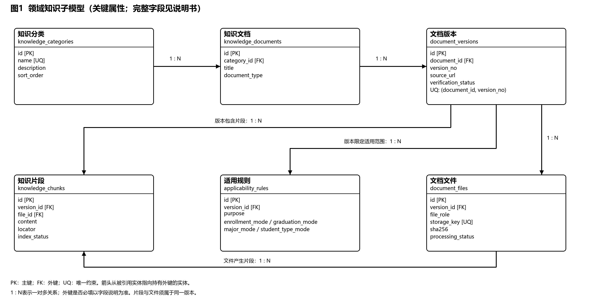

# 数据库 ER 图

负责人：丁晓炜。

| 文件 | 内容 |
| --- | --- |
| [知识库ER图.svg](知识库ER图.svg) | 六个核心实体的可编辑矢量图 |
| [知识库ER图.png](知识库ER图.png) | 概念图展示图片 |
| [实体关系说明.md](实体关系说明.md) | 实体、主要属性、六组联系、基数与约束说明 |
| [数据库关系图.mmd](数据库关系图.mmd) | 详细设计v1.2所附23表关系的Mermaid源稿 |

本目录中的数据库概念模型、ER图、实体关系说明及23表扩展关系设计由丁晓炜完成，并与王智洋讨论了关系模型及详细设计的衔接。六实体概念图展示知识库核心结构，23表扩展关系源稿展示全库关联，供团队交叉核对。

概念图和说明为团队评审材料，不表示数据库已部署、政策已核验或检索服务已上线。数据库设计说明书PDF及详细设计源文件按团队分工在其他指定目录提交。
