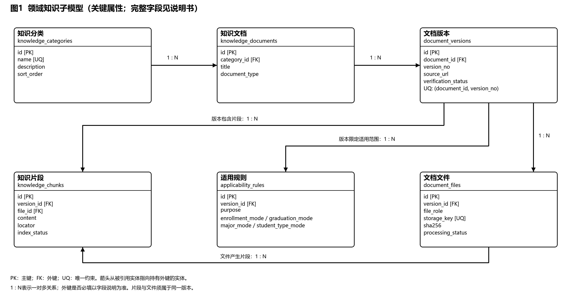

# CodeMind-FZU 知识库数据库概念设计

作者：丁晓炜

版本：概念设计 v1.0（待团队评审）

日期：2026年11月8日

## 一、设计范围

本部分梳理知识库数据结构，交付实体划分、主要属性、数据库实体关系（ER）图和实体关系说明，作为后续关系数据模型、数据字典和对象关系映射（ORM）的输入。

知识库按“分类—文档—版本”组织资料：文档表示一项政策或通知的逻辑身份，版本保存某次确定的内容、来源、日期和核验信息，版本下分别关联文件、适用规则和知识片段。

七类知识主题为学籍与学生事务、课程考试与教务办理、综评与奖学金、竞赛认定与创新学分、培养方案与学位要求、科研实践与实验室、推免与升学。它们是知识分类实体中的七条记录，不是七种独立实体。

## 二、知识库ER图

图中PK表示主键，FK表示外键，UQ表示唯一约束；“1 : N”表示一对多关系。箭头从被引用实体指向持有外键的实体。数量关系说明结构上的一对多，是否必须已有下属记录及其他约束见下文。

- [PNG展示图](知识库ER图.png)
- [SVG可编辑图](知识库ER图.svg)

## 三、实体划分与主要属性

图中英文表名和字段名作为概念模型与详细设计的对照标识，具体数据类型、索引及ORM配置由数据库详细设计统一细化。

| 实体 | 对应表名建议 | 保存的信息与主要属性 |
|---|---|---|
| 知识分类 | knowledge_categories | 知识主题；编号、分类名称、分类说明、展示顺序 |
| 知识文档 | knowledge_documents | 政策或通知的逻辑身份；编号、所属分类、标题、资料类型 |
| 文档版本 | document_versions | 某一版本的内容描述；编号、所属文档、版本号、官方来源、发布日期、政策状态、核验状态及说明 |
| 文档文件 | document_files | 某一版本对应的文件；编号、所属版本、文件角色、存储位置、文件校验值、处理状态 |
| 适用规则 | applicability_rules | 某一版本的使用条件；编号、所属版本、入学年级、毕业届别、专业、学生类别、使用用途 |
| 知识片段 | knowledge_chunks | 后续可供检索的正文段落；编号、所属版本、来源文件、片段正文、页码或章节位置、索引状态 |

## 四、实体关系说明

| 关系 | 数量关系 | 业务含义 | 关联字段建议 |
|---|---|---|---|
| 知识分类—知识文档 | 1 : N | 一个分类可以归入多份文档，每份文档必须属于一个主分类 | knowledge_documents.category_id |
| 知识文档—文档版本 | 1 : N | 一份文档可以保留多个版本，每个版本必须属于一份文档 | document_versions.document_id |
| 文档版本—文档文件 | 1 : N | 一个版本可以关联原始网页、官方附件、正文提取稿和整理稿，每个文件记录必须属于一个版本 | document_files.version_id |
| 文档版本—适用规则 | 1 : N | 一个版本可以有多条适用规则，每条规则必须属于一个版本 | applicability_rules.version_id |
| 文档版本—知识片段 | 1 : N | 一个版本可以形成多个检索片段，每个片段必须属于一个版本 | knowledge_chunks.version_id |
| 文档文件—知识片段 | 1 : N | 一个文件可以产生多个片段，每个片段必须关联一个来源文件 | knowledge_chunks.file_id |

文档登记后可以暂时没有版本记录；版本登记后可以暂时没有文件、适用规则或检索片段；文件尚未完成正文处理时可以没有片段。已存在的子记录必须关联其父记录。未提取或未确认的信息保持待处理状态，不伪造内容补齐记录。

## 五、业务约束

1. 文档与版本分开：经核对确认属于同一文档的更新，再建立新版本并保留历史版本。同一文档内版本号不可重复；不同年度通知或标题相近资料不自动合并。
2. 分类名称不可重复：七类主题统一维护，每份文档指定一个主分类。
3. 网页与附件分开登记：同一版本下的多个附件分别保存文件记录，正文稿也有独立记录。附件数量不增加政策事项数量；文件的存储位置不可冲突。
4. 适用规则按原文记录：入学年级与毕业届别分别表示，未知条件不能按全部适用处理。同一条规则内条件同时满足，多条规则之间满足任一条即可。
5. 片段来源可追溯：知识片段必须关联来源文件和文档版本，且文件属于同一版本。来源位置记录页码、章节或段落等信息，无法精确定位时如实说明。
6. 状态分别管理：来源核验、正文提取、政策有效性和是否开放检索分别记录。保存了文件或提取了正文，不等于政策已经完整核验或可以直接用于回答。

## 六、设计状态与详细设计衔接

本版已完成六个知识库实体、主要属性、六组一对多关系及ER图设计，当前作为团队评审稿。适用规则结构化和知识片段切分尚未实施，实际建表、数据库部署与Agent检索接入也未完成。

详细设计应据此细化关系模型、完整字段及数据类型、主外键、唯一与非空约束、索引和ORM映射。用户交互记录、任务结果及回答引用涉及的全库模型，由团队结合系统功能继续确认；回答引用知识资料时应固定到具体版本，精确定位时再关联知识片段。

数据库产品、具体ORM框架、文件部署位置和首版是否实际部署，仍需与技术架构方案统一。若详细设计调整本版实体、属性或关系，应同步修改ER图和本文，保持一致。

## 七、与详细设计 v1.2 的范围对应

本说明及PNG/SVG展示六个知识库核心实体，不是23表全库图。队友提供的详细设计v1.2已扩展为23张表，完整关系源稿另存为[数据库关系图.mmd](数据库关系图.mmd)。两者展示层次不同，不能将本概念图当作已覆盖全部扩展表的正式物理模型。

扩展部分包括业务标签与适用条件值、核查记录与待办、用户及会话消息、任务结果与引用、多办理节点、文件多来源、消息结果关联、政策关系及反馈核查关联。主外键、数据类型、索引及ORM以详细设计对应材料为准；全库模型仍需团队交叉审核。
