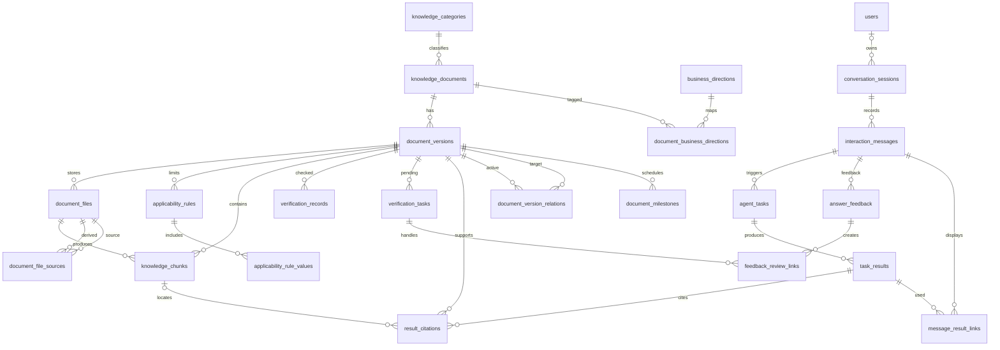

# 关系数据模型 v1.2（修正审核稿）

## v1.2修正内容

1. 约束名称使用完整列组合，消除唯一约束及外键命名冲突。
2. 新增document_milestones，分别保存多个办理节点、日期/时刻/未知精度、原文、时区和核验状态。deadline_status区分unknown/unstructured/structured/none；none只能经核实确认无期限，空值不是无期限。旧deadline_on仅作单一日期兼容字段，不作为所有办理节点的权威筛选入口。
3. 新增message_result_links，实现助手消息与实际采用结果的多对多关联。任务、结果和关联表通过会话ID复合外键限定同一会话，角色约束限定用户请求和助手回复。result_stage区分intermediate/final；引用仍挂在被采用的结果上，查询回复依据须沿消息关联表查结果及引用，不能取“最近一份结果”代替。
4. 新增document_file_sources，替代单一derived_from_file_id，支持一份正文由多个文件形成；片段另有original_file_id和original_locator，直接记录对应官方原件和位置。关联未知时留空、待核验，不能用提取稿行号冒充PDF页码。来源链必须无环，指向官方原件时核对文件角色和原文位置；跨行语义校验仍由后续服务事务落实。

本版为23表233字段，保留原6实体及主要关系。44条/37列原值、149文件、53业务标签关联不变；16个办理节点为离线转换预览，全部pending，未执行政策核验。对于24:00、按系统通知等未安全转换内容，保留原文及unknown精度，不猜测日期；structured只表示结构化，不表示已核验。

本次只修正设计和离线交付文件，未部署、未推送仓库、未执行OCR。原件派生关联与片段未核实时保持空表/空字段；不能将新增存储结构描述为已完成原件定位。

业务补充：政策版本替代/补充/配套关系、四类回答使用规则及用户反馈闭环已加入v1.2；详细规则见《业务回答与反馈规则_v1.2.md》。新增三关系均有模型及数据字典，原有核查记录不变。


## 关系定义

PK为主键，?表示允许空值。全部表有created_at/updated_at。具体类型与CHECK见数据字典及约束说明。

### knowledge_categories — 七类原始知识主题

```text
  id [PK]
  name
  description [?]
  sort_order
  created_at
  updated_at
  UQ(name)
```

### knowledge_documents — 政策或通知的逻辑身份

```text
  id [PK]
  category_id
  title
  document_type
  created_at
  updated_at
  FK: category_id → knowledge_categories.id
```

### document_versions — 确定内容的版本与原登记元数据

```text
  id [PK]
  document_id
  record_code
  version_no
  publisher [?]
  responsible_department [?]
  document_number [?]
  source_url
  published_on [?]
  issued_on [?]
  effective_on [?]
  deadline_on [?]
  document_written_on [?]
  source_page_published_on [?]
  source_verified_on [?]
  timeliness_verified_on [?]
  local_checked_on [?]
  legacy_last_verified_on [?]
  source_page_url [?]
  applicability_raw [?]
  policy_status
  source_verification_status
  timeliness_verification_status
  extraction_status
  attachment_status
  v1_inclusion_status
  retrieval_status
  inclusion_reason [?]
  verification_note [?]
  legacy_verification_text [?]
  import_snapshot [?]
  temporal_notes [?]
  deadline_status
  created_at
  updated_at
  UQ(document_id, version_no)
  UQ(record_code)
  FK: document_id → knowledge_documents.id
```

### document_files — 原始网页、附件、正文及整理稿

```text
  id [PK]
  version_id
  file_role
  storage_key
  original_name
  media_type [?]
  sha256 [?]
  source_url [?]
  processing_status
  processing_note [?]
  created_at
  updated_at
  UQ(id, version_id)
  UQ(storage_key)
  FK: version_id → document_versions.id
```

### applicability_rules — 适用规则；同用途多条OR

```text
  id [PK]
  version_id
  purpose
  enrollment_mode
  graduation_mode
  major_mode
  student_type_mode
  source_locator [?]
  verification_status
  created_at
  updated_at
  FK: version_id → document_versions.id
```

### applicability_rule_values — 一条适用规则各维度允许值

```text
  rule_id [PK]
  dimension [PK]
  value [PK]
  created_at
  updated_at
  FK: rule_id → applicability_rules.id
```

### knowledge_chunks — 可追溯检索片段

```text
  id [PK]
  version_id
  file_id
  chunk_no
  content
  locator [?]
  locator_note [?]
  original_file_id [?]
  original_locator [?]
  index_status
  created_at
  updated_at
  UQ(file_id, chunk_no)
  UQ(id, version_id)
  FK: version_id → document_versions.id
  FK(复合): (file_id, version_id) → document_files(id, version_id)
  FK(复合): (original_file_id, version_id) → document_files(id, version_id)
```

### business_directions — 五大业务方向

```text
  id [PK]
  code
  name
  delivery_stage
  sort_order
  created_at
  updated_at
  UQ(code)
  UQ(name)
```

### document_business_directions — 文档业务方向多标签

```text
  document_id [PK]
  direction_id [PK]
  mapping_reason [?]
  created_at
  updated_at
  FK: document_id → knowledge_documents.id
  FK: direction_id → business_directions.id
```

### verification_records — 只追加的核查历史

```text
  id [PK]
  version_id
  file_id [?]
  check_type
  outcome
  checked_on
  checked_at [?]
  reviewer_label [?]
  method
  evidence_url [?]
  evidence_locator [?]
  note
  created_at
  updated_at
  UQ(id, version_id)
  UQ(id, version_id, file_id)
  FK: version_id → document_versions.id
  FK(复合): (file_id, version_id) → document_files(id, version_id)
```

### verification_tasks — 资料核查待办

```text
  id [PK]
  version_id
  file_id [?]
  task_type
  description
  status
  priority
  assignee_label [?]
  completion_record_id [?]
  completed_at [?]
  created_at
  updated_at
  UQ(id, version_id)
  FK: version_id → document_versions.id
  FK(复合): (file_id, version_id) → document_files(id, version_id)
  FK(复合): (completion_record_id, version_id) → verification_records(id, version_id)
  FK(复合): (completion_record_id, version_id, file_id) → verification_records(id, version_id, file_id)
```

### users — 最小用户身份；无密码及成长档案

```text
  id [PK]
  external_subject [?]
  display_name [?]
  status
  created_at
  updated_at
  UQ(external_subject)
```

### conversation_sessions — 会话；支持匿名

```text
  id [PK]
  user_id [?]
  title [?]
  started_at
  ended_at [?]
  created_at
  updated_at
  FK: user_id → users.id
```

### interaction_messages — 用户与助手交互消息

```text
  id [PK]
  session_id
  sequence_no
  role
  content
  sent_at
  created_at
  updated_at
  UQ(id, session_id, role)
  UQ(session_id, sequence_no)
  FK: session_id → conversation_sessions.id
```

### agent_tasks — 由用户消息触发的Agent任务

```text
  id [PK]
  request_message_id
  session_id
  request_role
  task_type
  status
  started_at [?]
  finished_at [?]
  error_code [?]
  error_summary [?]
  created_at
  updated_at
  UQ(id, session_id)
  FK: session_id → conversation_sessions.id
  FK(复合): (request_message_id, session_id, request_role) → interaction_messages(id, session_id, role)
```

### task_results — 任务结果历史；重试追加

```text
  id [PK]
  task_id
  session_id
  result_stage
  answer_mode
  result_no
  result_type
  content
  generated_at
  created_at
  updated_at
  UQ(id, session_id)
  UQ(task_id, result_no)
  FK: session_id → conversation_sessions.id
  FK(复合): (task_id, session_id) → agent_tasks(id, session_id)
```

### result_citations — 结果引用；固定版本及可选片段

```text
  id [PK]
  result_id
  citation_no
  version_id
  chunk_id [?]
  locator [?]
  quoted_text [?]
  source_url_snapshot
  title_snapshot
  cited_at
  verification_snapshot
  created_at
  updated_at
  UQ(result_id, citation_no)
  FK: result_id → task_results.id
  FK: version_id → document_versions.id
  FK(复合): (chunk_id, version_id) → knowledge_chunks(id, version_id)
```

### document_milestones — 版本的多个办理节点；原文与时间精度分别保存

```text
  id [PK]
  version_id
  name
  raw_text
  precision
  due_on [?]
  due_at [?]
  timezone_name [?]
  verification_status
  created_at
  updated_at
  FK: version_id → document_versions.id
```

### document_file_sources — 派生文件与多个同版本来源；替代单来源字段

```text
  file_id [PK]
  source_file_id [PK]
  version_id
  source_locator [?]
  target_locator [?]
  verification_status
  created_at
  updated_at
  FK: version_id → document_versions.id
  FK(复合): (file_id, version_id) → document_files(id, version_id)
  FK(复合): (source_file_id, version_id) → document_files(id, version_id)
```

### message_result_links — 助手消息实际采用的结果；多对多支持结果整合

```text
  message_id [PK]
  result_id [PK]
  session_id
  message_role
  created_at
  updated_at
  FK: session_id → conversation_sessions.id
  FK(复合): (message_id, session_id, message_role) → interaction_messages(id, session_id, role)
  FK(复合): (result_id, session_id) → task_results(id, session_id)
```

### document_version_relations — 有证据的政策版本替代/补充/配套关系

```text
  from_version_id [PK]
  to_version_id [PK]
  relation_type [PK]
  effective_on [?]
  evidence_note
  evidence_url [?]
  verification_status
  created_at
  updated_at
  FK: from_version_id → document_versions.id
  FK: to_version_id → document_versions.id
```

### answer_feedback — 对助手回复的反馈及处理结果

```text
  id [PK]
  message_id
  session_id
  message_role
  version_id [?]
  feedback_type
  description
  status
  resolution_note [?]
  resolved_at [?]
  created_at
  updated_at
  UQ(id, version_id)
  FK: session_id → conversation_sessions.id
  FK: version_id → document_versions.id
  FK(复合): (message_id, session_id, message_role) → interaction_messages(id, session_id, role)
```

### feedback_review_links — 反馈转核查待办；同版本证据链

```text
  feedback_id [PK]
  verification_task_id [PK]
  version_id
  created_at
  updated_at
  FK: version_id → document_versions.id
  FK(复合): (feedback_id, version_id) → answer_feedback(id, version_id)
  FK(复合): (verification_task_id, version_id) → verification_tasks(id, version_id)
```

## 关系图



## 规则

七原分类与五业务方向并行。文档可以无版本，版本可以无文件/规则/片段；子记录必须有父记录。原44条先独立建立初始文档与版本，不自动合并相同标题，资料编号保存在版本上。模式unknown/all/include分别表示未知/全体/指定值；同规则维度AND，同维度值OR，同用途规则OR。来源、正文、时效、附件、适用范围与检索开放独立。历史资料只按历史或流程参考用途使用。成长档案与交换/出国交流不列首版必要交付。

任务及结果中的session_id是为复合外键约束保留的受控冗余，防止跨会话绑定；request_role/message_role是固定判别值，不由客户端自由选择。消息可整合多份结果，引用通过关联关系追溯。
文件来源关联支持多来源，片段可直接定位官方原件。数据库保证同版本和不能自己引用自己；来源链无环、官方原件角色及精确定位通过服务事务审核。文件和被引用片段的实质内容应不可原位改写。
多节点期限以document_milestones为准。DATE节点不擅自推断一天内截止时刻，精确时刻用带时区时间保存；unknown或待核验节点不能用于确定性办理资格判断。
被引用资料默认限制删除；个人交互保留和匿名化策略另行设计。updated_at由写入服务显式维护。未实施的服务约束见约束说明，不声称已部署。
