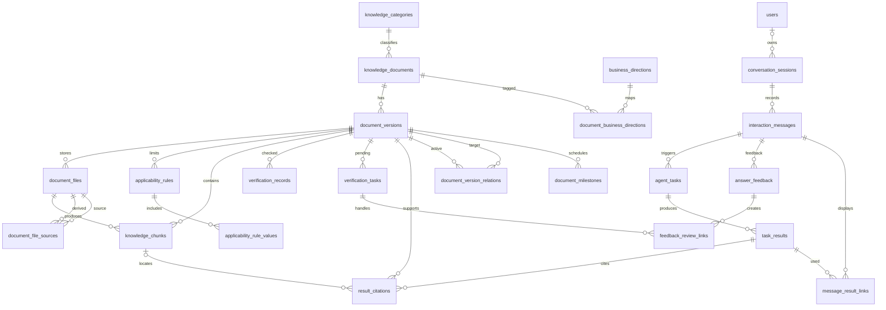

# 数据库详细设计完整审核稿 v1.2

附件：数据库详细设计说明书_v1.2.md

# CodeMind-FZU 数据库详细设计说明书

版本：v1.2（供团队审核，非已部署版本）  
日期：2026-11-08  
对应分工：王智洋的关系模型、表结构、约束索引、ORM映射及存储设计。

## 1. 交付结论

本版在丁晓炜6实体知识库概念模型上提出23表逻辑及物理设计，覆盖原知识库资料、版本、文件、适用规则、检索片段，以及业务标签、核查记录、待办、用户交互、任务结果和回答引用。本版以 PostgreSQL 和 SQLAlchemy 2 作为数据库设计的候选技术基线，具体技术选型及首版部署方案待技术架构负责人确认。本次已完成关系数据模型、DDL 和 ORM 映射设计，但尚未部署实际数据库，也未接入 Agent。

本地44条资料核对结果与入库预览保持一致：7类原分类，43条已提取正文但待语义复核，1条高水平科创奖励PDF待OCR。所有44条保留原编号和原37列；GitHub旧索引31条与本地仅登记核查的31条编号完全对应，13条本地新增部分核查资料尚未在所核对提交的展开目录同步。本次未推送仓库。

## 2. 需求对应

|分工要求|本次交付|
|---|---|
|关系数据模型|relational-model/关系数据模型_v1.2.md：关系定义、关联与关系图|
|表名、字段、数据类型|data-dictionary/数据字典_v1.2.md：23表、233列，含公共时间字段|
|主键、外键及关联|关系模型、约束说明及sql/01_schema.sql|
|唯一、非空、索引|data-dictionary/约束与索引设计_v1.2.md及SQL|
|实体类与表的ORM映射|orm/ORM映射说明_v1.2.md及source/models.py|
|资料和元数据存储|knowledge-base/知识库入库映射与存储方案_v1.2.md，37列逐项映射|
|用户交互和任务结果存储|users、conversation_sessions、interaction_messages、agent_tasks、task_results及result_citations|
|新知识库范围|44条业务分类表、首版资料覆盖清单及范围交接说明|

## 3. 数据组织

知识分类→知识文档→文档版本形成主线，版本关联原始网页、附件、正文稿、整理稿；附件数量不增加资料登记条数。所有资料类型以统一结构保存，不为七分类分别建七套表。业务方向通过多对多关联，不改变原主分类。

适用规则以入学年级、毕业届别、专业及学生类别分别表达。unknown不等于all；同规则内条件AND，同维度值OR，同用途多规则OR。当前不自动把适用原文转成已核实规则。

核查分来源、正文、时效、附件和适用范围，历史与当前汇总分离。首次预览不伪造已通过核查事件；保留旧文本并生成待办。版本检索默认blocked，开放须人工审核及服务端资格筛选。

用户身份只保留最小标识，支持匿名会话。消息按会话内序号排序；用户请求触发Agent任务，任务可有多份结果；助手消息通过message_result_links明确关联实际采用的结果，引用固定到版本及可选片段并保存回答时快照。个人成长档案不纳入首版。

## 4. 完整性与事务

UUID主键由应用生成；原资料编号唯一，文档内版本号唯一，文件存储键唯一。片段与来源文件、引用与片段必须同版本，采用复合外键。资料记录默认限制删除，政策过期通过状态保留，避免破坏引用。

单次业务操作使用一个Session事务：新增版本及文件、核查记录及汇总状态、任务结果及引用分别原子提交。外部文件写入与数据库事务无法天然原子，应先写临时文件、校验哈希后入库；提交后发布文件，失败清理孤立文件并定期对账。具体对象存储和补偿任务待架构确定。

主键/唯一索引不重复建索引，额外索引围绕版本检索筛选、分类导航、业务方向、文件角色、核查历史和会话任务队列。全文及向量索引待确定检索方案后新增，不在本轮虚构已实现能力。

ORM与SQL共用同一份metadata生成，减少字段漂移。updated_at并非数据库自动更新字段，后续写入服务必须维护。适用条件一致性、派生链无环、核查历史只追加与用户数据保留策略尚需业务服务落实，见约束说明中的明确边界。

## 5. 已完成与未实施的区分

|状态|内容|
|---|---|
|有现有材料支撑|原6实体、6组关系；本地44条及文件；31+13核查口径；43+1正文状态|
|本轮已生成|23表设计、233列数据字典、PostgreSQL建表稿、ORM映射源文件、44条离线预览及分类审核表|
|设计建议待确认|新增17关系、数据库/ORM技术基线、全部44条纳入归档范围建议、匿名会话身份及数据保留规则|
|尚未实施|数据库部署、线上导入、业务服务、真实认证、OCR与政策复核、切片、向量检索、Agent接入|

没有声称已与丁晓炜或架构负责人沟通。需将新增实体及适用规则表达提交他们确认，并同步更新正式ER。概念图副本保留为输入，不冒充更新后的正式团队图。

## 6. 验证与局限

source/validate_deliverables.py验证外键/状态/默认值、ORM关联、44条37列快照不丢失、预览批次完整插入、PostgreSQL SQL语法解析；source/validation_report.json保存真实运行结果。SQLite内存测试用于可移植约束检查，不等同于PostgreSQL实库验收。DDL编译和语法解析不保证所有运行时行为均已实库验证。

44条政策没有在本次逐条联网核验；来源网址、旧“当前有效”及核查文字均是已有记录，不能据此宣称现行性已复核。开题PPT原件及博客2.4.2原文未取得；本版遵循用户明确的新范围，不声称已直接修改PPT或博客。

## 7. 团队审核事项

请丁晓炜核对新增关系及规则表达，与其ER统一；请技术架构负责人确认PostgreSQL/SQLAlchemy或提供替代方案；请知识库维护方复核业务标签和资料纳入理由，继续完成OCR、目录、培养方案、奖学金数值、推免版本及31条时效核验。审核后再决定是否实际建库及部署。

本轮提供可编辑Markdown、SQL、Python与JSON，满足先提交可审核结构、不等待PDF排版的要求。

## v1.2修正内容

1. 约束名称使用完整列组合，消除唯一约束及外键命名冲突。
2. 新增document_milestones，分别保存多个办理节点、日期/时刻/未知精度、原文、时区和核验状态。deadline_status区分unknown/unstructured/structured/none；none只能经核实确认无期限，空值不是无期限。旧deadline_on仅作单一日期兼容字段，不作为所有办理节点的权威筛选入口。
3. 新增message_result_links，实现助手消息与实际采用结果的多对多关联。任务、结果和关联表通过会话ID复合外键限定同一会话，角色约束限定用户请求和助手回复。result_stage区分intermediate/final；引用仍挂在被采用的结果上，查询回复依据须沿消息关联表查结果及引用，不能取“最近一份结果”代替。
4. 新增document_file_sources，替代单一derived_from_file_id，支持一份正文由多个文件形成；片段另有original_file_id和original_locator，直接记录对应官方原件和位置。关联未知时留空、待核验，不能用提取稿行号冒充PDF页码。来源链必须无环，指向官方原件时核对文件角色和原文位置；跨行语义校验仍由后续服务事务落实。

本版为23表233字段，保留原6实体及主要关系。44条/37列原值、149文件、53业务标签关联不变；16个办理节点为离线转换预览，全部pending，未执行政策核验。对于24:00、按系统通知等未安全转换内容，保留原文及unknown精度，不猜测日期；structured只表示结构化，不表示已核验。

本次只修正设计和离线交付文件，未部署、未推送仓库、未执行OCR。原件派生关联与片段未核实时保持空表/空字段；不能将新增存储结构描述为已完成原件定位。

业务补充：政策版本替代/补充/配套关系、四类回答使用规则及用户反馈闭环已加入v1.2；详细规则见《业务回答与反馈规则_v1.2.md》。新增三关系均有模型及数据字典，原有核查记录不变。


---

附件：relational-model/关系数据模型_v1.2.md

# 关系数据模型 v1.2（修正审核稿）

## v1.2修正内容

1. 约束名称使用完整列组合，消除唯一约束及外键命名冲突。
2. 新增document_milestones，分别保存多个办理节点、日期/时刻/未知精度、原文、时区和核验状态。deadline_status区分unknown/unstructured/structured/none；none只能经核实确认无期限，空值不是无期限。旧deadline_on仅作单一日期兼容字段，不作为所有办理节点的权威筛选入口。
3. 新增message_result_links，实现助手消息与实际采用结果的多对多关联。任务、结果和关联表通过会话ID复合外键限定同一会话，角色约束限定用户请求和助手回复。result_stage区分intermediate/final；引用仍挂在被采用的结果上，查询回复依据须沿消息关联表查结果及引用，不能取“最近一份结果”代替。
4. 新增document_file_sources，替代单一derived_from_file_id，支持一份正文由多个文件形成；片段另有original_file_id和original_locator，直接记录对应官方原件和位置。关联未知时留空、待核验，不能用提取稿行号冒充PDF页码。来源链必须无环，指向官方原件时核对文件角色和原文位置；跨行语义校验仍由后续服务事务落实。

本版为23表233字段，保留原6实体及主要关系。44条/37列原值、149文件、53业务标签关联不变；16个办理节点为离线转换预览，全部pending，未执行政策核验。对于24:00、按系统通知等未安全转换内容，保留原文及unknown精度，不猜测日期；structured只表示结构化，不表示已核验。

本次只修正设计和离线交付文件，未部署、未推送仓库、未执行OCR。原件派生关联与片段未核实时保持空表/空字段；不能将新增存储结构描述为已完成原件定位。

业务补充：政策版本替代/补充/配套关系、四类回答使用规则及用户反馈闭环已加入v1.2；详细规则见《业务回答与反馈规则_v1.2.md》。新增三关系均有模型及数据字典，原有核查记录不变。


## 关系定义

PK为主键，?表示允许空值。全部表有created_at/updated_at。具体类型与CHECK见数据字典及约束说明。

### knowledge_categories — 七类原始知识主题

```text
  id [PK]
  name
  description [?]
  sort_order
  created_at
  updated_at
  UQ(name)
```

### knowledge_documents — 政策或通知的逻辑身份

```text
  id [PK]
  category_id [FK→knowledge_categories.id]
  title
  document_type
  created_at
  updated_at
```

### document_versions — 确定内容的版本与原登记元数据

```text
  id [PK]
  document_id [FK→knowledge_documents.id]
  record_code
  version_no
  publisher [?]
  responsible_department [?]
  document_number [?]
  source_url
  published_on [?]
  issued_on [?]
  effective_on [?]
  deadline_on [?]
  document_written_on [?]
  source_page_published_on [?]
  source_verified_on [?]
  timeliness_verified_on [?]
  local_checked_on [?]
  legacy_last_verified_on [?]
  source_page_url [?]
  applicability_raw [?]
  policy_status
  source_verification_status
  timeliness_verification_status
  extraction_status
  attachment_status
  v1_inclusion_status
  retrieval_status
  inclusion_reason [?]
  verification_note [?]
  legacy_verification_text [?]
  import_snapshot [?]
  temporal_notes [?]
  deadline_status
  created_at
  updated_at
  UQ(document_id, version_no)
  UQ(record_code)
```

### document_files — 原始网页、附件、正文及整理稿

```text
  id [PK]
  version_id [FK→document_versions.id]
  file_role
  storage_key
  original_name
  media_type [?]
  sha256 [?]
  source_url [?]
  processing_status
  processing_note [?]
  created_at
  updated_at
  UQ(id, version_id)
  UQ(storage_key)
```

### applicability_rules — 适用规则；同用途多条OR

```text
  id [PK]
  version_id [FK→document_versions.id]
  purpose
  enrollment_mode
  graduation_mode
  major_mode
  student_type_mode
  source_locator [?]
  verification_status
  created_at
  updated_at
```

### applicability_rule_values — 一条适用规则各维度允许值

```text
  rule_id [PK; FK→applicability_rules.id]
  dimension [PK]
  value [PK]
  created_at
  updated_at
```

### knowledge_chunks — 可追溯检索片段

```text
  id [PK]
  version_id [FK→document_files.version_id,document_files.version_id,document_versions.id]
  file_id [FK→document_files.id]
  chunk_no
  content
  locator [?]
  locator_note [?]
  original_file_id [?; FK→document_files.id]
  original_locator [?]
  index_status
  created_at
  updated_at
  UQ(file_id, chunk_no)
  UQ(id, version_id)
```

### business_directions — 五大业务方向

```text
  id [PK]
  code
  name
  delivery_stage
  sort_order
  created_at
  updated_at
  UQ(code)
  UQ(name)
```

### document_business_directions — 文档业务方向多标签

```text
  document_id [PK; FK→knowledge_documents.id]
  direction_id [PK; FK→business_directions.id]
  mapping_reason [?]
  created_at
  updated_at
```

### verification_records — 只追加的核查历史

```text
  id [PK]
  version_id [FK→document_files.version_id,document_versions.id]
  file_id [?; FK→document_files.id]
  check_type
  outcome
  checked_on
  checked_at [?]
  reviewer_label [?]
  method
  evidence_url [?]
  evidence_locator [?]
  note
  created_at
  updated_at
  UQ(id, version_id)
  UQ(id, version_id, file_id)
```

### verification_tasks — 资料核查待办

```text
  id [PK]
  version_id [FK→document_files.version_id,document_versions.id,verification_records.version_id,verification_records.version_id]
  file_id [?; FK→document_files.id,verification_records.file_id]
  task_type
  description
  status
  priority
  assignee_label [?]
  completion_record_id [?; FK→verification_records.id,verification_records.id]
  completed_at [?]
  created_at
  updated_at
  UQ(id, version_id)
```

### users — 最小用户身份；无密码及成长档案

```text
  id [PK]
  external_subject [?]
  display_name [?]
  status
  created_at
  updated_at
  UQ(external_subject)
```

### conversation_sessions — 会话；支持匿名

```text
  id [PK]
  user_id [?; FK→users.id]
  title [?]
  started_at
  ended_at [?]
  created_at
  updated_at
```

### interaction_messages — 用户与助手交互消息

```text
  id [PK]
  session_id [FK→conversation_sessions.id]
  sequence_no
  role
  content
  sent_at
  created_at
  updated_at
  UQ(id, session_id, role)
  UQ(session_id, sequence_no)
```

### agent_tasks — 由用户消息触发的Agent任务

```text
  id [PK]
  request_message_id [FK→interaction_messages.id]
  session_id [FK→conversation_sessions.id,interaction_messages.session_id]
  request_role [FK→interaction_messages.role]
  task_type
  status
  started_at [?]
  finished_at [?]
  error_code [?]
  error_summary [?]
  created_at
  updated_at
  UQ(id, session_id)
```

### task_results — 任务结果历史；重试追加

```text
  id [PK]
  task_id [FK→agent_tasks.id]
  session_id [FK→agent_tasks.session_id,conversation_sessions.id]
  result_stage
  answer_mode
  result_no
  result_type
  content
  generated_at
  created_at
  updated_at
  UQ(id, session_id)
  UQ(task_id, result_no)
```

### result_citations — 结果引用；固定版本及可选片段

```text
  id [PK]
  result_id [FK→task_results.id]
  citation_no
  version_id [FK→document_versions.id,knowledge_chunks.version_id]
  chunk_id [?; FK→knowledge_chunks.id]
  locator [?]
  quoted_text [?]
  source_url_snapshot
  title_snapshot
  cited_at
  verification_snapshot
  created_at
  updated_at
  UQ(result_id, citation_no)
```

### document_milestones — 版本的多个办理节点；原文与时间精度分别保存

```text
  id [PK]
  version_id [FK→document_versions.id]
  name
  raw_text
  precision
  due_on [?]
  due_at [?]
  timezone_name [?]
  verification_status
  created_at
  updated_at
```

### document_file_sources — 派生文件与多个同版本来源；替代单来源字段

```text
  file_id [PK; FK→document_files.id]
  source_file_id [PK; FK→document_files.id]
  version_id [FK→document_files.version_id,document_files.version_id,document_versions.id]
  source_locator [?]
  target_locator [?]
  verification_status
  created_at
  updated_at
```

### message_result_links — 助手消息实际采用的结果；多对多支持结果整合

```text
  message_id [PK; FK→interaction_messages.id]
  result_id [PK; FK→task_results.id]
  session_id [FK→conversation_sessions.id,interaction_messages.session_id,task_results.session_id]
  message_role [FK→interaction_messages.role]
  created_at
  updated_at
```

### document_version_relations — 有证据的政策版本替代/补充/配套关系

```text
  from_version_id [PK; FK→document_versions.id]
  to_version_id [PK; FK→document_versions.id]
  relation_type [PK]
  effective_on [?]
  evidence_note
  evidence_url [?]
  verification_status
  created_at
  updated_at
```

### answer_feedback — 对助手回复的反馈及处理结果

```text
  id [PK]
  message_id [FK→interaction_messages.id]
  session_id [FK→conversation_sessions.id,interaction_messages.session_id]
  message_role [FK→interaction_messages.role]
  version_id [?; FK→document_versions.id]
  feedback_type
  description
  status
  resolution_note [?]
  resolved_at [?]
  created_at
  updated_at
  UQ(id, version_id)
```

### feedback_review_links — 反馈转核查待办；同版本证据链

```text
  feedback_id [PK; FK→answer_feedback.id]
  verification_task_id [PK; FK→verification_tasks.id]
  version_id [FK→answer_feedback.version_id,document_versions.id,verification_tasks.version_id]
  created_at
  updated_at
```

## 关系图



## 规则

七原分类与五业务方向并行。文档可以无版本，版本可以无文件/规则/片段；子记录必须有父记录。原44条先独立建立初始文档与版本，不自动合并相同标题，资料编号保存在版本上。模式unknown/all/include分别表示未知/全体/指定值；同规则维度AND，同维度值OR，同用途规则OR。来源、正文、时效、附件、适用范围与检索开放独立。历史资料只按历史或流程参考用途使用。成长档案与交换/出国交流不列首版必要交付。

任务及结果中的session_id是为复合外键约束保留的受控冗余，防止跨会话绑定；request_role/message_role是固定判别值，不由客户端自由选择。消息可整合多份结果，引用通过关联关系追溯。
文件来源关联支持多来源，片段可直接定位官方原件。数据库保证同版本和不能自己引用自己；来源链无环、官方原件角色及精确定位通过服务事务审核。文件和被引用片段的实质内容应不可原位改写。
多节点期限以document_milestones为准。DATE节点不擅自推断一天内截止时刻，精确时刻用带时区时间保存；unknown或待核验节点不能用于确定性办理资格判断。
被引用资料默认限制删除；个人交互保留和匿名化策略另行设计。updated_at由写入服务显式维护。未实施的服务约束见约束说明，不声称已部署。


---

附件：data-dictionary/数据字典_v1.2.md

# 数据字典 v1.2（审核稿）

本版以 PostgreSQL 和 SQLAlchemy 2 作为数据库设计的候选技术基线，具体技术选型及首版部署方案待技术架构负责人确认。本次已完成关系数据模型、DDL 和 ORM 映射设计，但尚未部署实际数据库，也未接入 Agent。 候选ORM采用SQLAlchemy 2命令式映射。所有UUID由应用生成。全部表含created_at和updated_at；updated_at由写入服务显式更新，未配置自动更新时间触发器。

JSONB仅用于原始元数据快照和证据，不用于代替多标签或多附件关系。日期精度不足时不填伪造时间。

## knowledge_categories — 七类原始知识主题

|字段|中文含义|PostgreSQL类型|非空|主键|唯一约束成员|服务端默认值|
|---|---|---|---|---|---|---|
|id|内部UUID；应用生成|UUID|是|是||无|
|name|原始分类名称|VARCHAR(64)|是||uq_knowledge_categories_name|无|
|description|分类说明|TEXT|否|||无|
|sort_order|显示顺序|INTEGER|是|||0|
|created_at|创建时间|TIMESTAMP WITH TIME ZONE|是|||CURRENT_TIMESTAMP|
|updated_at|更新时间；更新操作须显式维护|TIMESTAMP WITH TIME ZONE|是|||CURRENT_TIMESTAMP|


## knowledge_documents — 政策或通知的逻辑身份

|字段|中文含义|PostgreSQL类型|非空|主键|唯一约束成员|服务端默认值|
|---|---|---|---|---|---|---|
|id|内部UUID；应用生成|UUID|是|是||无|
|category_id|所属原始主分类|UUID|是|||无|
|title|逻辑文档标题|VARCHAR(512)|是|||无|
|document_type|资料类型|VARCHAR(64)|是|||无|
|created_at|创建时间|TIMESTAMP WITH TIME ZONE|是|||CURRENT_TIMESTAMP|
|updated_at|更新时间；更新操作须显式维护|TIMESTAMP WITH TIME ZONE|是|||CURRENT_TIMESTAMP|


## document_versions — 确定内容的版本与原登记元数据

|字段|中文含义|PostgreSQL类型|非空|主键|唯一约束成员|服务端默认值|
|---|---|---|---|---|---|---|
|id|内部UUID；应用生成|UUID|是|是||无|
|document_id|所属文档|UUID|是||uq_document_versions_document_id_version_no|无|
|record_code|原资料编号；全局保留|VARCHAR(128)|是||uq_document_versions_record_code|无|
|version_no|文档内部版本标识|VARCHAR(64)|是||uq_document_versions_document_id_version_no|无|
|publisher|发布单位|VARCHAR(256)|否|||无|
|responsible_department|负责部门|VARCHAR(256)|否|||无|
|document_number|文号|VARCHAR(128)|否|||无|
|source_url|登记的官方来源网址；存在不等于已核验|TEXT|是|||无|
|published_on|发布日期|DATE|否|||无|
|issued_on|印发日期|DATE|否|||无|
|effective_on|生效日期|DATE|否|||无|
|deadline_on|截止日期|DATE|否|||无|
|document_written_on|文件成文日期|DATE|否|||无|
|source_page_published_on|来源页面发布日期|DATE|否|||无|
|source_verified_on|来源实际核验日期|DATE|否|||无|
|timeliness_verified_on|时效实际核验日期|DATE|否|||无|
|local_checked_on|本地检查日期|DATE|否|||无|
|legacy_last_verified_on|原最后核验日期；不推断核验维度|DATE|否|||无|
|source_page_url|附件来源页面|TEXT|否|||无|
|applicability_raw|适用年级/专业/对象原文|JSONB|否|||无|
|policy_status|原登记政策状态；未复核不得当现行结论|VARCHAR(128)|是|||'待核验'|
|source_verification_status|来源核验|VARCHAR(32)|是|||'pending'|
|timeliness_verification_status|政策时效核验|VARCHAR(32)|是|||'pending'|
|extraction_status|正文提取|VARCHAR(32)|是|||'pending'|
|attachment_status|版本附件处理汇总|VARCHAR(32)|是|||'not_registered'|
|v1_inclusion_status|首版资料范围纳入状态|VARCHAR(32)|是|||'pending'|
|retrieval_status|检索开放状态|VARCHAR(32)|是|||'blocked'|
|inclusion_reason|首版纳入或排除理由|TEXT|否|||无|
|verification_note|当前核查说明|TEXT|否|||无|
|legacy_verification_text|原混合核验状态原文|TEXT|否|||无|
|import_snapshot|原CSV全部37列；不可丢失或覆盖|JSONB|否|||无|
|temporal_notes|不能安全转换成单一DATE的期限和年级生效原文|JSONB|否|||无|
|deadline_status|期限结构化状态；空日期不能视为无期限|VARCHAR(32)|是|||'unknown'|
|created_at|创建时间|TIMESTAMP WITH TIME ZONE|是|||CURRENT_TIMESTAMP|
|updated_at|更新时间；更新操作须显式维护|TIMESTAMP WITH TIME ZONE|是|||CURRENT_TIMESTAMP|


## document_files — 原始网页、附件、正文及整理稿

|字段|中文含义|PostgreSQL类型|非空|主键|唯一约束成员|服务端默认值|
|---|---|---|---|---|---|---|
|id|内部UUID；应用生成|UUID|是|是|uq_document_files_id_version_id|无|
|version_id|所属版本|UUID|是||uq_document_files_id_version_id|无|
|file_role|文件角色|VARCHAR(32)|是|||无|
|storage_key|受控相对路径或对象存储键|TEXT|是||uq_document_files_storage_key|无|
|original_name|原始文件名|VARCHAR(512)|是|||无|
|media_type|MIME类型|VARCHAR(128)|否|||无|
|sha256|小写SHA-256；未知不伪造|VARCHAR(64)|否|||无|
|source_url|具体文件来源网址|TEXT|否|||无|
|processing_status|单文件处理状态|VARCHAR(32)|是|||'saved'|
|processing_note|文件解析及复核说明|TEXT|否|||无|
|created_at|创建时间|TIMESTAMP WITH TIME ZONE|是|||CURRENT_TIMESTAMP|
|updated_at|更新时间；更新操作须显式维护|TIMESTAMP WITH TIME ZONE|是|||CURRENT_TIMESTAMP|


## applicability_rules — 适用规则；同用途多条OR

|字段|中文含义|PostgreSQL类型|非空|主键|唯一约束成员|服务端默认值|
|---|---|---|---|---|---|---|
|id|内部UUID；应用生成|UUID|是|是||无|
|version_id|所属版本|UUID|是|||无|
|purpose|规则适用用途|VARCHAR(128)|是|||无|
|enrollment_mode|enrollment_mode：未知/全体/指定值|VARCHAR(32)|是|||'unknown'|
|graduation_mode|graduation_mode：未知/全体/指定值|VARCHAR(32)|是|||'unknown'|
|major_mode|major_mode：未知/全体/指定值|VARCHAR(32)|是|||'unknown'|
|student_type_mode|student_type_mode：未知/全体/指定值|VARCHAR(32)|是|||'unknown'|
|source_locator|规则原文位置|TEXT|否|||无|
|verification_status|规则是否经人工核实|VARCHAR(32)|是|||'pending'|
|created_at|创建时间|TIMESTAMP WITH TIME ZONE|是|||CURRENT_TIMESTAMP|
|updated_at|更新时间；更新操作须显式维护|TIMESTAMP WITH TIME ZONE|是|||CURRENT_TIMESTAMP|


## applicability_rule_values — 一条适用规则各维度允许值

|字段|中文含义|PostgreSQL类型|非空|主键|唯一约束成员|服务端默认值|
|---|---|---|---|---|---|---|
|rule_id|规则编号|UUID|是|是||无|
|dimension|条件维度|VARCHAR(32)|是|是||无|
|value|标准化条件值|VARCHAR(128)|是|是||无|
|created_at|创建时间|TIMESTAMP WITH TIME ZONE|是|||CURRENT_TIMESTAMP|
|updated_at|更新时间；更新操作须显式维护|TIMESTAMP WITH TIME ZONE|是|||CURRENT_TIMESTAMP|


## knowledge_chunks — 可追溯检索片段

|字段|中文含义|PostgreSQL类型|非空|主键|唯一约束成员|服务端默认值|
|---|---|---|---|---|---|---|
|id|内部UUID；应用生成|UUID|是|是|uq_knowledge_chunks_id_version_id|无|
|version_id|所属版本|UUID|是||uq_knowledge_chunks_id_version_id|无|
|file_id|片段来源文件|UUID|是||uq_knowledge_chunks_file_id_chunk_no|无|
|chunk_no|来源文件内片段序号；从1开始|INTEGER|是||uq_knowledge_chunks_file_id_chunk_no|无|
|content|片段正文|TEXT|是|||无|
|locator|页码、章节或段落位置|TEXT|否|||无|
|locator_note|定位限制说明|TEXT|否|||无|
|original_file_id|对应官方原件；未定位则空|UUID|否|||无|
|original_locator|官方原件的页码或章节；不能冒用提取稿行号|TEXT|否|||无|
|index_status|索引状态|VARCHAR(32)|是|||'pending'|
|created_at|创建时间|TIMESTAMP WITH TIME ZONE|是|||CURRENT_TIMESTAMP|
|updated_at|更新时间；更新操作须显式维护|TIMESTAMP WITH TIME ZONE|是|||CURRENT_TIMESTAMP|


## business_directions — 五大业务方向

|字段|中文含义|PostgreSQL类型|非空|主键|唯一约束成员|服务端默认值|
|---|---|---|---|---|---|---|
|id|内部UUID；应用生成|UUID|是|是||无|
|code|固定业务代码|VARCHAR(64)|是||uq_business_directions_code|无|
|name|业务方向名称|VARCHAR(64)|是||uq_business_directions_name|无|
|delivery_stage|交付阶段|VARCHAR(16)|是|||无|
|sort_order|展示顺序|INTEGER|是|||无|
|created_at|创建时间|TIMESTAMP WITH TIME ZONE|是|||CURRENT_TIMESTAMP|
|updated_at|更新时间；更新操作须显式维护|TIMESTAMP WITH TIME ZONE|是|||CURRENT_TIMESTAMP|


## document_business_directions — 文档业务方向多标签

|字段|中文含义|PostgreSQL类型|非空|主键|唯一约束成员|服务端默认值|
|---|---|---|---|---|---|---|
|document_id|文档|UUID|是|是||无|
|direction_id|业务方向|UUID|是|是||无|
|mapping_reason|分类依据|TEXT|否|||无|
|created_at|创建时间|TIMESTAMP WITH TIME ZONE|是|||CURRENT_TIMESTAMP|
|updated_at|更新时间；更新操作须显式维护|TIMESTAMP WITH TIME ZONE|是|||CURRENT_TIMESTAMP|


## verification_records — 只追加的核查历史

|字段|中文含义|PostgreSQL类型|非空|主键|唯一约束成员|服务端默认值|
|---|---|---|---|---|---|---|
|id|内部UUID；应用生成|UUID|是|是|uq_verification_records_id_version_id_file_id, uq_verification_records_id_version_id|无|
|version_id|核查版本|UUID|是||uq_verification_records_id_version_id_file_id, uq_verification_records_id_version_id|无|
|file_id|具体核查文件；空表示版本级|UUID|否||uq_verification_records_id_version_id_file_id|无|
|check_type|核查维度|VARCHAR(32)|是|||无|
|outcome|核查结果|VARCHAR(32)|是|||无|
|checked_on|真实核查日期|DATE|是|||无|
|checked_at|真实精确时间；仅有日期则空|TIMESTAMP WITH TIME ZONE|否|||无|
|reviewer_label|核验人标识；历史未知则空|VARCHAR(128)|否|||无|
|method|核查方法|VARCHAR(128)|是|||无|
|evidence_url|证据网址|TEXT|否|||无|
|evidence_locator|证据定位|TEXT|否|||无|
|note|具体核查结论与限制|TEXT|是|||无|
|created_at|创建时间|TIMESTAMP WITH TIME ZONE|是|||CURRENT_TIMESTAMP|
|updated_at|更新时间；更新操作须显式维护|TIMESTAMP WITH TIME ZONE|是|||CURRENT_TIMESTAMP|


## verification_tasks — 资料核查待办

|字段|中文含义|PostgreSQL类型|非空|主键|唯一约束成员|服务端默认值|
|---|---|---|---|---|---|---|
|id|内部UUID；应用生成|UUID|是|是|uq_verification_tasks_id_version_id|无|
|version_id|待办版本|UUID|是||uq_verification_tasks_id_version_id|无|
|file_id|待办文件；可空|UUID|否|||无|
|task_type|OCR/数值/目录/时效/适用范围等|VARCHAR(64)|是|||无|
|description|具体待办|TEXT|是|||无|
|status|待办状态|VARCHAR(32)|是|||'open'|
|priority|优先级；1最高|INTEGER|是|||2|
|assignee_label|负责人员标识|VARCHAR(128)|否|||无|
|completion_record_id|完成证据核查记录|UUID|否|||无|
|completed_at|完成时间|TIMESTAMP WITH TIME ZONE|否|||无|
|created_at|创建时间|TIMESTAMP WITH TIME ZONE|是|||CURRENT_TIMESTAMP|
|updated_at|更新时间；更新操作须显式维护|TIMESTAMP WITH TIME ZONE|是|||CURRENT_TIMESTAMP|


## users — 最小用户身份；无密码及成长档案

|字段|中文含义|PostgreSQL类型|非空|主键|唯一约束成员|服务端默认值|
|---|---|---|---|---|---|---|
|id|内部UUID；应用生成|UUID|是|是||无|
|external_subject|外部认证主体；未接入则空|VARCHAR(256)|否||uq_users_external_subject|无|
|display_name|展示名称|VARCHAR(128)|否|||无|
|status|用户状态|VARCHAR(32)|是|||'active'|
|created_at|创建时间|TIMESTAMP WITH TIME ZONE|是|||CURRENT_TIMESTAMP|
|updated_at|更新时间；更新操作须显式维护|TIMESTAMP WITH TIME ZONE|是|||CURRENT_TIMESTAMP|


## conversation_sessions — 会话；支持匿名

|字段|中文含义|PostgreSQL类型|非空|主键|唯一约束成员|服务端默认值|
|---|---|---|---|---|---|---|
|id|内部UUID；应用生成|UUID|是|是||无|
|user_id|用户；匿名为空|UUID|否|||无|
|title|会话标题|VARCHAR(256)|否|||无|
|started_at|开始时间|TIMESTAMP WITH TIME ZONE|是|||CURRENT_TIMESTAMP|
|ended_at|结束时间|TIMESTAMP WITH TIME ZONE|否|||无|
|created_at|创建时间|TIMESTAMP WITH TIME ZONE|是|||CURRENT_TIMESTAMP|
|updated_at|更新时间；更新操作须显式维护|TIMESTAMP WITH TIME ZONE|是|||CURRENT_TIMESTAMP|


## interaction_messages — 用户与助手交互消息

|字段|中文含义|PostgreSQL类型|非空|主键|唯一约束成员|服务端默认值|
|---|---|---|---|---|---|---|
|id|内部UUID；应用生成|UUID|是|是|uq_interaction_messages_id_session_id_role|无|
|session_id|所属会话|UUID|是||uq_interaction_messages_id_session_id_role, uq_interaction_messages_session_id_sequence_no|无|
|sequence_no|会话内消息序号|INTEGER|是||uq_interaction_messages_session_id_sequence_no|无|
|role|消息角色|VARCHAR(16)|是||uq_interaction_messages_id_session_id_role|无|
|content|消息内容|TEXT|是|||无|
|sent_at|发送时间|TIMESTAMP WITH TIME ZONE|是|||CURRENT_TIMESTAMP|
|created_at|创建时间|TIMESTAMP WITH TIME ZONE|是|||CURRENT_TIMESTAMP|
|updated_at|更新时间；更新操作须显式维护|TIMESTAMP WITH TIME ZONE|是|||CURRENT_TIMESTAMP|


## agent_tasks — 由用户消息触发的Agent任务

|字段|中文含义|PostgreSQL类型|非空|主键|唯一约束成员|服务端默认值|
|---|---|---|---|---|---|---|
|id|内部UUID；应用生成|UUID|是|是|uq_agent_tasks_id_session_id|无|
|request_message_id|触发用户消息|UUID|是|||无|
|session_id|触发会话；用于跨表一致性约束|UUID|是||uq_agent_tasks_id_session_id|无|
|request_role|约束触发消息必须是user|VARCHAR(16)|是|||'user'|
|task_type|任务类型；首版业务代码|VARCHAR(64)|是|||无|
|status|执行状态|VARCHAR(32)|是|||'queued'|
|started_at|执行开始时间|TIMESTAMP WITH TIME ZONE|否|||无|
|finished_at|执行结束时间|TIMESTAMP WITH TIME ZONE|否|||无|
|error_code|错误代码|VARCHAR(64)|否|||无|
|error_summary|错误摘要；不保存密钥|TEXT|否|||无|
|created_at|创建时间|TIMESTAMP WITH TIME ZONE|是|||CURRENT_TIMESTAMP|
|updated_at|更新时间；更新操作须显式维护|TIMESTAMP WITH TIME ZONE|是|||CURRENT_TIMESTAMP|


## task_results — 任务结果历史；重试追加

|字段|中文含义|PostgreSQL类型|非空|主键|唯一约束成员|服务端默认值|
|---|---|---|---|---|---|---|
|id|内部UUID；应用生成|UUID|是|是|uq_task_results_id_session_id|无|
|task_id|所属任务|UUID|是||uq_task_results_task_id_result_no|无|
|session_id|会话；必须与任务一致|UUID|是||uq_task_results_id_session_id|无|
|result_stage|区分中间结果与最终结果|VARCHAR(32)|是|||'final'|
|answer_mode|回答用途；默认资料不足，不输出确定政策结论|VARCHAR(32)|是|||'insufficient_data'|
|result_no|任务内结果序号|INTEGER|是||uq_task_results_task_id_result_no|无|
|result_type|结果类型：答案/导航/结构化结果等|VARCHAR(32)|是|||无|
|content|结果内容；结构化结果可序列化JSON文本|TEXT|是|||无|
|generated_at|生成时间|TIMESTAMP WITH TIME ZONE|是|||CURRENT_TIMESTAMP|
|created_at|创建时间|TIMESTAMP WITH TIME ZONE|是|||CURRENT_TIMESTAMP|
|updated_at|更新时间；更新操作须显式维护|TIMESTAMP WITH TIME ZONE|是|||CURRENT_TIMESTAMP|


## result_citations — 结果引用；固定版本及可选片段

|字段|中文含义|PostgreSQL类型|非空|主键|唯一约束成员|服务端默认值|
|---|---|---|---|---|---|---|
|id|内部UUID；应用生成|UUID|是|是||无|
|result_id|所属结果|UUID|是||uq_result_citations_result_id_citation_no|无|
|citation_no|结果内引用序号|INTEGER|是||uq_result_citations_result_id_citation_no|无|
|version_id|引用的确定版本|UUID|是|||无|
|chunk_id|可选精确片段|UUID|否|||无|
|locator|引用位置|TEXT|否|||无|
|quoted_text|引用片段快照|TEXT|否|||无|
|source_url_snapshot|回答时的来源网址|TEXT|是|||无|
|title_snapshot|回答时资料标题|VARCHAR(512)|是|||无|
|cited_at|引用时间|TIMESTAMP WITH TIME ZONE|是|||CURRENT_TIMESTAMP|
|verification_snapshot|回答时核查状态、使用用途及适用条件快照|JSONB|是|||无|
|created_at|创建时间|TIMESTAMP WITH TIME ZONE|是|||CURRENT_TIMESTAMP|
|updated_at|更新时间；更新操作须显式维护|TIMESTAMP WITH TIME ZONE|是|||CURRENT_TIMESTAMP|


## document_milestones — 版本的多个办理节点；原文与时间精度分别保存

|字段|中文含义|PostgreSQL类型|非空|主键|唯一约束成员|服务端默认值|
|---|---|---|---|---|---|---|
|id|内部UUID；应用生成|UUID|是|是||无|
|version_id|所属版本|UUID|是|||无|
|name|办理节点名称|VARCHAR(256)|是|||无|
|raw_text|节点完整原文|TEXT|是|||无|
|precision|date/time/unknown|VARCHAR(16)|是|||无|
|due_on|只精确到日期的截止日|DATE|否|||无|
|due_at|精确截止时刻；时区感知|TIMESTAMP WITH TIME ZONE|否|||无|
|timezone_name|原办理时间所用时区，精确时刻必填|VARCHAR(64)|否|||无|
|verification_status|时间转换后仍需核实原文|VARCHAR(32)|是|||'pending'|
|created_at|创建时间|TIMESTAMP WITH TIME ZONE|是|||CURRENT_TIMESTAMP|
|updated_at|更新时间；更新操作须显式维护|TIMESTAMP WITH TIME ZONE|是|||CURRENT_TIMESTAMP|


## document_file_sources — 派生文件与多个同版本来源；替代单来源字段

|字段|中文含义|PostgreSQL类型|非空|主键|唯一约束成员|服务端默认值|
|---|---|---|---|---|---|---|
|file_id|派生文件|UUID|是|是||无|
|source_file_id|来源文件|UUID|是|是||无|
|version_id|同一版本|UUID|是|||无|
|source_locator|来源原件定位|TEXT|否|||无|
|target_locator|派生稿对应位置|TEXT|否|||无|
|verification_status|来源对应关系核验|VARCHAR(32)|是|||'pending'|
|created_at|创建时间|TIMESTAMP WITH TIME ZONE|是|||CURRENT_TIMESTAMP|
|updated_at|更新时间；更新操作须显式维护|TIMESTAMP WITH TIME ZONE|是|||CURRENT_TIMESTAMP|


## message_result_links — 助手消息实际采用的结果；多对多支持结果整合

|字段|中文含义|PostgreSQL类型|非空|主键|唯一约束成员|服务端默认值|
|---|---|---|---|---|---|---|
|message_id|助手消息|UUID|是|是||无|
|result_id|采用的任务结果|UUID|是|是||无|
|session_id|同一会话|UUID|是|||无|
|message_role|固定assistant以约束消息角色|VARCHAR(16)|是|||'assistant'|
|created_at|创建时间|TIMESTAMP WITH TIME ZONE|是|||CURRENT_TIMESTAMP|
|updated_at|更新时间；更新操作须显式维护|TIMESTAMP WITH TIME ZONE|是|||CURRENT_TIMESTAMP|


## document_version_relations — 有证据的政策版本替代/补充/配套关系

|字段|中文含义|PostgreSQL类型|非空|主键|唯一约束成员|服务端默认值|
|---|---|---|---|---|---|---|
|from_version_id|主动替代/补充的版本|UUID|是|是||无|
|to_version_id|被替代/补充的目标版本|UUID|是|是||无|
|relation_type|有方向的政策关系|VARCHAR(32)|是|是||无|
|effective_on|关系生效日期；未知则空|DATE|否|||无|
|evidence_note|关系原文证据与适用限制|TEXT|是|||无|
|evidence_url|官方证据网址|TEXT|否|||无|
|verification_status|关系核查状态|VARCHAR(32)|是|||'pending'|
|created_at|创建时间|TIMESTAMP WITH TIME ZONE|是|||CURRENT_TIMESTAMP|
|updated_at|更新时间；更新操作须显式维护|TIMESTAMP WITH TIME ZONE|是|||CURRENT_TIMESTAMP|


## answer_feedback — 对助手回复的反馈及处理结果

|字段|中文含义|PostgreSQL类型|非空|主键|唯一约束成员|服务端默认值|
|---|---|---|---|---|---|---|
|id|内部UUID；应用生成|UUID|是|是|uq_answer_feedback_id_version_id|无|
|message_id|被反馈的助手消息|UUID|是|||无|
|session_id|消息所属会话|UUID|是|||无|
|message_role|固定助手角色|VARCHAR(16)|是|||'assistant'|
|version_id|反馈主要涉及资料版本；未知则空|UUID|否||uq_answer_feedback_id_version_id|无|
|feedback_type|错误/过期/适用范围/来源/其他|VARCHAR(32)|是|||无|
|description|反馈内容|TEXT|是|||无|
|status|反馈处理状态|VARCHAR(32)|是|||'open'|
|resolution_note|处理说明|TEXT|否|||无|
|resolved_at|处理结束时间|TIMESTAMP WITH TIME ZONE|否|||无|
|created_at|创建时间|TIMESTAMP WITH TIME ZONE|是|||CURRENT_TIMESTAMP|
|updated_at|更新时间；更新操作须显式维护|TIMESTAMP WITH TIME ZONE|是|||CURRENT_TIMESTAMP|


## feedback_review_links — 反馈转核查待办；同版本证据链

|字段|中文含义|PostgreSQL类型|非空|主键|唯一约束成员|服务端默认值|
|---|---|---|---|---|---|---|
|feedback_id|反馈|UUID|是|是||无|
|verification_task_id|核查待办|UUID|是|是||无|
|version_id|反馈及待办共同指向的版本|UUID|是|||无|
|created_at|创建时间|TIMESTAMP WITH TIME ZONE|是|||CURRENT_TIMESTAMP|
|updated_at|更新时间；更新操作须显式维护|TIMESTAMP WITH TIME ZONE|是|||CURRENT_TIMESTAMP|


---

附件：data-dictionary/约束与索引设计_v1.2.md

# 主外键、约束与索引设计

所有外键默认ON DELETE RESTRICT；不级联删除引用证据。复合外键使用默认MATCH SIMPLE，允许可选的file_id/chunk_id为空；非空时必须同版本。

## knowledge_categories

- pk_knowledge_categories：id
- uq_knowledge_categories_name：name

## knowledge_documents

- fk_knowledge_documents_category_id_knowledge_categories：category_id → knowledge_categories.id；删除RESTRICT
- pk_knowledge_documents：id
- ix_documents_category：category_id

## document_versions

- ck_document_versions_attachment_status_values：attachment_status IN ('not_registered', 'pending', 'partial', 'parsed', 'reviewed', 'failed')
- ck_document_versions_deadline_status_values：deadline_status IN ('unknown', 'unstructured', 'structured', 'none')
- ck_document_versions_enable_prerequisites：retrieval_status <> 'enabled' OR (v1_inclusion_status='included' AND source_verification_status='verified' AND extraction_status='extracted' AND timeliness_verification_status IN ('current','historical','superseded','expired'))
- ck_document_versions_extraction_status_values：extraction_status IN ('pending', 'extracted', 'needs_ocr', 'failed')
- ck_document_versions_retrieval_status_values：retrieval_status IN ('blocked', 'review_only', 'enabled')
- ck_document_versions_source_verification_status_values：source_verification_status IN ('pending', 'partial', 'verified', 'failed')
- ck_document_versions_timeliness_verification_status_values：timeliness_verification_status IN ('pending', 'current', 'historical', 'superseded', 'expired', 'uncertain')
- ck_document_versions_v1_inclusion_status_values：v1_inclusion_status IN ('included', 'excluded', 'pending')
- fk_document_versions_document_id_knowledge_documents：document_id → knowledge_documents.id；删除RESTRICT
- pk_document_versions：id
- uq_document_versions_document_id_version_no：document_id, version_no
- uq_document_versions_record_code：record_code
- ix_versions_answer_filter：v1_inclusion_status, retrieval_status, timeliness_verification_status

## document_files

- ck_document_files_file_role_values：file_role IN ('original', 'attachment', 'extracted', 'curated')
- ck_document_files_processing_status_values：processing_status IN ('saved', 'extracted', 'needs_ocr', 'reviewed', 'failed')
- ck_document_files_sha256_length：sha256 IS NULL OR length(sha256)=64
- fk_document_files_version_id_document_versions：version_id → document_versions.id；删除RESTRICT
- pk_document_files：id
- uq_document_files_id_version_id：id, version_id
- uq_document_files_storage_key：storage_key
- ix_files_version_role：version_id, file_role

## applicability_rules

- ck_applicability_rules_enrollment_mode_values：enrollment_mode IN ('unknown', 'all', 'include')
- ck_applicability_rules_graduation_mode_values：graduation_mode IN ('unknown', 'all', 'include')
- ck_applicability_rules_major_mode_values：major_mode IN ('unknown', 'all', 'include')
- ck_applicability_rules_student_type_mode_values：student_type_mode IN ('unknown', 'all', 'include')
- ck_applicability_rules_verification_status_values：verification_status IN ('pending', 'verified', 'failed')
- fk_applicability_rules_version_id_document_versions：version_id → document_versions.id；删除RESTRICT
- pk_applicability_rules：id
- ix_rules_version_purpose：version_id, purpose

## applicability_rule_values

- ck_applicability_rule_values_dimension_values：dimension IN ('enrollment', 'graduation', 'major', 'student_type')
- fk_applicability_rule_values_rule_id_applicability_rules：rule_id → applicability_rules.id；删除RESTRICT
- pk_applicability_rule_values：rule_id, dimension, value

## knowledge_chunks

- ck_knowledge_chunks_chunk_no_positive：chunk_no > 0
- ck_knowledge_chunks_index_status_values：index_status IN ('pending', 'indexed', 'failed', 'disabled')
- fk_knowledge_chunks_file_id_version_id_document_files：file_id → document_files.id, version_id → document_files.version_id；删除RESTRICT
- fk_knowledge_chunks_original_file_id_version_id_document_files：original_file_id → document_files.id, version_id → document_files.version_id；删除RESTRICT
- fk_knowledge_chunks_version_id_document_versions：version_id → document_versions.id；删除RESTRICT
- pk_knowledge_chunks：id
- uq_knowledge_chunks_file_id_chunk_no：file_id, chunk_no
- uq_knowledge_chunks_id_version_id：id, version_id
- ix_chunks_version：version_id

## business_directions

- ck_business_directions_delivery_stage_values：delivery_stage IN ('v1', 'future')
- pk_business_directions：id
- uq_business_directions_code：code
- uq_business_directions_name：name

## document_business_directions

- fk_document_business_directions_direction_id_business_directions：direction_id → business_directions.id；删除RESTRICT
- fk_document_business_directions_document_id_knowledge_documents：document_id → knowledge_documents.id；删除RESTRICT
- pk_document_business_directions：document_id, direction_id
- ix_document_directions_reverse：direction_id, document_id

## verification_records

- ck_verification_records_check_type_values：check_type IN ('source', 'timeliness', 'extraction', 'attachment', 'applicability')
- ck_verification_records_outcome_values：outcome IN ('passed', 'partial', 'failed', 'inconclusive')
- fk_verification_records_file_id_version_id_document_files：file_id → document_files.id, version_id → document_files.version_id；删除RESTRICT
- fk_verification_records_version_id_document_versions：version_id → document_versions.id；删除RESTRICT
- pk_verification_records：id
- uq_verification_records_id_version_id：id, version_id
- uq_verification_records_id_version_id_file_id：id, version_id, file_id
- ix_checks_version_date：version_id, checked_on

## verification_tasks

- ck_verification_tasks_completion_evidence：(status='done' AND completion_record_id IS NOT NULL AND completed_at IS NOT NULL) OR (status<>'done' AND completion_record_id IS NULL AND completed_at IS NULL)
- ck_verification_tasks_priority_range：priority BETWEEN 1 AND 3
- ck_verification_tasks_status_values：status IN ('open', 'in_progress', 'blocked', 'done', 'cancelled')
- fk_verification_tasks_completion_record_id_version_id_file_id_verification_records：completion_record_id → verification_records.id, version_id → verification_records.version_id, file_id → verification_records.file_id；删除RESTRICT
- fk_verification_tasks_completion_record_id_version_id_verification_records：completion_record_id → verification_records.id, version_id → verification_records.version_id；删除RESTRICT
- fk_verification_tasks_file_id_version_id_document_files：file_id → document_files.id, version_id → document_files.version_id；删除RESTRICT
- fk_verification_tasks_version_id_document_versions：version_id → document_versions.id；删除RESTRICT
- pk_verification_tasks：id
- uq_verification_tasks_id_version_id：id, version_id
- ix_review_tasks_status：status, priority
- ix_review_tasks_version：version_id

## users

- ck_users_status_values：status IN ('active', 'disabled', 'anonymized')
- pk_users：id
- uq_users_external_subject：external_subject

## conversation_sessions

- ck_conversation_sessions_session_time_order：ended_at IS NULL OR ended_at >= started_at
- fk_conversation_sessions_user_id_users：user_id → users.id；删除RESTRICT
- pk_conversation_sessions：id
- ix_sessions_user_start：user_id, started_at

## interaction_messages

- ck_interaction_messages_message_sequence_positive：sequence_no>0
- ck_interaction_messages_role_values：role IN ('user', 'assistant', 'system')
- fk_interaction_messages_session_id_conversation_sessions：session_id → conversation_sessions.id；删除RESTRICT
- pk_interaction_messages：id
- uq_interaction_messages_id_session_id_role：id, session_id, role
- uq_interaction_messages_session_id_sequence_no：session_id, sequence_no

## agent_tasks

- ck_agent_tasks_failure_reason：status <> 'failed' OR error_summary IS NOT NULL
- ck_agent_tasks_request_is_user：request_role='user'
- ck_agent_tasks_started_required：status NOT IN ('running','succeeded') OR started_at IS NOT NULL
- ck_agent_tasks_status_values：status IN ('queued', 'running', 'succeeded', 'failed', 'cancelled')
- ck_agent_tasks_task_time_order：finished_at IS NULL OR started_at IS NULL OR finished_at >= started_at
- ck_agent_tasks_terminal_time：(status IN ('succeeded','failed','cancelled') AND finished_at IS NOT NULL) OR (status IN ('queued','running') AND finished_at IS NULL)
- fk_agent_tasks_request_message_id_session_id_request_role_interaction_messages：request_message_id → interaction_messages.id, session_id → interaction_messages.session_id, request_role → interaction_messages.role；删除RESTRICT
- fk_agent_tasks_session_id_conversation_sessions：session_id → conversation_sessions.id；删除RESTRICT
- pk_agent_tasks：id
- uq_agent_tasks_id_session_id：id, session_id
- ix_agent_tasks_request：request_message_id
- ix_agent_tasks_status：status, created_at

## task_results

- ck_task_results_answer_mode_values：answer_mode IN ('current_policy', 'historical', 'procedure_reference', 'insufficient_data')
- ck_task_results_result_sequence_positive：result_no>0
- ck_task_results_result_stage_values：result_stage IN ('intermediate', 'final')
- fk_task_results_session_id_conversation_sessions：session_id → conversation_sessions.id；删除RESTRICT
- fk_task_results_task_id_session_id_agent_tasks：task_id → agent_tasks.id, session_id → agent_tasks.session_id；删除RESTRICT
- pk_task_results：id
- uq_task_results_id_session_id：id, session_id
- uq_task_results_task_id_result_no：task_id, result_no

## result_citations

- ck_result_citations_citation_sequence_positive：citation_no>0
- fk_result_citations_chunk_id_version_id_knowledge_chunks：chunk_id → knowledge_chunks.id, version_id → knowledge_chunks.version_id；删除RESTRICT
- fk_result_citations_result_id_task_results：result_id → task_results.id；删除RESTRICT
- fk_result_citations_version_id_document_versions：version_id → document_versions.id；删除RESTRICT
- pk_result_citations：id
- uq_result_citations_result_id_citation_no：result_id, citation_no
- ix_citations_version：version_id

## document_milestones

- ck_document_milestones_precision_values：precision IN ('date', 'time', 'unknown')
- ck_document_milestones_time_precision：(precision='date' AND due_on IS NOT NULL AND due_at IS NULL) OR (precision='time' AND due_on IS NULL AND due_at IS NOT NULL AND timezone_name IS NOT NULL) OR (precision='unknown' AND due_on IS NULL AND due_at IS NULL)
- ck_document_milestones_verification_status_values：verification_status IN ('pending', 'verified', 'failed')
- fk_document_milestones_version_id_document_versions：version_id → document_versions.id；删除RESTRICT
- pk_document_milestones：id
- ix_milestones_due_date：due_on
- ix_milestones_due_time：due_at
- ix_milestones_version：version_id

## document_file_sources

- ck_document_file_sources_no_self_source：file_id<>source_file_id
- ck_document_file_sources_verification_status_values：verification_status IN ('pending', 'verified', 'failed')
- fk_document_file_sources_file_id_version_id_document_files：file_id → document_files.id, version_id → document_files.version_id；删除RESTRICT
- fk_document_file_sources_source_file_id_version_id_document_files：source_file_id → document_files.id, version_id → document_files.version_id；删除RESTRICT
- fk_document_file_sources_version_id_document_versions：version_id → document_versions.id；删除RESTRICT
- pk_document_file_sources：file_id, source_file_id
- ix_file_sources_reverse：source_file_id

## message_result_links

- ck_message_result_links_message_is_assistant：message_role='assistant'
- fk_message_result_links_message_id_session_id_message_role_interaction_messages：message_id → interaction_messages.id, session_id → interaction_messages.session_id, message_role → interaction_messages.role；删除RESTRICT
- fk_message_result_links_result_id_session_id_task_results：result_id → task_results.id, session_id → task_results.session_id；删除RESTRICT
- fk_message_result_links_session_id_conversation_sessions：session_id → conversation_sessions.id；删除RESTRICT
- pk_message_result_links：message_id, result_id
- ix_message_results_reverse：result_id

## document_version_relations

- ck_document_version_relations_no_self_relation：from_version_id <> to_version_id
- ck_document_version_relations_relation_type_values：relation_type IN ('replaces', 'supplements', 'accompanies', 'historical_reference')
- ck_document_version_relations_verification_status_values：verification_status IN ('pending', 'verified', 'rejected')
- fk_document_version_relations_from_version_id_document_versions：from_version_id → document_versions.id；删除RESTRICT
- fk_document_version_relations_to_version_id_document_versions：to_version_id → document_versions.id；删除RESTRICT
- pk_document_version_relations：from_version_id, to_version_id, relation_type
- ix_version_relations_target：to_version_id

## answer_feedback

- ck_answer_feedback_feedback_assistant：message_role='assistant'
- ck_answer_feedback_feedback_resolution：(status IN ('resolved','dismissed') AND resolution_note IS NOT NULL AND resolved_at IS NOT NULL) OR (status NOT IN ('resolved','dismissed') AND resolved_at IS NULL)
- ck_answer_feedback_feedback_type_values：feedback_type IN ('incorrect', 'outdated', 'applicability', 'source', 'other')
- ck_answer_feedback_status_values：status IN ('open', 'triaged', 'in_review', 'resolved', 'dismissed')
- fk_answer_feedback_message_id_session_id_message_role_interaction_messages：message_id → interaction_messages.id, session_id → interaction_messages.session_id, message_role → interaction_messages.role；删除RESTRICT
- fk_answer_feedback_session_id_conversation_sessions：session_id → conversation_sessions.id；删除RESTRICT
- fk_answer_feedback_version_id_document_versions：version_id → document_versions.id；删除RESTRICT
- pk_answer_feedback：id
- uq_answer_feedback_id_version_id：id, version_id
- ix_feedback_message：message_id
- ix_feedback_queue：status, created_at

## feedback_review_links

- fk_feedback_review_links_feedback_id_version_id_answer_feedback：feedback_id → answer_feedback.id, version_id → answer_feedback.version_id；删除RESTRICT
- fk_feedback_review_links_verification_task_id_version_id_verification_tasks：verification_task_id → verification_tasks.id, version_id → verification_tasks.version_id；删除RESTRICT
- fk_feedback_review_links_version_id_document_versions：version_id → document_versions.id；删除RESTRICT
- pk_feedback_review_links：feedback_id, verification_task_id
- ix_feedback_reviews_task：verification_task_id

## 设计理由与服务层约束

- 主键及唯一约束已生成索引，不重复建立。版本文档关系由(document_id, version_no)索引前缀支持，消息和结果由其组合唯一索引支持。
- 分类检索、版本开放状态筛选、业务方向反向查询、文件角色筛选、会话时间线和待办队列分别建立组合索引。暂不凭空建立向量索引或全文分词索引。
- 非高频反向路径不一律为每个外键建索引；实际导入和查询量增加后以执行计划补充。
- 开放检索的CHECK只验证基础状态；附件语义复核、具体问题适用性、截止日期、历史用途仍必须在回答服务核实。
- 适用规则mode与条件值数量的一致性、派生文件链无环、文件级待办证据实际覆盖、核查历史只追加、快照及被引用内容不可原位改写：由同一事务的服务校验和数据库角色权限落实。本稿ORM未实现这些业务服务；不能宣称仅执行DDL就已满足这些规则。
- 同版本外键、待办完成证据非空、任务触发user角色、消息结果同会话及assistant角色、办理节点时间精度、状态取值、序号及时间范围由DDL实施。done并不自动等于核查通过，核查结果可能为partial或failed，待办是否关闭由审核结论决定。
- 普通知识库查询账号只读，维护服务按需授予写入；数据库凭据不进入交付包。用户交互保留期限、匿名化和删除规则须团队确认后实现。


---

附件：orm/ORM映射说明_v1.2.md

# ORM映射说明 v1.2

本版以 PostgreSQL 和 SQLAlchemy 2 作为数据库设计的候选技术基线，具体技术选型及首版部署方案待技术架构负责人确认。本次已完成关系数据模型、DDL 和 ORM 映射设计，但尚未部署实际数据库，也未接入 Agent。 候选ORM采用SQLAlchemy 2命令式映射。models.py为可导入的模型源文件，不连接数据库。字段名与列名一致，不额外制造别名；关系属性用于对象导航，底层外键/约束为最终依据。

|实体类|表名|主键|
|---|---|---|
|KnowledgeCategory|knowledge_categories|id|
|KnowledgeDocument|knowledge_documents|id|
|DocumentVersion|document_versions|id|
|DocumentFile|document_files|id|
|ApplicabilityRule|applicability_rules|id|
|ApplicabilityRuleValue|applicability_rule_values|rule_id, dimension, value|
|KnowledgeChunk|knowledge_chunks|id|
|BusinessDirection|business_directions|id|
|DocumentBusinessDirection|document_business_directions|document_id, direction_id|
|VerificationRecord|verification_records|id|
|VerificationTask|verification_tasks|id|
|User|users|id|
|ConversationSession|conversation_sessions|id|
|InteractionMessage|interaction_messages|id|
|AgentTask|agent_tasks|id|
|TaskResult|task_results|id|
|ResultCitation|result_citations|id|
|DocumentMilestone|document_milestones|id|
|DocumentFileSource|document_file_sources|file_id, source_file_id|
|MessageResultLink|message_result_links|message_id, result_id|
|DocumentVersionRelation|document_version_relations|from_version_id, to_version_id, relation_type|
|AnswerFeedback|answer_feedback|id|
|FeedbackReviewLink|feedback_review_links|feedback_id, verification_task_id|

## 对象关联

KnowledgeDocument.category、DocumentVersion.document、DocumentFile.version、ApplicabilityRule.version、ApplicabilityRuleValue.rule、KnowledgeChunk.file、DocumentBusinessDirection.document/direction、ConversationSession.user、InteractionMessage.session、AgentTask.request_message、TaskResult.task、ResultCitation.result/chunk、DocumentMilestone.version、DocumentFileSource.file/source_file、MessageResultLink.message/result均已映射。其余关联通过明确外键查询，未承诺所有反向collection均存在。

## 写入示例

```python
from sqlalchemy.orm import Session
from models import KnowledgeCategory, KnowledgeDocument, DocumentVersion
# engine由架构层配置，本文件不包含连接凭据
with Session(engine) as session, session.begin():
    category = KnowledgeCategory(name="示例分类", sort_order=99)
    document = KnowledgeDocument(category=category, title="示例政策", document_type="政策")
    version = DocumentVersion(document=document, record_code="示例-001",
        version_no="import-1", source_url="https://example.edu/policy")
    session.add(version)
# 默认检索blocked；生产入库使用已有七分类，不重复创建示例分类
```

写入时区使用UTC存储时刻、展示按Asia/Shanghai转换；政策生效等日历日期使用DATE。UUID默认由uuid4生成。组合主键关联类无单独id。禁止依赖ORM级联删除政策证据；updated_at需业务服务维护。

## 实现边界

ORM源文件及表结构已生成并通过本地可移植约束测试；数据库部署、业务服务、Agent接入、认证接入、向量检索及在线迁移尚未实施。PostgreSQL专属DDL仅经编译/语法解析，不冒充实库集成测试。

依据：[SQLAlchemy官方映射文档](https://docs.sqlalchemy.org/en/20/orm/mapping_styles.html)、[组合外键](https://docs.sqlalchemy.org/en/20/core/constraints.html#defining-foreign-keys)。


---

附件：knowledge-base/知识库入库映射与存储方案_v1.2.md

# 知识库入库映射与存储方案 v1.2

状态：审核稿；已生成离线预览，未连接数据库。输入为用户提供的44条知识库索引和本地文件，不把GitHub的31条旧索引当作完整资料范围。

## 一、存储分工

关系数据库保存元数据、状态、版本、规则、业务标签、文件定位和引用。HTML/PDF/DOC/DOCX/XLSX/RAR/Markdown原件继续存文件系统或对象存储，不将二进制附件塞入文本字段。数据库只存受控storage_key、文件名、校验值和处理状态。检索片段保存文字和来源定位，向量库选型及嵌入模型不在本次部署中确定。

每份资料先建立一份文档及一个import-1版本。内部UUID与原资料编号并存；UUID由确定性命名生成以便审核复核，实际新增记录由ORM生成随机UUID。import-1不是官方版本号。确认政策沿革后才调整版本归属，不自动按相同标题合并。

## 二、原37列完整映射

所有37列原值均完整保留于document_versions.import_snapshot，以下结构化列是额外映射，不能覆盖或删除原文。

|原字段|结构化去向及规则|
|---|---|
|记录编号|document_versions.record_code；唯一且原样保留|
|标题|knowledge_documents.title；引用时另保存标题快照|
|发布单位|document_versions.publisher|
|负责部门|document_versions.responsible_department|
|文号|document_versions.document_number|
|资料类型|knowledge_documents.document_type|
|发布日期|document_versions.published_on；仅标准单一日期转换|
|生效日期|effective_on；“某级开始施行”等保留temporal_notes及原快照|
|适用年级|applicability_raw中的原文；不自动生成已核实规则|
|适用专业|applicability_raw中的原文；规则人工结构化后另存|
|适用对象|applicability_raw中的原文|
|状态|policy_status；旧政策状态原样保留，不代替新时效核验|
|来源网址|source_url；只证明已登记网址|
|原始文件|document_files中original记录；路径加受控资料根前缀|
|附件路径|按中文或英文分号拆分为attachment文件行|
|最后核验日期|legacy_last_verified_on；不推断来源或时效维度|
|内容哈希|import_snapshot原值保留；文件实际SHA-256重新计算并存document_files.sha256|
|截止日期|deadline_on仅接收单一YYYY-MM-DD；多节点/具体时刻保存temporal_notes，不截断|
|文件成文日期|document_written_on|
|核验状态|legacy_verification_text原文；31条映射来源pending，13条映射partial，全部时效pending|
|核验说明|verification_note；同时进入首次待办的上下文|
|检索用途|import_snapshot；人工形成purpose及回答用途策略，不自动开放检索|
|附件来源|import_snapshot保留；后续逐附件核对后填具体document_files.source_url|
|来源页面|source_page_url|
|来源页面发布日期|source_page_published_on|
|整理文件|document_files中curated记录|
|正文文件|document_files中extracted记录；不虚构派生自哪一个附件|
|正文提取状态|43条映射extracted，科创奖励PDF映射needs_ocr；原文完整保留|
|附件处理状态|有登记附件映射partial，无附件登记映射not_registered；原说明保留|
|本地核查日期|local_checked_on；不得当官网核验日期|
|初次核查整理稿状态|import_snapshot保留，作为整理历史|
|关联资料|import_snapshot保留；未逐对确认前不建立虚假版本/关联关系|
|印发日期|issued_on，与网页发布日期分开|
|主题分类|knowledge_categories及knowledge_documents.category_id；七类不更名|
|原登记内容哈希|import_snapshot保留，不覆盖原错误登记证据|
|哈希更正说明|import_snapshot保留，实际文件校验值独立计算|
|附件哈希|import_snapshot完整保留；每个已登记文件的实际sha256独立计算|

只在核实证据和真实核查日期后创建verification_records。当前不将混合历史文字伪造成新的“核查通过”记录；每条资料建立一条initial_review待办，完整保留已有结论及限制，再由维护人拆分处理。无规则、无片段、无用户数据时保持空表，不为凑齐模型生成虚构记录。

## 三、首版范围与建设优先级

业务分类审核表保留44条，七类原分类与五大业务方向并行。44条均建议纳入首版资料归档范围；旧版、已过期通知仍只能用于历史或流程参考。全部检索状态为blocked，不能直接作为正式回答证据。

1. 高水平科创竞赛奖励办法OCR与人工校对。
2. 2026竞赛等级目录、学分认定目录分别复核；两者用途不同，不混用。
3. 培养方案目标年级、完整课程表及旧DOC解析；不得把网页概况称作完整方案。
4. 奖学金关键金额、分值及附件数值表复核。
5. 推免基础办法、补充规定、2025奖励办法及当年学院通知的组合适用性核实。
6. 31条登记资料逐条联网核时效；43份正文语义复核；所有网页附件完整性核对。

不把交换/出国交流收集列入当前任务。托福雅思替代大学英语属于课程办理，继续保留。个人成长档案与长期规划为后续方向，不建设专门资料。现有升学资料不等于已覆盖就业信息；当前年级培养方案和完整办事渠道仍有缺口。

## 四、导入、文件部署与回滚

- 01_schema.sql为PostgreSQL建表稿，02_review_seed_44.sql为44条离线入库预览；仅适用于空的专用数据库或Schema。每个脚本自行BEGIN/COMMIT，不能宣称两文件合起来是一次事务。
- UUID由脚本或应用提供，SQL脚本不依赖UUID扩展。路径为逻辑相对键，部署时由配置映射根目录；SQL导入不会自动复制149个文件，需单独部署文件并复算校验值。
- 02脚本不使用ON CONFLICT忽略错误：重复导入、编号冲突或文件键冲突会导致整批事务失败。不得向已有生产库直接试跑。
- 审核后先在临时PostgreSQL实例验证，再由架构负责人确定部署。本版仅提供空库审核脚本，不自动创建数据库或删除任何既有表。
- 首次导入失败时02事务整体回滚；01已建结构会保留。清理仅能针对已确认的专用测试环境，由操作者执行，不生成通用DROP脚本。
- 验收至少核对44个原编号、7分类、43正文状态+1待OCR、37列原值、149文件及SHA-256、53条业务关联，确认全部retrieval_status=blocked。

## 五、未完成项

本轮完成的是设计、脚本和离线预览。官方政策复核、OCR、附件解析、数据库实际部署、认证、Agent服务、向量检索和真实ORM接入均未实施；历史核查记录不因本轮生成而提高可信等级。

## v1.2修正内容

1. 约束名称使用完整列组合，消除唯一约束及外键命名冲突。
2. 新增document_milestones，分别保存多个办理节点、日期/时刻/未知精度、原文、时区和核验状态。deadline_status区分unknown/unstructured/structured/none；none只能经核实确认无期限，空值不是无期限。旧deadline_on仅作单一日期兼容字段，不作为所有办理节点的权威筛选入口。
3. 新增message_result_links，实现助手消息与实际采用结果的多对多关联。任务、结果和关联表通过会话ID复合外键限定同一会话，角色约束限定用户请求和助手回复。result_stage区分intermediate/final；引用仍挂在被采用的结果上，查询回复依据须沿消息关联表查结果及引用，不能取“最近一份结果”代替。
4. 新增document_file_sources，替代单一derived_from_file_id，支持一份正文由多个文件形成；片段另有original_file_id和original_locator，直接记录对应官方原件和位置。关联未知时留空、待核验，不能用提取稿行号冒充PDF页码。来源链必须无环，指向官方原件时核对文件角色和原文位置；跨行语义校验仍由后续服务事务落实。

本版为23表233字段，保留原6实体及主要关系。44条/37列原值、149文件、53业务标签关联不变；16个办理节点为离线转换预览，全部pending，未执行政策核验。对于24:00、按系统通知等未安全转换内容，保留原文及unknown精度，不猜测日期；structured只表示结构化，不表示已核验。

本次只修正设计和离线交付文件，未部署、未推送仓库、未执行OCR。原件派生关联与片段未核实时保持空表/空字段；不能将新增存储结构描述为已完成原件定位。

业务补充：政策版本替代/补充/配套关系、四类回答使用规则及用户反馈闭环已加入v1.2；详细规则见《业务回答与反馈规则_v1.2.md》。新增三关系均有模型及数据字典，原有核查记录不变。


---

附件：knowledge-base/范围调整与交接说明_v1.2.md

# 知识库范围调整与交接说明 v1.2

本文件是本地审核副本，不代表已经修改团队博客、开题PPT或GitHub。依据用户最新明确的五大方向，不把交换/出国交流列为首版必需场景。

## 首版业务范围

1. 政策与事务办理：奖学金、评优评奖、学籍、选课和其他校园事务。
2. 升学与就业发展：推免、升学准备及相关政策；现有资料主要为推免，不宣称就业覆盖完成。
3. 竞赛与科研信息：竞赛目录与认定、创新学分、科研实践及机会。
4. 学院资源导航：培养方案、学位要求、学院学习及科研资源、办事渠道。
5. 个人成长档案与长期规划：后续迭代，不要求首版专门知识库。

保持44条资料和七分类，不因本轮调整删资料或改编号。业务方向多选，单条资料可支持多个方向。原核查记录完整保留，是否首版资料范围与能否正式回答分别记录。

## 交接注意事项

- 44条业务分类表是审核建议，“是”表示纳入资料归档范围，不表示当前有效或已经可以回答。
- 高水平科创奖励PDF需OCR；2026竞赛目录与学分认定附件需分别核验用途；培养方案目标年级与表格、奖学金数值、推免版本继续优先处理。
- 原正文43条均待人工语义复核，附件保存不等于解析完整。所有回答开放状态维持blocked。
- 保留历史奖学金、旧竞赛目录和旧培养方案用于追溯，不能以“最新版”回答。推免接收方案不等于本科推荐资格方案。
- 托福雅思替代课程资料是校内课程办理，不因包含语言考试词汇而删除。交换/出国交流资料新增收集从当前首版待办移除。
- 本地交付包含完整44条；所核对GitHub提交仍是31条旧版。审核后需同时同步完整文件、正文、元数据与文档，不可只把统计改成44。

## 审核后应同步的位置

|位置|待同步内容|
|---|---|
|GitHub知识库索引及资料目录|44条完整索引、缺失13条文件、正文和核查状态字段|
|知识库设计方案与资料清单|前四方向为首版，七分类不变，43+1及31+13限制如实说明|
|系统设计说明书|版本追溯、状态过滤、引用、任务结果与本模型一致|
|开题PPT|取得原件后核对44条口径及截止时间，不伪造历史答辩时点的数据|
|团队博客2.4.2|取得正文后逐项核对五方向及首版边界|
|丁晓炜正式ER|审核新增17关系及字段，重新导出团队正式图|

当前未执行任何远程修改、发送沟通消息或实际部署。审核通过前，这些均保留为待办。

## v1.2修正内容

1. 约束名称使用完整列组合，消除唯一约束及外键命名冲突。
2. 新增document_milestones，分别保存多个办理节点、日期/时刻/未知精度、原文、时区和核验状态。deadline_status区分unknown/unstructured/structured/none；none只能经核实确认无期限，空值不是无期限。旧deadline_on仅作单一日期兼容字段，不作为所有办理节点的权威筛选入口。
3. 新增message_result_links，实现助手消息与实际采用结果的多对多关联。任务、结果和关联表通过会话ID复合外键限定同一会话，角色约束限定用户请求和助手回复。result_stage区分intermediate/final；引用仍挂在被采用的结果上，查询回复依据须沿消息关联表查结果及引用，不能取“最近一份结果”代替。
4. 新增document_file_sources，替代单一derived_from_file_id，支持一份正文由多个文件形成；片段另有original_file_id和original_locator，直接记录对应官方原件和位置。关联未知时留空、待核验，不能用提取稿行号冒充PDF页码。来源链必须无环，指向官方原件时核对文件角色和原文位置；跨行语义校验仍由后续服务事务落实。

本版为23表233字段，保留原6实体及主要关系。44条/37列原值、149文件、53业务标签关联不变；16个办理节点为离线转换预览，全部pending，未执行政策核验。对于24:00、按系统通知等未安全转换内容，保留原文及unknown精度，不猜测日期；structured只表示结构化，不表示已核验。

本次只修正设计和离线交付文件，未部署、未推送仓库、未执行OCR。原件派生关联与片段未核实时保持空表/空字段；不能将新增存储结构描述为已完成原件定位。

业务补充：政策版本替代/补充/配套关系、四类回答使用规则及用户反馈闭环已加入v1.2；详细规则见《业务回答与反馈规则_v1.2.md》。新增三关系均有模型及数据字典，原有核查记录不变。


---

附件：修订说明_v1.2.md

# 设计问题修正记录

## v1.2修正内容

1. 约束名称使用完整列组合，消除唯一约束及外键命名冲突。
2. 新增document_milestones，分别保存多个办理节点、日期/时刻/未知精度、原文、时区和核验状态。deadline_status区分unknown/unstructured/structured/none；none只能经核实确认无期限，空值不是无期限。旧deadline_on仅作单一日期兼容字段，不作为所有办理节点的权威筛选入口。
3. 新增message_result_links，实现助手消息与实际采用结果的多对多关联。任务、结果和关联表通过会话ID复合外键限定同一会话，角色约束限定用户请求和助手回复。result_stage区分intermediate/final；引用仍挂在被采用的结果上，查询回复依据须沿消息关联表查结果及引用，不能取“最近一份结果”代替。
4. 新增document_file_sources，替代单一derived_from_file_id，支持一份正文由多个文件形成；片段另有original_file_id和original_locator，直接记录对应官方原件和位置。关联未知时留空、待核验，不能用提取稿行号冒充PDF页码。来源链必须无环，指向官方原件时核对文件角色和原文位置；跨行语义校验仍由后续服务事务落实。

本版为23表233字段，保留原6实体及主要关系。44条/37列原值、149文件、53业务标签关联不变；16个办理节点为离线转换预览，全部pending，未执行政策核验。对于24:00、按系统通知等未安全转换内容，保留原文及unknown精度，不猜测日期；structured只表示结构化，不表示已核验。

本次只修正设计和离线交付文件，未部署、未推送仓库、未执行OCR。原件派生关联与片段未核实时保持空表/空字段；不能将新增存储结构描述为已完成原件定位。

业务补充：政策版本替代/补充/配套关系、四类回答使用规则及用户反馈闭环已加入v1.2；详细规则见《业务回答与反馈规则_v1.2.md》。新增三关系均有模型及数据字典，原有核查记录不变。

原审查4项问题的结构设计均已修正；真实数据核验及服务实现不纳入已完成结论。


---

附件：业务回答与反馈规则_v1.2.md

# 业务回答与反馈规则 v1.2

本文件补齐首版业务规则，是设计规格，不表示Agent服务已实现。新增3个关系：document_version_relations、answer_feedback、feedback_review_links；task_results增加answer_mode。本版共23表233字段。

## 政策替代、补充和配套

- 关系固定到版本，不只关联可变化的逻辑文档。from为主动版本，to为目标版本；例如“新办法 replaces 旧办法”。
- replaces表示有证据的整体替代，supplements表示补充，accompanies表示配套，historical_reference表示历史参考。只改部分条文的情况不能误标整体替代，须记录范围和证据。
- 每条关系记录官方证据、适用限制、生效日期及核验状态。pending/rejected关系不参与自动政策优先级判定；发布日期较新不能单独证明替代。
- verified关系仍须与年级、用途和生效日期共同判断，不能全局停用仍适用于旧年级的版本。替代链禁止形成环；循环、证据冲突或适用范围不清时停止确定性结论并进入核查。
- 多份政策各有用途时保留并列引用，不使用一条目录替代奖学金、综评、学分、推免等不同用途的规则。关系核验和版本状态更新在同一业务事务完成，不由本轮脚本猜测关系。

## 回答使用规则

task_results.answer_mode保存本次回答用途，默认insufficient_data。引用快照保存当时用途、目标年级/专业、核查结果和限制，便于回放。

|用途|允许条件|输出要求|
|---|---|---|
|current_policy|版本纳入范围且检索enabled；来源及当前时效通过核验；问题对应适用范围、正文数值和必需附件已复核；办理节点已核实且未过期；无未解决政策冲突|给明确适用对象、条件、来源和核验日期；不将旧通知当开放入口|
|historical|用户明确询问历史，资料来源与引用内容已核实且允许检索|注明年份/版本和历史性质，不宣称当前可办理|
|procedure_reference|仅解释历史办理流程，内容及来源已复核，检索允许|显著标记“流程参考”，当前材料与时间以新通知为准|
|insufficient_data|无匹配资料、年级未知、当前方案缺失、OCR/附件/数值待核、期限精度未知、政策冲突或检索未开放|说明具体缺项，给已登记官方入口，必要时询问年级/专业；不得编造阈值或默认为全体适用|

结构化不代表核验通过。deadline_status=unknown/unstructured，或节点verification_status不是verified时，不得仅凭deadline_on为空得出“没有截止时间”。日期精度节点不推断当日具体几点；无期限须有证据才设none。已截止的通知可以按历史/流程用途回答，但不能按current_policy告诉用户仍可申请。

表级CHECK只验证基本状态，以上问题相关资格由后续回答服务判断；该服务本轮未实现。新增answer_mode也不能自动证明回答符合规则。所有44条导入资料保持blocked，仍无法直接成为正式政策答案。

## 用户反馈到核查待办

1. 反馈绑定具体assistant消息及其会话，保存错误类型、描述和处理状态；会话权限由服务端校验，不能只凭客户端ID操作。
2. 沿message_result_links查询该消息实际采用的结果及引用。反馈版本不明时允许留空，待分派时定位到主要版本；涉及多份资料时分别建立关联版本的反馈记录，避免覆盖不同版本的处理结果。
3. 核实问题涉及资料后，建立verification_tasks并通过feedback_review_links关联。反馈、待办必须同版本；一条反馈可拆多个核查待办，同一待办也可汇总多条反馈。
4. 用户反馈只是线索，不自动改变政策有效性。维护人核查后追加verification_records并更新对应维度状态；有实质错误时限制相关资料检索，修正内容建立新版本，不覆盖历史答案快照。
5. 反馈状态open→triaged→in_review→resolved，或有理由dismissed。结束必须保存说明和时间；标resolved之前，业务服务需检查关联待办结论及是否仍有未处理项。必要时生成纠正说明，旧回答原样留存并可展示后续更正状态。

本版提供存储、复合外键、状态及结束条件约束；跨行的核查结论汇总、权限、替代链无环、通知用户和回答策略仍是后续服务实现事项。没有自动发送消息或修改上游资料。

## 扩展边界

新增业务方向以记录和标签扩展；新年度政策新增版本；新Agent任务复用任务结果与引用结构。成长档案、目标及长期规划后续按独立模块接入用户ID，本版不提前建设。嵌入模型及向量索引另行扩展，不影响现有正文来源和版本追溯。


---

附件：验证报告_v1.2.md

# 验证报告 v1.2

本轮未连接PostgreSQL实库。

- 23表、233字段；18项自动测试通过。
- 保留44条，每条37列原值完全一致；149文件，53业务方向关联。
- 43条正文已提取、1条待OCR；44条全部blocked。
- 16条办理节点预览全部pending；未知来源关联未伪造。
- 开启外键的SQLite内存库完整批次导入通过。
- PostgreSQL建表SQL解析303条，预览SQL解析364条。

新增检查覆盖约束名唯一、办理节点时间精度、同版本文件来源、同会话助手消息结果绑定及错误角色拒绝、多节点拆分、精确时刻保留和24:00不误转。
原v1.0的10项测试未发现约束名称冲突，本版已增加针对性回归检查。编译后DDL约束名称也检查同表不重复；这仍不等同于PostgreSQL实库验收。

仍未进行PostgreSQL执行、并发/性能、业务服务或Agent集成测试，没有联网复核政策或执行OCR。
