# 学生端完整流程索引
覆盖现有 52 个学生端页面和弹窗，按首版与后续迭代分组。每张图中的编号用于阅读定位，下方跳转清单依据 Figma 配置提取。画板中的隐藏控件也可能带有交互配置，实际播放可点击性需另行验证。
## 奖学金咨询与资料补充

首版。以下列出其他分组未列出的六个画板。首页链接见科研与学院资源查询分组。

- [04 奖学金咨询入口](https://www.figma.com/design/Wan3sZFRzZyAo8JtW3olYV/agent?node-id=54-334)
- [05 正在检索](https://www.figma.com/design/Wan3sZFRzZyAo8JtW3olYV/agent?node-id=54-391)
- [06 奖学金咨询结果](https://www.figma.com/design/Wan3sZFRzZyAo8JtW3olYV/agent?node-id=54-448)
- [08 展开资料依据](https://www.figma.com/design/Wan3sZFRzZyAo8JtW3olYV/agent?node-id=54-562)
- [11 奖学金连续追问](https://www.figma.com/design/Wan3sZFRzZyAo8JtW3olYV/agent?node-id=61-646)
- [49 补充背景弹窗](https://www.figma.com/design/Wan3sZFRzZyAo8JtW3olYV/agent?node-id=233-3309)

[奖学金咨询流程图](screenshots/学生端页面跳转_v1.png) · [资料不足与补充流程图](screenshots/资料不足与补充流程_v1.png)

## 学生端 · 科研与学院资源查询
首版
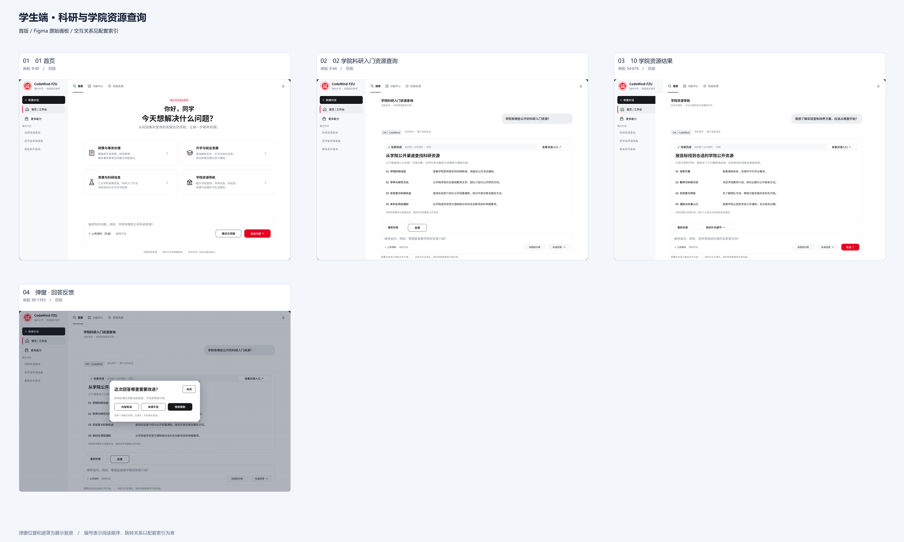
- [01 首页](https://www.figma.com/design/Wan3sZFRzZyAo8JtW3olYV/agent?node-id=9-40)
- [02 学院科研入门资源查询](https://www.figma.com/design/Wan3sZFRzZyAo8JtW3olYV/agent?node-id=9-44)
- [10 学院资源结果](https://www.figma.com/design/Wan3sZFRzZyAo8JtW3olYV/agent?node-id=54-676)
- [Overlay / 回答反馈](https://www.figma.com/design/Wan3sZFRzZyAo8JtW3olYV/agent?node-id=90-1393)

本组已配置跳转

- 01 首页 → Action / 发送问题 ↑ → 02 学院科研入门资源查询
- 01 首页 → Feature / resources → 10 学院资源结果
- 02 学院科研入门资源查询 → Action / 反馈 → Overlay / 回答反馈
- 02 学院科研入门资源查询 → Action / 查看资源入口 ↗ → 10 学院资源结果
- 02 学院科研入门资源查询 → Action / 重新检索 → 01 首页

## 学生端 · 推免条件与依据
首版
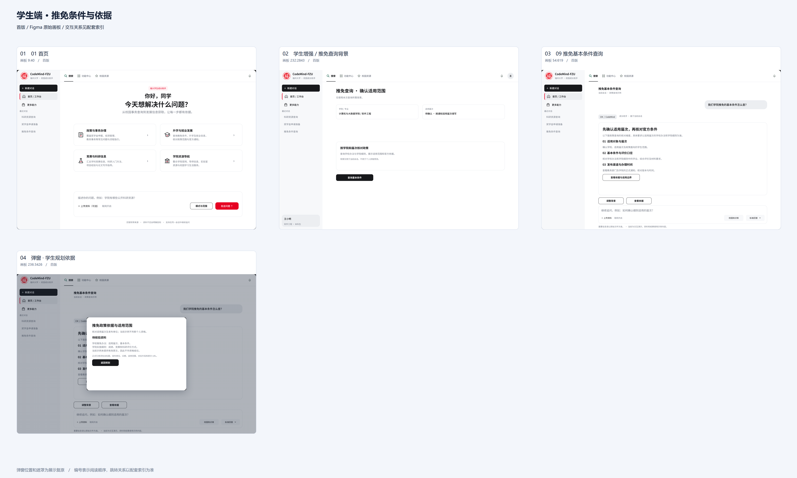
- [01 首页](https://www.figma.com/design/Wan3sZFRzZyAo8JtW3olYV/agent?node-id=9-40)
- [学生增强 / 推免查询背景](https://www.figma.com/design/Wan3sZFRzZyAo8JtW3olYV/agent?node-id=232-2843)
- [09 推免基本条件查询](https://www.figma.com/design/Wan3sZFRzZyAo8JtW3olYV/agent?node-id=54-619)
- [Overlay / 学生规划依据](https://www.figma.com/design/Wan3sZFRzZyAo8JtW3olYV/agent?node-id=236-3426)

本组已配置跳转

- 01 首页 → Feature / planning → 学生增强 / 推免查询背景
- 09 推免基本条件查询 → Action / 查看依据 → Overlay / 学生规划依据
- 09 推免基本条件查询 → Action / 查看依据与适用边界 → Overlay / 学生规划依据
- 09 推免基本条件查询 → Action / 调整背景 → 学生增强 / 推免查询背景
- 学生增强 / 推免查询背景 → Action / 按示例背景生成规划 → 09 推免基本条件查询

## 学生端 · 竞赛认定与依据
首版
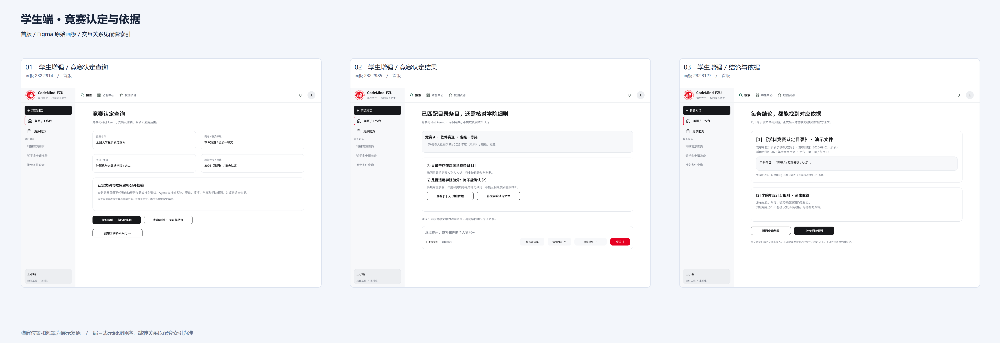
- [学生增强 / 竞赛认定查询](https://www.figma.com/design/Wan3sZFRzZyAo8JtW3olYV/agent?node-id=232-2914)
- [学生增强 / 竞赛认定结果](https://www.figma.com/design/Wan3sZFRzZyAo8JtW3olYV/agent?node-id=232-2985)
- [学生增强 / 结论与依据](https://www.figma.com/design/Wan3sZFRzZyAo8JtW3olYV/agent?node-id=232-3127)

本组已配置跳转

- 学生增强 / 竞赛认定查询 → Action / 查询示例 · 有匹配条目 → 学生增强 / 竞赛认定结果
- 学生增强 / 竞赛认定结果 → Action / 查看 [1] [2] 对应依据 → 学生增强 / 结论与依据
- 学生增强 / 结论与依据 → Action / 返回查询结果 → 学生增强 / 竞赛认定结果

## 学生端 · 竞赛证据不足与上传
首版
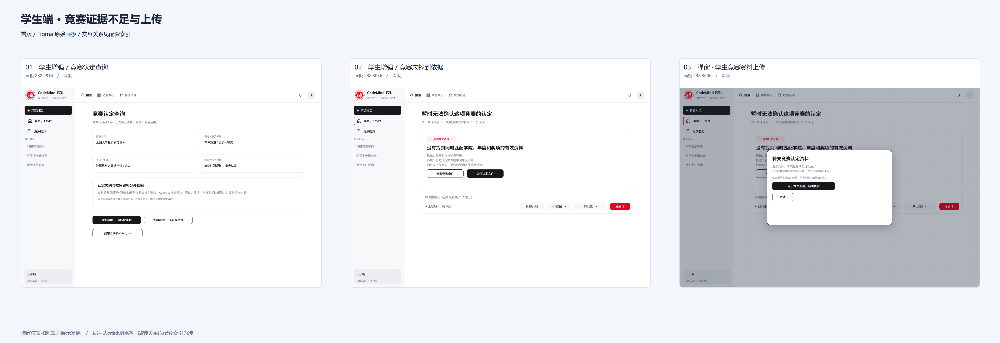
- [学生增强 / 竞赛认定查询](https://www.figma.com/design/Wan3sZFRzZyAo8JtW3olYV/agent?node-id=232-2914)
- [学生增强 / 竞赛未找到依据](https://www.figma.com/design/Wan3sZFRzZyAo8JtW3olYV/agent?node-id=232-3056)
- [Overlay / 学生竞赛资料上传](https://www.figma.com/design/Wan3sZFRzZyAo8JtW3olYV/agent?node-id=238-3606)

本组已配置跳转

- Overlay / 学生竞赛资料上传 → Action / 用于本次查询，继续核验 → 学生增强 / 竞赛未找到依据
- 学生增强 / 竞赛未找到依据 → Action / 上传认定文件 → Overlay / 学生竞赛资料上传
- 学生增强 / 竞赛未找到依据 → Action / 修改查询条件 → 学生增强 / 竞赛认定查询
- 学生增强 / 竞赛未找到依据 → Send → 学生增强 / 竞赛认定查询
- 学生增强 / 竞赛认定查询 → Action / 查询示例 · 无可靠依据 → 学生增强 / 竞赛未找到依据

## 学生端 · 临时资料上传与范围
首版
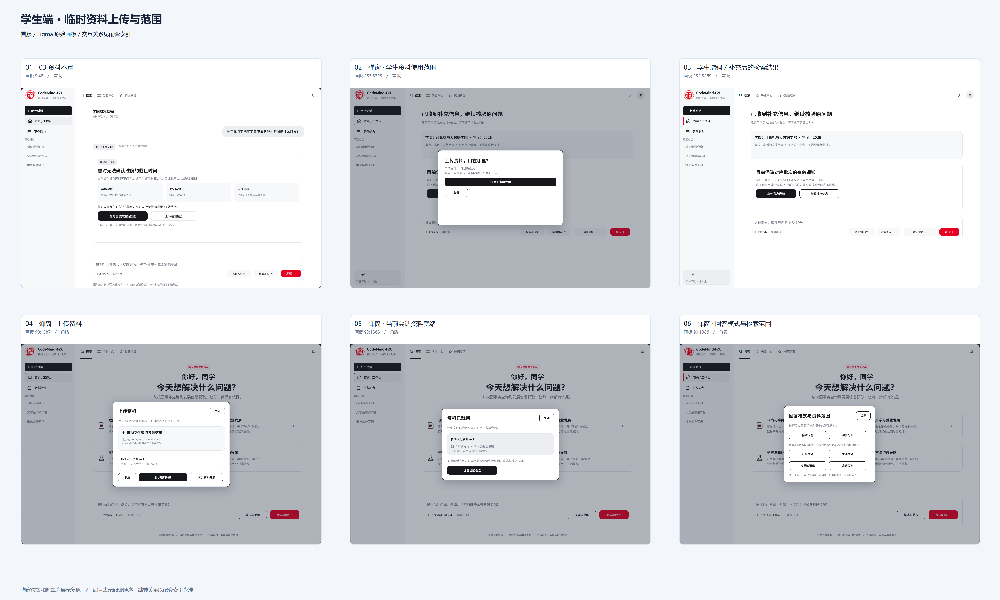
- [03 资料不足](https://www.figma.com/design/Wan3sZFRzZyAo8JtW3olYV/agent?node-id=9-48)
- [Overlay / 学生资料使用范围](https://www.figma.com/design/Wan3sZFRzZyAo8JtW3olYV/agent?node-id=233-3323)
- [学生增强 / 补充后的检索结果](https://www.figma.com/design/Wan3sZFRzZyAo8JtW3olYV/agent?node-id=232-3269)
- [Overlay / 上传资料](https://www.figma.com/design/Wan3sZFRzZyAo8JtW3olYV/agent?node-id=90-1387)
- [Overlay / 当前会话资料就绪](https://www.figma.com/design/Wan3sZFRzZyAo8JtW3olYV/agent?node-id=90-1388)
- [Overlay / 回答模式与检索范围](https://www.figma.com/design/Wan3sZFRzZyAo8JtW3olYV/agent?node-id=90-1386)

本组已配置跳转

- 03 资料不足 → Action / 查看可用资料线索 → Overlay / 学生资料使用范围
- 03 资料不足 → Knowledge Selector → Overlay / 回答模式与检索范围
- 03 资料不足 → Mode Selector → Overlay / 回答模式与检索范围
- 03 资料不足 → ◎ 联网检索已开启 → Overlay / 回答模式与检索范围
- 03 资料不足 → ＋ 上传资料 → Overlay / 上传资料
- Overlay / 上传资料 → Action / 演示解析并入库 → Overlay / 当前会话资料就绪
- Overlay / 学生资料使用范围 → Action / 仅用于当前会话 → 学生增强 / 补充后的检索结果
- 学生增强 / 补充后的检索结果 → Action / 上传官方通知 → Overlay / 学生资料使用范围
- 学生增强 / 补充后的检索结果 → Send → 03 资料不足

## 学生端 · 检索来源与工具记录
首版；高级工具授权另列后续迭代
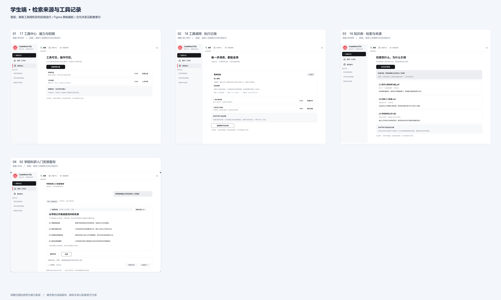
- [17 工具中心 · 能力与权限](https://www.figma.com/design/Wan3sZFRzZyAo8JtW3olYV/agent?node-id=90-953)
- [18 工具调用 · 执行记录](https://www.figma.com/design/Wan3sZFRzZyAo8JtW3olYV/agent?node-id=90-1007)
- [16 知识库 · 检索与来源](https://www.figma.com/design/Wan3sZFRzZyAo8JtW3olYV/agent?node-id=90-899)
- [02 学院科研入门资源查询](https://www.figma.com/design/Wan3sZFRzZyAo8JtW3olYV/agent?node-id=9-44)

本组已配置跳转

- 16 知识库 · 检索与来源 → Action / 在对话中使用 → 02 学院科研入门资源查询
- 17 工具中心 · 能力与权限 → Action / 查看调用记录 → 18 工具调用 · 执行记录
- 17 工具中心 · 能力与权限 → V4 / Data Row → 18 工具调用 · 执行记录
- 18 工具调用 · 执行记录 → V4 / Data Row → 16 知识库 · 检索与来源

## 学生端 · 账号注册与访客
后续迭代
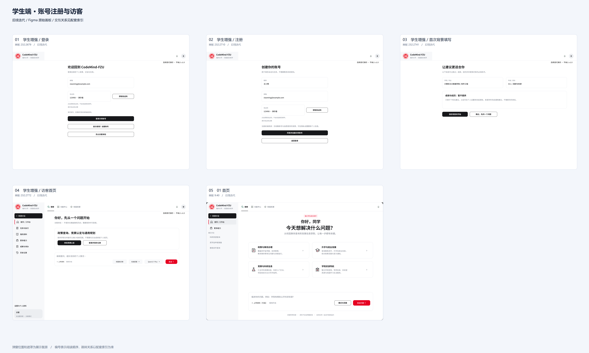
- [学生增强 / 登录](https://www.figma.com/design/Wan3sZFRzZyAo8JtW3olYV/agent?node-id=232-2679)
- [学生增强 / 注册](https://www.figma.com/design/Wan3sZFRzZyAo8JtW3olYV/agent?node-id=232-2710)
- [学生增强 / 首次背景填写](https://www.figma.com/design/Wan3sZFRzZyAo8JtW3olYV/agent?node-id=232-2741)
- [学生增强 / 访客首页](https://www.figma.com/design/Wan3sZFRzZyAo8JtW3olYV/agent?node-id=232-2772)
- [01 首页](https://www.figma.com/design/Wan3sZFRzZyAo8JtW3olYV/agent?node-id=9-40)

本组已配置跳转

- 学生增强 / 注册 · 后续迭代 → Action / 同意并创建示例账号 → 学生增强 / 首次背景填写 · 后续迭代
- 学生增强 / 注册 · 后续迭代 → Action / 返回登录 → 学生增强 / 登录 · 后续迭代
- 学生增强 / 登录 · 后续迭代 → Action / 先以访客体验 → 学生增强 / 访客首页 · 后续迭代
- 学生增强 / 登录 · 后续迭代 → Action / 登录示例账号 → 01 首页
- 学生增强 / 登录 · 后续迭代 → Action / 首次使用？创建账号 → 学生增强 / 注册 · 后续迭代
- 学生增强 / 访客首页 · 后续迭代 → Action / 登录并保存记录 → 学生增强 / 登录 · 后续迭代
- 学生增强 / 首次背景填写 · 后续迭代 → Action / 保存背景并开始 → 01 首页
- 学生增强 / 首次背景填写 · 后续迭代 → Action / 跳过，先问一个问题 → 01 首页

## 学生端 · 任务规划与执行
后续迭代
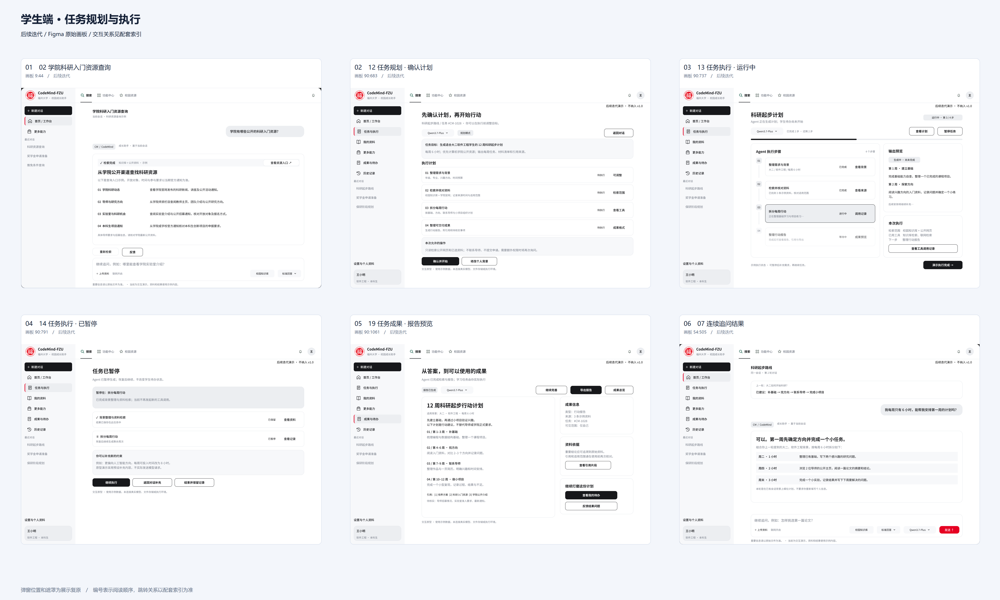
- [02 学院科研入门资源查询](https://www.figma.com/design/Wan3sZFRzZyAo8JtW3olYV/agent?node-id=9-44)
- [12 任务规划 · 确认计划](https://www.figma.com/design/Wan3sZFRzZyAo8JtW3olYV/agent?node-id=90-683)
- [13 任务执行 · 运行中](https://www.figma.com/design/Wan3sZFRzZyAo8JtW3olYV/agent?node-id=90-737)
- [14 任务执行 · 已暂停](https://www.figma.com/design/Wan3sZFRzZyAo8JtW3olYV/agent?node-id=90-791)
- [19 任务成果 · 报告预览](https://www.figma.com/design/Wan3sZFRzZyAo8JtW3olYV/agent?node-id=90-1061)
- [07 连续追问结果](https://www.figma.com/design/Wan3sZFRzZyAo8JtW3olYV/agent?node-id=54-505)

本组已配置跳转

- 02 学院科研入门资源查询 → Action / 查看成果报告 → 19 任务成果 · 报告预览 · 后续迭代
- 02 学院科研入门资源查询 → Action / 生成每周计划 → 07 连续追问结果 · 后续迭代
- 02 学院科研入门资源查询 → Action / 规划并执行 → 12 任务规划 · 确认计划 · 后续迭代
- 07 连续追问结果 · 后续迭代 → Send → 02 学院科研入门资源查询
- 12 任务规划 · 确认计划 · 后续迭代 → Action / 确认并开始 → 13 任务执行 · 运行中 · 后续迭代
- 12 任务规划 · 确认计划 · 后续迭代 → Action / 返回对话 → 02 学院科研入门资源查询
- 13 任务执行 · 运行中 · 后续迭代 → Action / 暂停任务 → 14 任务执行 · 已暂停 · 后续迭代
- 13 任务执行 · 运行中 · 后续迭代 → Action / 查看计划 → 12 任务规划 · 确认计划 · 后续迭代
- 13 任务执行 · 运行中 · 后续迭代 → Action / 演示执行完成 → 19 任务成果 · 报告预览 · 后续迭代
- 13 任务执行 · 运行中 · 后续迭代 → V4 / Data Row → 19 任务成果 · 报告预览 · 后续迭代
- 14 任务执行 · 已暂停 · 后续迭代 → Action / 继续执行 → 13 任务执行 · 运行中 · 后续迭代
- 14 任务执行 · 已暂停 · 后续迭代 → Action / 返回对话补充 → 07 连续追问结果 · 后续迭代
- 19 任务成果 · 报告预览 · 后续迭代 → Action / 继续完善 → 07 连续追问结果 · 后续迭代

## 学生端 · 成果与待办
后续迭代
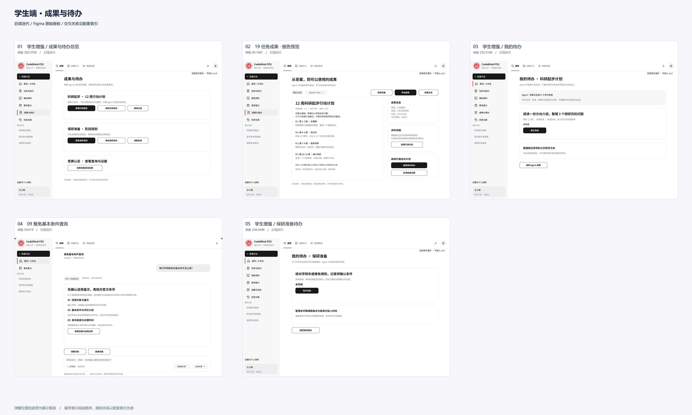
- [学生增强 / 成果与待办总览](https://www.figma.com/design/Wan3sZFRzZyAo8JtW3olYV/agent?node-id=292-3700)
- [19 任务成果 · 报告预览](https://www.figma.com/design/Wan3sZFRzZyAo8JtW3olYV/agent?node-id=90-1061)
- [学生增强 / 我的待办](https://www.figma.com/design/Wan3sZFRzZyAo8JtW3olYV/agent?node-id=232-3198)
- [09 推免基本条件查询](https://www.figma.com/design/Wan3sZFRzZyAo8JtW3olYV/agent?node-id=54-619)
- [学生增强 / 保研准备待办](https://www.figma.com/design/Wan3sZFRzZyAo8JtW3olYV/agent?node-id=236-3446)

本组已配置跳转

- 09 推免基本条件查询 → Action / 查看准备待办 → 学生增强 / 保研准备待办 · 后续迭代
- 19 任务成果 · 报告预览 · 后续迭代 → Action / 成果总览 → 学生增强 / 成果与待办总览 · 后续迭代
- 19 任务成果 · 报告预览 · 后续迭代 → Action / 生成每周详细安排 → 学生增强 / 我的待办 · 后续迭代
- 学生增强 / 保研准备待办 · 后续迭代 → Action / 返回保研规划 → 09 推免基本条件查询
- 学生增强 / 成果与待办总览 · 后续迭代 → Action / 查看保研规划 → 09 推免基本条件查询
- 学生增强 / 成果与待办总览 · 后续迭代 → Action / 查看科研报告 → 19 任务成果 · 报告预览 · 后续迭代
- 学生增强 / 成果与待办总览 · 后续迭代 → Action / 继续保研待办 → 学生增强 / 保研准备待办 · 后续迭代
- 学生增强 / 成果与待办总览 · 后续迭代 → Action / 继续科研待办 → 学生增强 / 我的待办 · 后续迭代
- 学生增强 / 我的待办 · 后续迭代 → Action / 返回 Agent 成果 → 19 任务成果 · 报告预览 · 后续迭代

## 学生端 · 历史恢复与删除
后续迭代
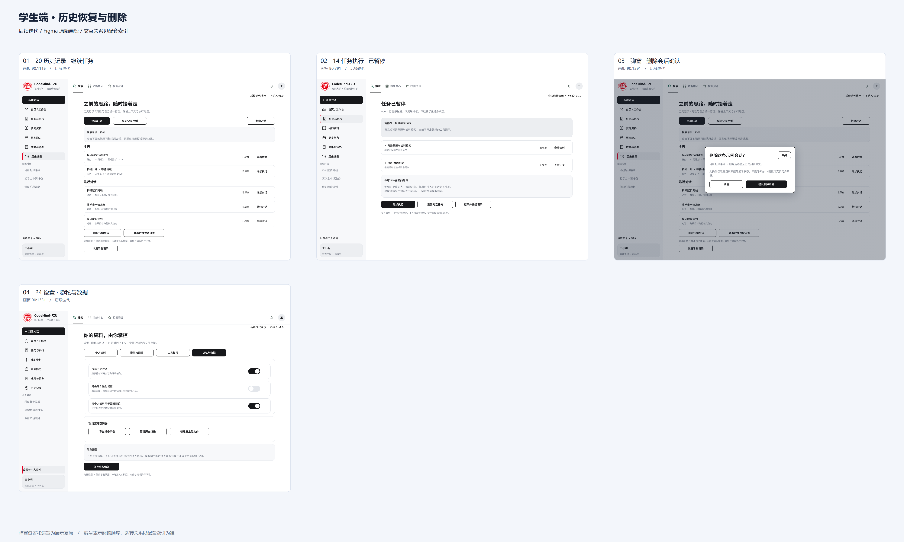
- [20 历史记录 · 继续任务](https://www.figma.com/design/Wan3sZFRzZyAo8JtW3olYV/agent?node-id=90-1115)
- [14 任务执行 · 已暂停](https://www.figma.com/design/Wan3sZFRzZyAo8JtW3olYV/agent?node-id=90-791)
- [Overlay / 删除会话确认](https://www.figma.com/design/Wan3sZFRzZyAo8JtW3olYV/agent?node-id=90-1391)
- [24 设置 · 隐私与数据](https://www.figma.com/design/Wan3sZFRzZyAo8JtW3olYV/agent?node-id=90-1331)

本组已配置跳转

- 14 任务执行 · 已暂停 · 后续迭代 → Action / 结束并保留记录 → 20 历史记录 · 继续任务 · 后续迭代
- 20 历史记录 · 继续任务 · 后续迭代 → Action / 删除示例会话… → Overlay / 删除会话确认 · 后续迭代
- 20 历史记录 · 继续任务 · 后续迭代 → Action / 查看数据保留设置 → 24 设置 · 隐私与数据 · 后续迭代
- 20 历史记录 · 继续任务 · 后续迭代 → V4 / Data Row → 14 任务执行 · 已暂停 · 后续迭代
- 24 设置 · 隐私与数据 · 后续迭代 → Action / 管理历史记录 → 20 历史记录 · 继续任务 · 后续迭代

## 学生端 · 个人资料与设置
后续迭代
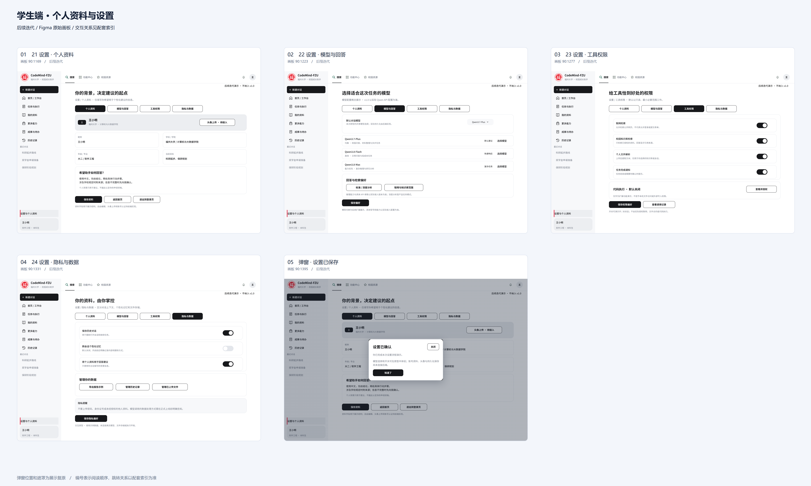
- [21 设置 · 个人资料](https://www.figma.com/design/Wan3sZFRzZyAo8JtW3olYV/agent?node-id=90-1169)
- [22 设置 · 模型与回答](https://www.figma.com/design/Wan3sZFRzZyAo8JtW3olYV/agent?node-id=90-1223)
- [23 设置 · 工具权限](https://www.figma.com/design/Wan3sZFRzZyAo8JtW3olYV/agent?node-id=90-1277)
- [24 设置 · 隐私与数据](https://www.figma.com/design/Wan3sZFRzZyAo8JtW3olYV/agent?node-id=90-1331)
- [Overlay / 设置已保存](https://www.figma.com/design/Wan3sZFRzZyAo8JtW3olYV/agent?node-id=90-1395)

本组已配置跳转

- 21 设置 · 个人资料 · 后续迭代 → Action / 保存资料 → Overlay / 设置已保存 · 后续迭代
- 21 设置 · 个人资料 · 后续迭代 → Action / 工具权限 → 23 设置 · 工具权限 · 后续迭代
- 21 设置 · 个人资料 · 后续迭代 → Action / 模型与回答 → 22 设置 · 模型与回答 · 后续迭代
- 21 设置 · 个人资料 · 后续迭代 → Action / 隐私与数据 → 24 设置 · 隐私与数据 · 后续迭代
- 22 设置 · 模型与回答 · 后续迭代 → Action / 个人资料 → 21 设置 · 个人资料 · 后续迭代
- 22 设置 · 模型与回答 · 后续迭代 → Action / 保存偏好 → Overlay / 设置已保存 · 后续迭代
- 22 设置 · 模型与回答 · 后续迭代 → Action / 工具权限 → 23 设置 · 工具权限 · 后续迭代
- 22 设置 · 模型与回答 · 后续迭代 → Action / 隐私与数据 → 24 设置 · 隐私与数据 · 后续迭代
- 23 设置 · 工具权限 · 后续迭代 → Action / 个人资料 → 21 设置 · 个人资料 · 后续迭代
- 23 设置 · 工具权限 · 后续迭代 → Action / 保存权限偏好 → Overlay / 设置已保存 · 后续迭代
- 23 设置 · 工具权限 · 后续迭代 → Action / 模型与回答 → 22 设置 · 模型与回答 · 后续迭代
- 23 设置 · 工具权限 · 后续迭代 → Action / 隐私与数据 → 24 设置 · 隐私与数据 · 后续迭代
- 24 设置 · 隐私与数据 · 后续迭代 → Action / 个人资料 → 21 设置 · 个人资料 · 后续迭代
- 24 设置 · 隐私与数据 · 后续迭代 → Action / 保存隐私偏好 → Overlay / 设置已保存 · 后续迭代
- 24 设置 · 隐私与数据 · 后续迭代 → Action / 工具权限 → 23 设置 · 工具权限 · 后续迭代
- 24 设置 · 隐私与数据 · 后续迭代 → Action / 模型与回答 → 22 设置 · 模型与回答 · 后续迭代

## 学生端 · 模型与工具授权
后续迭代
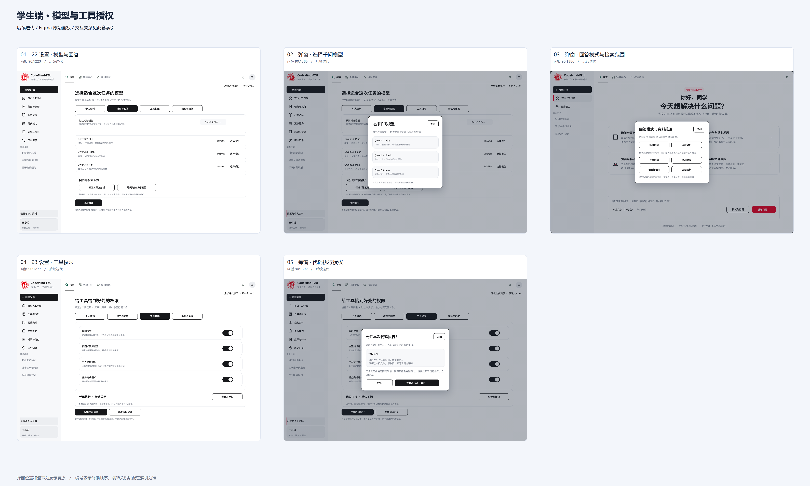
- [22 设置 · 模型与回答](https://www.figma.com/design/Wan3sZFRzZyAo8JtW3olYV/agent?node-id=90-1223)
- [Overlay / 选择千问模型](https://www.figma.com/design/Wan3sZFRzZyAo8JtW3olYV/agent?node-id=90-1385)
- [Overlay / 回答模式与检索范围](https://www.figma.com/design/Wan3sZFRzZyAo8JtW3olYV/agent?node-id=90-1386)
- [23 设置 · 工具权限](https://www.figma.com/design/Wan3sZFRzZyAo8JtW3olYV/agent?node-id=90-1277)
- [Overlay / 代码执行授权](https://www.figma.com/design/Wan3sZFRzZyAo8JtW3olYV/agent?node-id=90-1392)

本组已配置跳转

- 22 设置 · 模型与回答 · 后续迭代 → Action / 工具权限 → 23 设置 · 工具权限 · 后续迭代
- 22 设置 · 模型与回答 · 后续迭代 → Action / 标准 / 深度分析 → Overlay / 回答模式与检索范围
- 22 设置 · 模型与回答 · 后续迭代 → Action / 联网与知识库范围 → Overlay / 回答模式与检索范围
- 22 设置 · 模型与回答 · 后续迭代 → V4 / Data Row → Overlay / 选择千问模型 · 后续迭代
- 22 设置 · 模型与回答 · 后续迭代 → V4 / Model Selector → Overlay / 选择千问模型 · 后续迭代
- 23 设置 · 工具权限 · 后续迭代 → Action / 查看并授权 → Overlay / 代码执行授权 · 后续迭代
- 23 设置 · 工具权限 · 后续迭代 → Action / 模型与回答 → 22 设置 · 模型与回答 · 后续迭代

## 学生端 · 个人资料库
后续迭代；临时上传组件亦用于首版
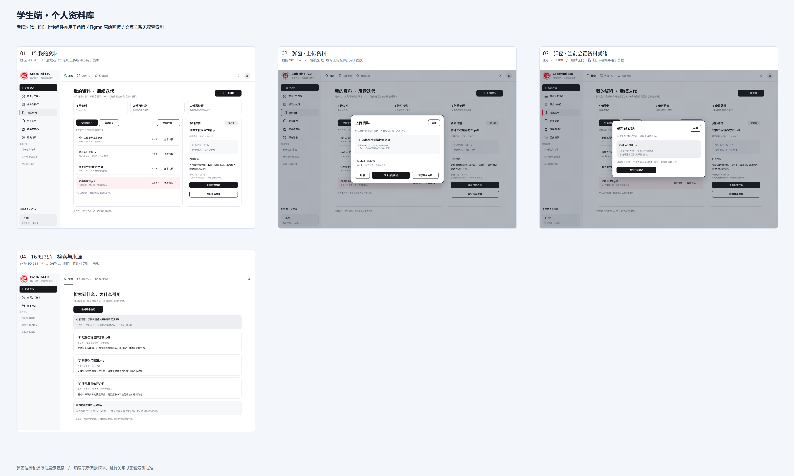
- [15 我的资料](https://www.figma.com/design/Wan3sZFRzZyAo8JtW3olYV/agent?node-id=90-845)
- [Overlay / 上传资料](https://www.figma.com/design/Wan3sZFRzZyAo8JtW3olYV/agent?node-id=90-1387)
- [Overlay / 当前会话资料就绪](https://www.figma.com/design/Wan3sZFRzZyAo8JtW3olYV/agent?node-id=90-1388)
- [16 知识库 · 检索与来源](https://www.figma.com/design/Wan3sZFRzZyAo8JtW3olYV/agent?node-id=90-899)

本组已配置跳转

- 15 我的资料 · 后续迭代 → Action / 查看检索片段 → 16 知识库 · 检索与来源
- 15 我的资料 · 后续迭代 → Action / 检索示例 → 16 知识库 · 检索与来源
- 15 我的资料 · 后续迭代 → Action / 重新上传 → Overlay / 上传资料
- 15 我的资料 · 后续迭代 → Action / ＋ 上传资料 → Overlay / 上传资料
- 15 我的资料 · 后续迭代 → V4 / Data Row → 16 知识库 · 检索与来源
- 16 知识库 · 检索与来源 → Action / ← 返回知识库 → 15 我的资料 · 后续迭代
- Overlay / 上传资料 → Action / 演示解析并入库 → Overlay / 当前会话资料就绪

## 学生端 · 成果导出与通知
后续迭代
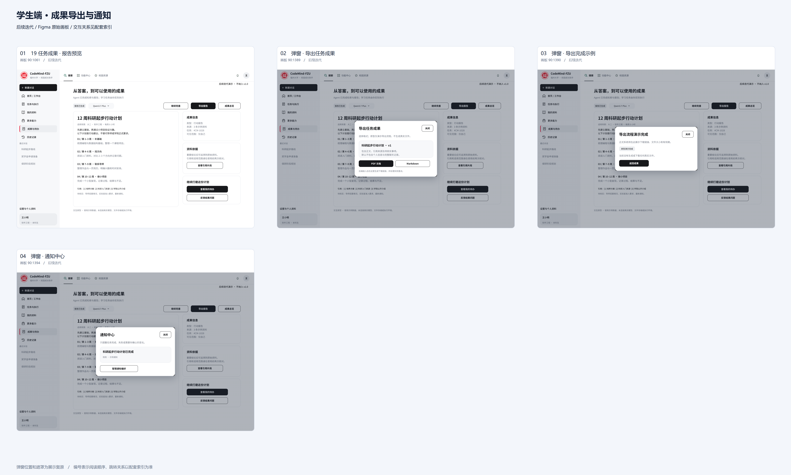
- [19 任务成果 · 报告预览](https://www.figma.com/design/Wan3sZFRzZyAo8JtW3olYV/agent?node-id=90-1061)
- [Overlay / 导出任务成果](https://www.figma.com/design/Wan3sZFRzZyAo8JtW3olYV/agent?node-id=90-1389)
- [Overlay / 导出完成示例](https://www.figma.com/design/Wan3sZFRzZyAo8JtW3olYV/agent?node-id=90-1390)
- [Overlay / 通知中心](https://www.figma.com/design/Wan3sZFRzZyAo8JtW3olYV/agent?node-id=90-1394)

本组已配置跳转

- 19 任务成果 · 报告预览 · 后续迭代 → Action / 导出报告 → Overlay / 导出任务成果 · 后续迭代
- 19 任务成果 · 报告预览 · 后续迭代 → Notifications → Overlay / 通知中心
- Overlay / 导出任务成果 · 后续迭代 → Action / Markdown → Overlay / 导出完成示例 · 后续迭代
- Overlay / 导出任务成果 · 后续迭代 → Action / PDF 文档 → Overlay / 导出完成示例 · 后续迭代
- Overlay / 通知中心 → Task notification → 19 任务成果 · 报告预览 · 后续迭代
