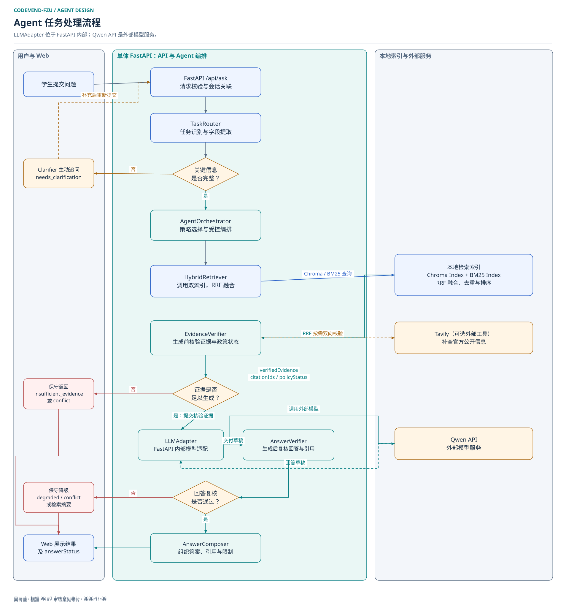
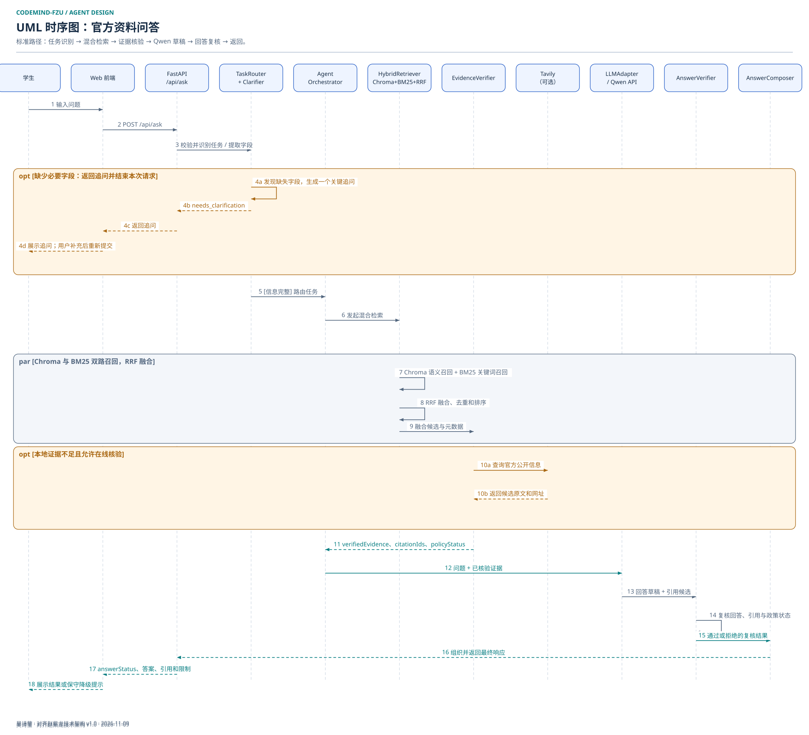
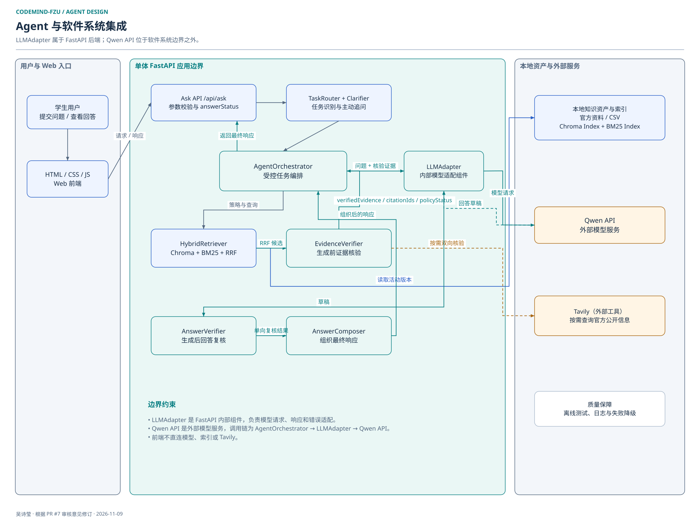

# Agent 流程与系统集成说明

负责人：吴诗莹  
版本：v1.2，2026-11-09
架构基线：[赵紫龙《技术架构设计说明》v1.0](../architecture/技术架构设计说明_赵紫龙_v1.md)

本文负责 Agent 工作流程、关键调用时序和系统集成说明。组件名称、调用方向和能力边界以团队技术架构为准。

## 1. Agent 流程图

流程与技术架构保持一致：

1. 学生通过 Web 前端提交问题，前端调用 FastAPI 的 `/api/ask`，不直接连接模型、索引或联网工具。
2. `TaskRouter` 识别任务并提取必要字段。信息不足时，`Clarifier` 返回一个关键追问和 `needs_clarification`；用户补充后重新提交请求。
3. 信息完整时，`AgentOrchestrator` 选择策略并调用 `HybridRetriever`。Chroma 与 BM25 双路召回后，由 RRF 融合、去重和排序。
4. `EvidenceVerifier` 在生成前核验证据的来源、日期、适用范围、时效和政策状态。本地证据不足且允许在线核验时，它按需调用 Tavily；Tavily 结果必须回到 `EvidenceVerifier`，不能直接交给生成模型。
5. `EvidenceVerifier` 向 `AgentOrchestrator` 返回 `verifiedEvidence`、`citationIds` 和 `policyStatus`，由 `AgentOrchestrator` 判断证据是否足以生成。证据不足或冲突时，系统返回 `insufficient_evidence` 或 `conflict`，不强行生成结论。
6. 仅当核验结果允许生成时，`AgentOrchestrator` 才调用 FastAPI 内部的 `LLMAdapter`，由适配器将问题和已核验证据提交给外部 Qwen API，并接收回答草稿与引用候选。
7. `AnswerVerifier` 在生成后复核回答、引用和政策状态。通过后由 `AnswerComposer` 组织最终答案、来源、限制和下一步建议，再沿 `AnswerComposer → AgentOrchestrator → FastAPI /api/ask → Web 前端` 返回；未通过时保守降级。

生成前的 `EvidenceVerifier` 与生成后的 `AnswerVerifier` 是两个不同步骤，不能合并为一次“核验证据”。

## 2. UML 时序图

时序图展示一次官方资料问答中的主要对象和消息顺序：

- 学生、Web 前端和 FastAPI 负责问题提交与结果展示。
- `TaskRouter + Clarifier` 负责任务识别和主动追问，不在检索前调用 Qwen 自由判断政策事实。
- `AgentOrchestrator` 调用 `HybridRetriever` 发起混合检索；`HybridRetriever` 在 `par` 片段中分别调用 `Chroma Index` 和 `BM25 Index`，两路候选返回后再交给 `RRF` 融合、去重和排序。
- `EvidenceVerifier` 接收融合候选，并可选调用 Tavily 补充官方原文。
- 核验结果先返回 `AgentOrchestrator`；由 `AgentOrchestrator` 决定是否调用 FastAPI 内部的 `LLMAdapter`，再由适配器调用外部 Qwen API 生成草稿。
- `AnswerVerifier` 复核草稿并单向交给 `AnswerComposer`；`AnswerComposer` 将组织后的结果返回 `AgentOrchestrator`，再由 `AgentOrchestrator` 交给 FastAPI `/api/ask`，最后由 FastAPI 返回 Web 前端。

图中的第一个 `opt` 表示主动追问分支，`par` 表示双路召回与 RRF 融合，第二个 `opt` 表示本地证据不足时的可选联网核验。

## 3. 集成说明

### 3.1 集成方式

v1.0 使用单体 FastAPI 应用承载 API 与 Agent 编排逻辑，不把 Agent 预设为独立微服务。HTML/CSS/JavaScript 前端只访问 FastAPI；FastAPI 内部包含 Ask API、任务路由、主动追问、Agent 编排、混合检索、证据核验、`LLMAdapter`、回答复核和回答组织等逻辑组件。Qwen API 是 FastAPI 边界外部的模型服务。

这种集成方式保持清晰的调用边界：前端不持有模型密钥，也不能绕过后端直接调用 Qwen、Tavily 或本地索引。

### 3.2 领域知识的作用

领域知识由学校和学院官方原文、中文整理稿、CSV 元数据以及 Chroma、BM25 索引组成，是政策回答的主要事实依据。Chroma 处理语义相近表达，BM25 保留政策名称、文号、年份等精确匹配能力，RRF 融合两路结果。

Chroma 与 BM25 应读取同一完整发布版本。检索结果只是候选资料，必须经 `EvidenceVerifier` 核验后才能提交给 Qwen。

### 3.3 工具与模型调用的作用

Tavily 是候选联网能力，只在本地证据不足、资料时效不明或需要补查当前官方信息时，由 `EvidenceVerifier` 受控调用。搜索结果需要回到官方原文核验，不能直接作为回答。

Web 前端通过 HTTP 请求调用 Ask API；Ask API 完成编排后通过独立的 HTTP 响应返回 `answerStatus`、最终答案及引用。请求与响应在集成图中使用两条方向相反的箭头表示。

`LLMAdapter` 是 FastAPI 内部的模型适配组件，负责封装模型请求、响应和错误；Qwen API 是外部模型服务。调用链固定为 `AgentOrchestrator → LLMAdapter → Qwen API`。Qwen 只负责基于 `verifiedEvidence` 组织回答草稿，不独立决定政策事实，草稿必须经过 `AnswerVerifier` 的引用存在性和政策状态复核。

### 3.4 任务流程的作用

任务流程把一次咨询拆分为请求校验、任务识别、主动追问、混合检索、生成前证据核验、证据约束生成、生成后回答复核和结果组织。每一步都有明确输入、输出和失败状态，使系统能够返回 `grounded`、`needs_clarification`、`insufficient_evidence`、`conflict` 或 `degraded`，而不是在资料不足时给出无依据结论。

## 4. 架构一致性约束

- 前端只调用 FastAPI，不直连 Qwen、Tavily、Chroma 或 BM25。
- Agent 编排逻辑属于单体 FastAPI 应用，不描述成已部署的独立微服务。
- `LLMAdapter` 位于 FastAPI 应用内部，Qwen API 位于系统边界外部；二者不得合并成同一个外部组件。
- 本地检索固定为 Chroma + BM25 + RRF，不省略融合步骤。
- UML 时序图使用 `par` 的两个操作数分别表示 Chroma 与 BM25 召回，RRF 在两路结果返回后执行。
- Tavily 结果返回 `EvidenceVerifier`，不直接进入 Qwen。
- Qwen 只接收生成前核验通过的证据。
- 回答草稿必须经过 `AnswerVerifier`，再由 `AnswerComposer` 返回最终结果。
- `AnswerVerifier → AnswerComposer` 为单向调用；最终响应必须沿 `AnswerComposer → AgentOrchestrator → FastAPI /api/ask → Web 前端` 返回，不能绕过 FastAPI。
