<!--
CodeMind-FZU 系统设计说明书（主稿）
维护：薛锦荣
说明：
1. 本文为 Markdown 主稿，构建脚本见 build/build.ps1，输出 docx 与 PDF。
2. 图、表编号按章编排；正文引用统一写作“图 x-y”“表 x-y”。
3. 本文描述目标设计，不等同于已实现功能。
-->

# 1 引言

## 1.1 编写目的

本文档是 CodeMind-FZU 校园事务与发展信息智能助手（以下简称“CodeMind-FZU”或“本系统”）的系统设计说明书。文档依据第一次团队作业的需求分析与开题方案、第二次团队作业的原型设计与各成员设计成果，对系统的总体架构、业务流程、用例、对象结构、Agent 设计、接口、数据结构、运行与维护方案进行统一说明。

本文档的预期读者包括：课程指导教师与助教、项目组全体成员、后续参与开发与测试的同学。文档用于统一团队对系统结构与技术边界的理解，作为详细设计、编码、测试和验收的依据，同时作为第二次团队作业“概要设计”部分的提交材料。

## 1.2 项目背景

福州大学计算机与大数据学院（软件学院）本科生在选课、考试、奖学金、综合素质评价、转专业、辅修、竞赛认定、推免升学等事务上，需要频繁查阅学校与学院发布的政策文件、通知和附件。这些资料分散在不同官网、通知页面和附件中，存在三个突出问题：信息入口分散、容易被群消息淹没、缺少统一检索手段。同时，通用大模型在回答具体年份、具体学院的规则时容易脱离依据，给出看似确定但无法核对的结论。

2026 年 10 月，项目组面向计算机相关专业学生发放问卷，回收有效样本 84 份。调研结果显示：76.19% 的受访者认为信息分散、不知道从哪里找；76.19% 的受访者担心信息不准确；61.90% 的受访者希望获得针对年级和专业的建议；升学与就业发展的重要程度评分为 4.43/5，学院资源导航为 4.38/5。该样本为小样本探索性调查，结论仅用于确定首版功能的优先级，不外推为全体学生意见。

基于上述背景，本系统以“领域知识库 + Agent”为核心，把分散的官方资料整理为可检索、可追溯的知识库，通过自然语言问答为学生提供有来源、可核对的政策咨询，并在证据不足时明确说明，而不是编造结论。

## 1.3 术语与缩略语

本文使用的术语与缩略语如表 1-1 所示。文中所有缩写首次出现时均给出中文全称或解释。

表 1-1　术语与缩略语

| 术语/缩写 | 全称或含义 | 说明 |
|---|---|---|
| CodeMind-FZU | 本系统名称 | 面向福州大学计算机与大数据学院本科生的校园事务与发展信息智能助手 |
| Agent | 智能体 | 承担任务识别、检索、证据核验、回答组织的软件组件 |
| LLM | 大语言模型（Large Language Model） | 用于理解问题与组织回答的生成式模型 |
| RAG | 检索增强生成（Retrieval-Augmented Generation） | 先检索知识库、再基于检索结果生成回答的技术路线 |
| Chroma | 向量数据库组件 | 保存资料分块的语义向量索引，用于语义召回 |
| BM25 | 关键词排序算法 | 基于词频、逆文档频率和文档长度的检索算法，用于精确匹配 |
| RRF | 倒数排名融合（Reciprocal Rank Fusion） | 融合语义与关键词两路候选并去重的排序方法 |
| Qwen | 通义千问模型服务 | 本系统选用的外部大语言模型 API |
| Tavily | 联网检索服务 | 候选联网核验工具，仅在本地证据不足时受控调用 |
| FastAPI | Python Web 后端框架 | 承载 API 与 Agent 编排逻辑的单体应用框架 |
| SQLAlchemy | Python ORM 框架 | 用于实体类与关系表映射，本设计采用 2.0 命令式映射 |
| PostgreSQL | 关系型数据库 | 数据库详细设计的候选技术基线，v1.0 未部署 |
| 知识库 | 领域知识库 | 经整理与核验的学校、学院政策资料及其元数据集合 |
| 意图识别 | — | 判断学生问题属于哪类事务、需要哪些信息的处理步骤 |
| 证据核验 | — | 对检索到的资料核对来源、发布日期、适用范围与核验状态的过程 |
| 核验状态 | — | 资料的可信程度标记，分为来源核验、时效核验与政策生命周期三个维度 |
| 溯源 | 来源追溯 | 回答中标注所依据资料的文件名、发布单位与发布日期 |
| answerStatus | 回答状态 | 取值为 grounded、needs_clarification、insufficient_evidence、conflict、degraded |
| MVP | 最小可行产品（Minimum Viable Product） | 本系统首版交付的最小功能闭环 |
| UC | 用例（Use Case） | 本文档第 3 章的用例编号 |
| TC | 测试用例（Test Case） | 需求分析文档中的验收用例编号 |
| UML | 统一建模语言（Unified Modeling Language） | 用例图、活动图、类图、时序图、通信图的建模语言 |
| ER | 实体—联系（Entity-Relationship） | 数据库概念模型 |
| ORM | 对象关系映射（Object-Relational Mapping） | 实体类与数据库表之间的映射 |
| API | 应用程序编程接口（Application Programming Interface） | 模块或服务之间约定的调用接口 |
| OCR | 光学字符识别（Optical Character Recognition） | 将扫描件图片转换为可检索文本的处理 |
| PoC | 概念验证（Proof of Concept） | 首版开发前用于验证接口与校验流程的离线测试 |

## 1.4 参考资料

1. 《2026 秋软件工程实践 第二次团队作业要求》（原型设计 + 概要设计）。
2. CodeMind-FZU 第一次团队作业《需求分析》文档及验收用例 TC-01～TC-07（待补链接）。
3. 《CodeMind-FZU 产品规划说明》v1.0（`diagrams/business-process/产品规划说明_v1.md`）。
4. 《CodeMind-FZU 业务流程说明》v1.0（`diagrams/business-process/业务流程说明_v1.md`）。
5. 《CodeMind-FZU 系统功能结构图说明》（`diagrams/function/模块职责说明_林世颖_v1.md`）。
6. 《CodeMind-FZU 系统用例规约》v3.4（`diagrams/uml/use-case/系统用例规约_颜俊宇_v3.md`）。
7. 《CodeMind-FZU 技术架构设计说明》v1.0（`diagrams/architecture/技术架构设计说明_赵紫龙_v1.md`）。
8. 《CodeMind-FZU UML 通信设计说明》v1.0（`diagrams/uml/communication/通信设计说明_赵紫龙_v1.md`）。
9. 《Agent 流程与系统集成说明》v1.1（`diagrams/agent-flow/Agent流程与系统集成说明_吴诗莹_v1.md`，随 PR #7 合入）。
10. 《CodeMind-FZU 数据库详细设计说明书》v1.2（`database-design/数据库详细设计说明书_v1.2.md`）。
11. 《CodeMind-FZU 知识库数据库概念设计》（`database-design/er/实体关系说明.md`）。
12. GB/T 8567—2006《计算机软件文档编制规范》。
13. OMG Unified Modeling Language Specification 2.5.1。
14. 团队仓库：https://github.com/yz-Yezi-Genm/CodeMind-FZU 。

## 1.5 文档约定

（1）本文档描述的是目标设计，不等同于已实现功能。截至 2026 年 11 月 9 日，知识库以 44 条资料为总量基准，其中 43 条完成正文提取、1 条扫描件待 OCR，13 条已有部分核查记录、31 条完成本地文件与来源登记核查但时效仍待联网复核。知识库尚未正式接入 Agent；Qwen 调用、混合检索效果、数据库部署和端到端联调均未完成，首版仅有 9 项离线 PoC 测试证明接口与校验流程可运行。凡涉及未实现内容，文中均以“设计”“计划”“待实现”表述。

（2）图、表按章编号：图号格式为“图 章号-序号”，表号格式为“表 章号-序号”，正文通过编号引用。

（3）设计成果的来源文件保存在团队仓库 `docs/assignment-02/` 下：原型在 `prototype/`，UML 与架构图在 `system-design/diagrams/`，数据库设计在 `database-design/`。

（4）本文档与《CodeMind-FZU 数据库设计说明书》的分工是：本文档说明数据对象、概念模型与存储管理方式；表结构、字段、约束、数据字典与完整 ORM 映射以数据库设计说明书为准，本文档仅给出汇总与引用。

（5）本文档中的类图（图 5-1）为整合稿：依据王智洋的 ORM 模型与林世颖的模块职责说明整理，用于统一全书的对象口径；若后续提交单独的类图，以最终版本替换。

# 2 系统总体设计

## 2.1 设计目标

本系统的设计目标可概括为以下六点：

1. **官方依据优先**：优先使用本地已登记、已提取正文的福州大学官方资料，不以模型记忆替代政策原文。
2. **回答可溯源**：每条确定结论至少能够追溯到一个来源，标注文件名、发布单位、发布日期、适用范围与核验状态。
3. **证据约束生成**：Qwen 只基于检索并核验后的证据片段组织答案，不自由补全政策结论。
4. **信息不足先追问**：缺少年级、专业、竞赛名称、年份或用途时，先请求补充，不猜测条件。
5. **不确定性显性化**：资料不足、版本冲突或时效无法确认时，明确提示限制并建议线下核实。
6. **渐进实现**：先完成可靠问答闭环，再扩展动态机会推荐、历史记录和个性化发展服务。

## 2.2 设计原则

（1）**官方来源优先**：知识库只收录学校、学院官方渠道发布的资料，逐条记录发布部门、日期、原文链接和核验状态。

（2）**版本可追溯**：同一事项的不同版本分别保存，过期资料标记为历史参考或已废止，不直接删除，保证回答能够区分现行政策与历史通知。

（3）**职责分离**：Web 与 API 层、Agent 编排层、检索与证据层、外部与知识层、质量保障层分层设计，层间通过明确接口交互；v1.0 采用单体 FastAPI 应用承载 API 与 Agent 编排，组件是逻辑划分，不代表已经拆分为独立微服务。

（4）**可解释、可审计**：检索结果、证据核验结论、工具调用记录、回答引用均保留记录，回答中的引用可回溯到原始资料。

（5）**信息最小化**：只收集完成当前问答所必需的信息，年级、专业、用途等由用户在必要时主动提供，不强制采集、不伪造用户身份。

（6）**不提前宣称效果**：领域知识库与 Agent 是否优于通用模型，以真实资料接入后的对照测试结果为准，文档中不使用未经测试的效果结论。

## 2.3 系统范围与边界

### 2.3.1 业务方向与首版范围

产品整体规划五大业务方向，首版（v1.0）优先支持前四个方向中有官方资料依据的查询与导航，第五个方向为后续迭代，如表 2-1 所示。

表 2-1　业务方向与首版范围

| 编号 | 业务方向 | 首版（v1.0）范围 |
|---|---|---|
| 1 | 政策与事务办理 | 奖学金、评优、申请条件与办理流程的官方资料查询 |
| 2 | 升学与就业发展 | 推免政策、升学要求与发展规划的政策查询 |
| 3 | 竞赛与科研信息 | 竞赛认定、赛事信息与科研机会的资料查询 |
| 4 | 学院资源导航 | 实验室、导师方向与本科生科研资源的查询与导航 |
| 5 | 个人成长档案与长期规划 | 后续迭代，不纳入 v1.0 |

自然语言问答、任务识别、知识检索、来源展示、证据核验和必要追问是五个方向共用的技术能力，不单独构成第六个业务方向。竞赛认定、奖学金申请、推免基本条件三个代表性测试任务只用于验证共用的 Agent 流程，不代表业务方向数量。

### 2.3.2 首版核心闭环

v1.0 只交付一条完整、可靠的核心查询闭环：

```
学生提问 → 信息不足时追问 → Chroma/BM25 混合检索 → 证据核验
        → 证据充分：Qwen 基于证据生成回答，展示来源与状态
        → 证据不足 / 版本冲突 / 时效未确认：如实提示，不编造结论
```

### 2.3.3 明确不做

以下内容不纳入 v1.0：完整的个性化升学规划、个人成长档案、动态机会自动推送、经验帖类 UGC 内容、ESP32 硬件联动、实名认证、即时聊天、地图定位、完整后台管理 Web 应用、独立数据库与消息队列部署。交换与出国属于“升学与就业发展”方向下的具体事项，但当前知识库缺少项目要求、申请条件和办理流程资料，不作为首版确定交付功能；遇到相关问题时，系统应说明资料尚未收录并建议向国际合作与交流主管部门核实。

后台维护在首版可以由脚本和人工审核完成；本次作业交付的后台管理原型用于说明后续形态，不作为 v1.0 必须上线的功能。

## 2.4 运行环境

本系统为 Web 软件，采用浏览器/服务器（B/S）结构，运行环境如表 2-2 所示。

表 2-2　运行环境

| 类别 | 要求 | 说明 |
|---|---|---|
| 客户端 | 主流桌面浏览器（Chrome、Edge、Firefox 等） | 学生端为 Web 页面，无需安装客户端 |
| 移动端 | 响应式布局，支持手机浏览器访问 | 首版以桌面端为主，移动端保证基本可用 |
| 服务端 | Python 3.10 及以上 | FastAPI 单体应用，承载 API 与 Agent 编排 |
| 语义检索 | Chroma 本地索引 | 与 Embedding 模型配套使用 |
| 关键词检索 | BM25 本地索引 | 保留政策名称、文号、年份等精确匹配能力 |
| 模型服务 | 可通过 HTTPS 调用的 Qwen API | 需要密钥与超时控制 |
| 联网核验 | Tavily（可选） | 仅在本地证据不足时受控调用 |
| 数据库 | PostgreSQL 16 + SQLAlchemy 2.0（候选技术基线） | 设计阶段基线；v1.0 是否部署待团队确认 |
| 网络 | 服务端可访问 Qwen 与 Tavily；客户端可访问服务端 | 校园网或公网部署均可 |

> **【待确认】** 部署方式（单机 / 容器）、服务器配置、端口与域名，以团队最终部署方案为准。

## 2.5 总体架构

系统采用分层逻辑架构，自顶向下由六个逻辑层组成，如图 2-1 所示。

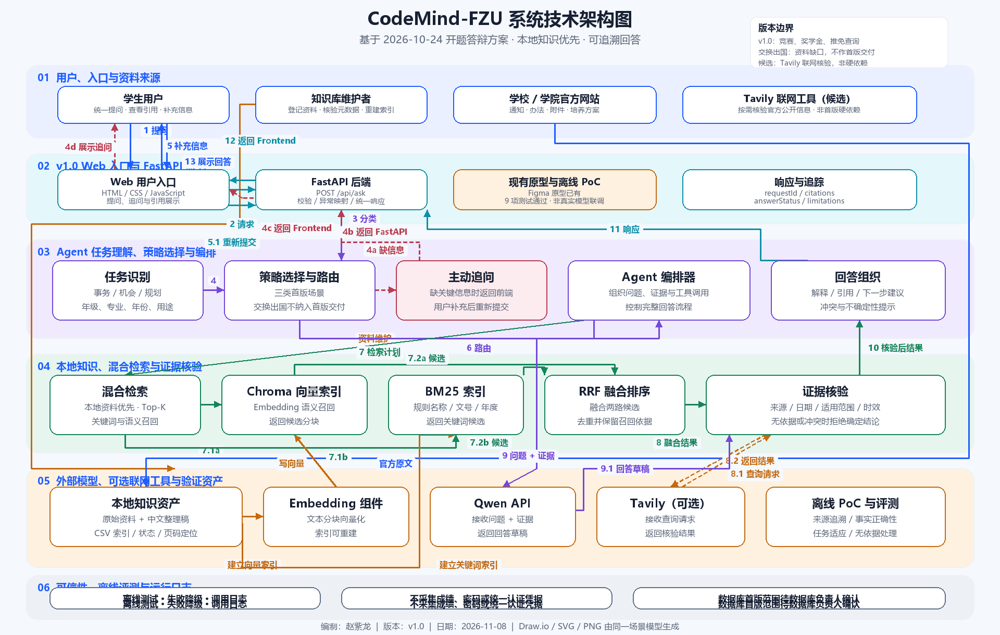{width=15cm}

各层职责如表 2-3 所示。

表 2-3　逻辑分层与职责

| 层级 | 主要组件 | 主要职责 |
|---|---|---|
| 用户与来源 | 学生、知识库维护者、学校/学院官网、Tavily | 发起问题、维护资料、提供官方信息与可选联网核验 |
| Web 与 API | HTML/CSS/JavaScript 前端、FastAPI、Ask API | 收集问题、校验请求、调用 Agent、返回答案与引用 |
| Agent 编排 | 任务识别、策略路由、主动追问、Agent 编排器、回答组织 | 判断任务类型、选择流程、处理信息缺口、组织输出 |
| 检索与证据 | 混合检索、Chroma、BM25、RRF、证据核验 | 召回候选、融合排序、校验来源、日期、适用范围与时效 |
| 外部与知识 | 本地资料、Embedding、Qwen API、Tavily、离线 PoC | 提供知识、向量化、生成与可选在线核验能力 |
| 质量保障 | 离线测试、失败降级、调用日志、资料更新记录 | 验证事实正确性、来源可追溯性与异常处理 |

### 2.5.1 组件边界

v1.0 使用单体 FastAPI 应用承载 API 与 Agent 编排逻辑，Chroma 和 BM25 作为本地索引组件运行。前端只访问 FastAPI，不直接连接 Qwen、Tavily、Chroma 或 BM25；模型密钥只通过后端环境变量注入。Agent 不作为独立微服务部署，其在系统中的位置与集成方式见第 6.8 节。

## 2.6 技术选型

技术选型如表 2-4 所示。前六项遵循第一次作业开题方案与赵紫龙的技术架构设计；数据库相关选型遵循王智洋的数据库详细设计，并明确其为候选技术基线。

表 2-4　技术选型

| 层次 | 选型 | 状态 | 说明 |
|---|---|---|---|
| 前端 | HTML、CSS、JavaScript | 已确定 | v1.0 Web 用户入口，含学生端页面与交互 |
| 后端 | Python + FastAPI | 已确定 | 请求校验、异常处理、接口与结果编排 |
| Agent | 任务识别、追问、检索、证据核验、回答生成 | 设计方向 | 作为 FastAPI 内部逻辑模块，不拆独立微服务 |
| 语义检索 | Embedding + Chroma | 设计方向 | 语义召回资料分块 |
| 关键词检索 | BM25 | 设计方向 | 精确匹配政策名称、文号、年度 |
| 融合排序 | RRF | 设计方向 | 两路候选融合、去重与排序 |
| 大模型 | Qwen API | 设计方向 | 基于证据组织回答，不自由补全政策事实 |
| 联网核验 | Tavily | 候选能力 | 默认按需启用，结果须回到官方原文核验 |
| 数据库 | PostgreSQL 16 + SQLAlchemy 2.0 命令式映射 | 候选基线 | 已通过 SQLite 建表与单元测试验证，未部署 |
| 部署 | 单机 FastAPI + 本地索引 | 待确认 | 以课程演示环境为准 |

## 2.7 功能结构

系统功能划分为学生端服务、后台管理端、Agent 核心服务三大一级模块，如图 2-2 所示。

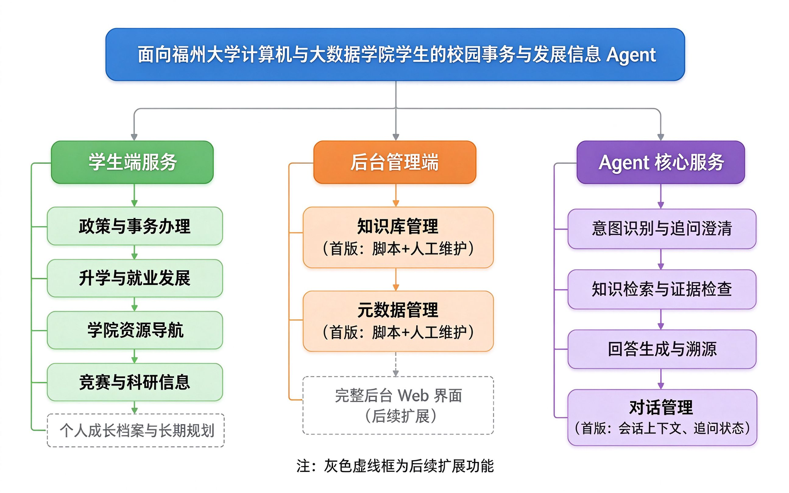{width=15.5cm}

各模块职责如表 2-5 所示。需要说明的是：后台管理端在 v1.0 以维护脚本和人工审核为主，本次作业交付的管理端原型用于说明后续 Web 管理端的页面与流程；Agent 核心服务在 v1.0 以 FastAPI 内部逻辑组件的形式存在。

表 2-5　功能模块划分

| 一级模块 | 二级模块 | 主要职责 |
|---|---|---|
| 学生端服务 | 首页与导航 | 政策热点推荐、常见问题入口、分类浏览、全局搜索入口 |
| 学生端服务 | 智能问答交互 | 自然语言提问、多轮对话、来源引用展示、追问澄清、回答反馈 |
| 学生端服务 | 政策分类查询 | 按学籍、奖助、竞赛、升学等分类浏览政策与通知 |
| 学生端服务 | 个人中心 | 历史对话、收藏与书签、个人偏好设置（部分为后续迭代） |
| 后台管理端 | 知识库管理 | 资料列表与检索、录入与编辑、审核发布、分类与标签 |
| 后台管理端 | 元数据管理 | 政策状态标注、适用范围、更新时间与核验记录 |
| 后台管理端 | 数据统计看板 | 问答量与热门问题、知识库覆盖、用户反馈汇总 |
| 后台管理端 | 用户与权限管理 | 管理员账号、角色权限、操作日志 |
| Agent 核心服务 | 意图识别 | 任务分类、关键实体抽取、信息完整性判断 |
| Agent 核心服务 | 知识检索引擎 | Chroma 语义检索、BM25 关键词检索、RRF 融合、来源定位 |
| Agent 核心服务 | 回答生成 | 证据约束生成、引用标注、可信度判断 |
| Agent 核心服务 | 对话管理 | 上下文维护、多轮状态管理、追问处理 |

## 2.8 角色与权限

系统的参与者分为学生（查询者）与知识库管理员（内容维护者）两类。知识库管理员在后台管理原型中进一步细分为系统管理员、资料维护员与只读运营三种后台角色，用于描述后续 Web 管理端的权限设计；v1.0 的维护工作可由项目组以脚本和人工审核方式承担。角色与权限如表 2-6 所示。

表 2-6　角色与权限

| 角色 | 主要权限 | 数据范围 | 首版状态 |
|---|---|---|---|
| 学生（查询者） | 提问、查看回答与来源、查看依据、提交反馈 | 本人会话与反馈 | v1.0 |
| 知识库管理员 | 资料收录、更新、归档，来源与时效核验，索引构建与发布 | 知识库资料与核验记录 | v1.0（脚本 + 人工） |
| 系统管理员 | 账号、角色与权限管理，系统配置 | 管理数据 | 后续 Web 管理端 |
| 资料维护员 | 资料录入、编辑、审核与发布 | 知识库资料 | 后续 Web 管理端 |
| 只读运营 | 查看统计、运行记录与审计，不修改数据 | 只读 | 后续 Web 管理端 |

# 3 用例分析

## 3.1 参与者

系统的参与者包括：

- **学生（查询者）**：以自然语言查询事务与政策信息，是系统的核心用户；可补充信息、查看回答依据、提交反馈。
- **知识库管理员（内容维护者）**：负责知识库资料的收录、更新、归档，以及来源与时效核验、索引构建与发布。

参与者是“角色”而非“部门”，同一自然人可扮演不同角色；系统不依赖部门组织，只依赖角色权限。

## 3.2 用例图

系统用例图如图 3-1 所示。

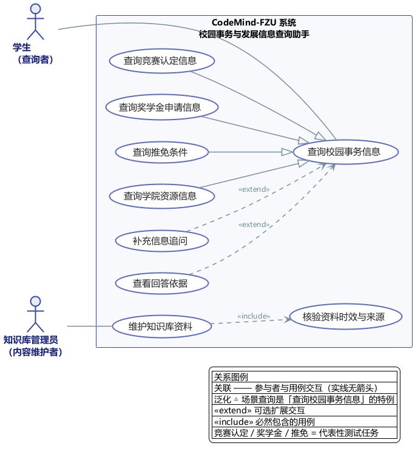{width=10.5cm}

用例图包含 1 个抽象基用例“查询校园事务信息”和 9 个具体用例。4 个查询类用例是抽象基用例的特例（泛化关系）；“补充信息追问”“查看回答依据”是从抽象基用例扩展的可选交互（extend）；“维护知识库资料”包含“核验资料时效与来源”（include），核验也可由管理员独立触发。用例清单如表 3-1 所示。

表 3-1　用例清单

| 编号 | 用例名称 | 参与者 | 说明 |
|---|---|---|---|
| UC-01 | 查询竞赛认定信息 | 学生 | 代表性测试任务：认定类别、规则及对综测/推免的影响 |
| UC-02 | 查询奖学金申请信息 | 学生 | 代表性测试任务：申请条件、材料、时间节点与流程 |
| UC-03 | 查询推免条件 | 学生 | 代表性测试任务：推免政策、成绩要求与适用范围；不预测个人资格 |
| UC-04 | 查询学院资源信息 | 学生 | 实验室方向、导师领域、本科生科研资源与办事渠道 |
| UC-05 | 维护知识库资料 | 知识库管理员 | 新增、更新、归档资料，经核验、质量检查与发布上线 |
| UC-06 | 核验资料时效与来源 | 知识库管理员 | 分别更新来源核验、时效核验与政策生命周期状态 |
| UC-07 | 补充信息追问 | 学生 | 扩展用例：信息不足时追问并重新提交 |
| UC-08 | 查看回答依据 | 学生 | 扩展用例：查看来源部门、日期、链接与核验状态 |
| UC-09 | 反馈回答问题 | 学生 | 记录反馈并关联回答与资料版本，供人工复核 |

## 3.3 关键用例说明

### 3.3.1 UC-01 查询竞赛认定信息

- **参与者**：学生（主）、Agent、知识库（辅）。
- **前置条件**：学生已进入查询界面；知识库已收录竞赛认定相关官方资料。
- **主成功场景**：
  1. 学生输入竞赛认定问题；
  2. 系统理解意图，检索竞赛认定规则；
  3. 系统核验资料来源、版本与时效；
  4. 系统展示认定类别、规则要点及对综测/推免的影响，并附官方来源；
  5. 学生获得有依据、可追溯的回答。
- **扩展流程**：
  - 1a. 信息不足（年级/专业/竞赛名称）：追问必要信息，学生补充后继续；
  - 3a. 证据不足：明确说明无官方依据，建议线下咨询学院，不编造结论；
  - 3b. 版本冲突或时效未确认：如实标注，提示以最新官方通知为准；
  - 4a. 查看依据：展示来源部门、日期、链接与核验状态。
- **后置条件**：获得有来源的回答，或明确的“无法作答”提示及线下核实建议。

### 3.3.2 UC-05 维护知识库资料（含 UC-06）

- **参与者**：知识库管理员（主）。
- **前置条件**：管理员具有知识库维护权限。
- **主成功场景**：
  1. 新增、更新或归档资料，补充来源部门、发布日期与链接；
  2. 执行核验（UC-06）：分别核验来源、时效与政策生命周期状态；
  3. 通过核验的资料进入索引构建与质量检查；
  4. 质量检查与离线测试通过后，经人工审核完成版本发布；
  5. 资料随完整版本上线，进入可检索状态。
- **扩展流程**：
  - 1a. 新旧资料冲突：保留两个版本，标注差异与时效，不直接覆盖；
  - 4a. 质量或测试未通过：发布中止，保留上一版可用版本；
  - 5a. 发布失败：回滚并保留上一版，查询侧始终只读取完整发布版本。
- **后置条件**：只有通过核验、质量检查、测试与人工审核的完整版本才切换上线。

### 3.3.3 UC-07、UC-08、UC-09

- **UC-07 补充信息追问**：系统判断信息不足时，向学生追问一个最关键问题；学生补充后重新提交，补充信息仅用于本次回答。
- **UC-08 查看回答依据**：学生点击查看依据，系统展示来源部门、发布日期、链接与核验状态，用于判断回答可信度。
- **UC-09 反馈回答问题**：学生对回答提交反馈，系统记录并关联回答与资料版本，供知识库管理员复核与改进。

## 3.4 用例与设计章节的对应

用例与后续设计章节的对应关系为：UC-01～UC-04 对应第 4 章业务流程与第 6 章 Agent 流程；UC-05、UC-06 对应第 4.2 节知识库维护流程与第 11 章维护设计；UC-07～UC-09 对应第 6 章交互设计与第 7 章接口设计。

# 4 业务流程设计

## 4.1 学生问答主流程

学生问答是系统的核心业务主线，流程如图 4-1 所示。

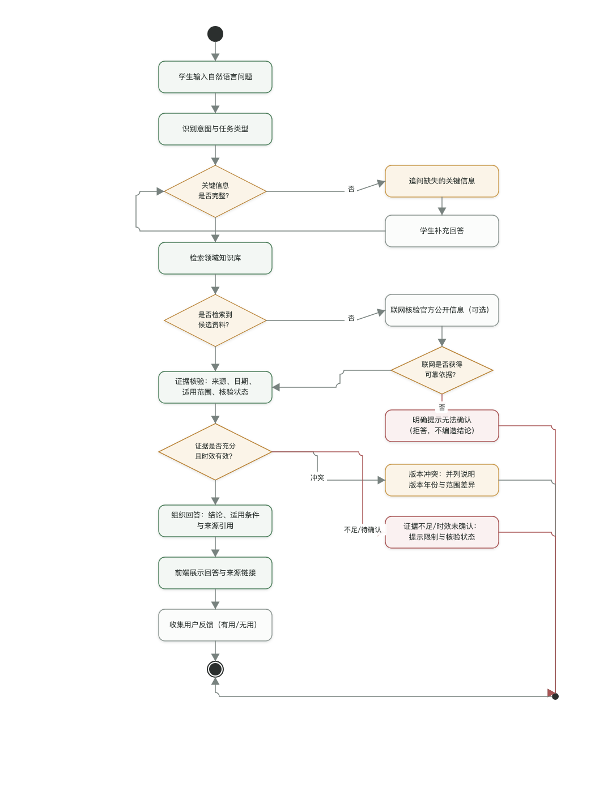{width=12cm}

流程说明：

1. 学生输入自然语言问题；
2. Agent 识别意图与任务类型；
3. 判断关键信息（事项名称、年份、年级专业、用途等）是否完整；
4. 信息完整后检索领域知识库；
5. 对候选资料进行证据核验，核对来源、发布日期、适用范围和核验状态；
6. 证据充分时组织回答，说明结论、适用条件和来源引用；
7. 前端展示回答与来源链接，并收集用户反馈。

## 4.2 知识库维护流程

知识库维护是保障回答质量的支撑主线，流程如图 4-2 所示。

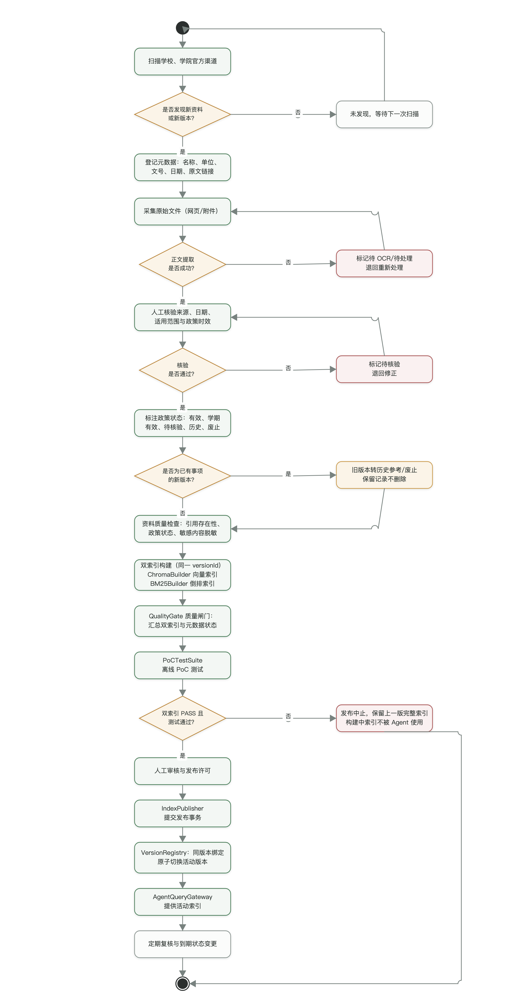{width=12cm}

流程说明：

1. 定期扫描学校、学院官方渠道，发现新资料或新版本；
2. 登记元数据：名称、发布单位、文号、日期、原文链接；
3. 采集原始文件（网页或附件）并提取正文；
4. 人工核验来源真实性、日期、适用范围和政策时效；
5. 标注政策状态：当前有效、学期有效、待核验、历史参考、已废止；
6. 发布入库，资料方可被 Agent 检索调用；
7. 定期复核，对到期或失效资料变更状态。

## 4.3 异常与退回分支

两条业务主线中的分支与退回情况如表 4-1 所示。

表 4-1　业务流程的分支与退回

| 场景 | 触发条件 | 处理方式 | 关联需求 |
|---|---|---|---|
| 关键信息不完整 | 缺少事项名称、年份、年级专业或用途 | 追问缺失信息，学生补充后重新判断，不自行猜测 | FR-03 |
| 知识库无候选资料 | 检索结果为空 | 可选择联网核验官方公开信息；仍无可靠依据则拒答 | FR-04、FR-07 |
| 联网获得可靠依据 | 联网检索到官方资料 | 回到证据核验环节，按正常路径处理 | FR-04 |
| 证据不足或时效未确认 | 资料不完整、状态待核验 | 提示限制与核验状态，建议线下核实 | FR-06、FR-07 |
| 资料版本冲突 | 同一事项存在多个有效版本 | 并列说明各版本年份与适用范围差异，提示进一步核实 | FR-08 |
| 正文提取失败 | 扫描件、图片型附件 | 标记待 OCR/待处理，退回重新采集 | — |

所有异常与拒答分支统一汇入结束节点，保证一次查询只有两种结局：带来源的回答，或明确的无法确认提示。

## 4.4 UML 活动图

业务流程图面向业务读者描述角色间的信息流转，UML 活动图则用规范符号精确表达控制流、决策与并行。系统包含两张关键活动图。

### 4.4.1 学生政策咨询活动图

学生政策咨询活动图如图 4-3 所示，覆盖“提问—意图识别—信息补全—检索—证据核验—回答”的完整控制流。

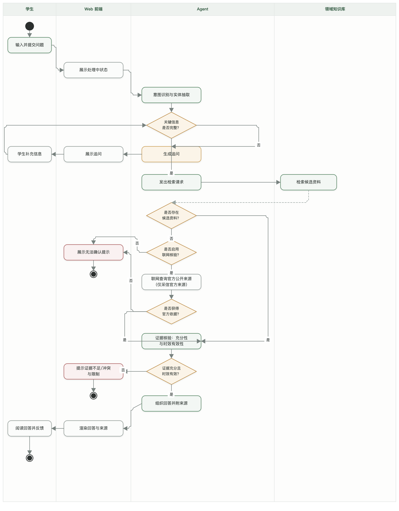{width=12.5cm}

图中的关键设计点：

- 追问循环只有一个出口，即信息完整后才允许检索，从流程上杜绝带缺失条件的猜测式回答；
- 冲突与不足分支不与最终回答汇合，而是作为独立终止路径，语义上与“给出确定答案”明确区分；
- 虚线箭头表示知识库向 Agent 返回检索结果，泳道按学生、Web 前端、Agent、领域知识库划分职责。

### 4.4.2 竞赛认定查询活动图

竞赛认定查询活动图如图 4-4 所示，对应代表性任务“某项竞赛如何认定，对综合素质评价和推免有什么影响”，并覆盖验收用例 TC-01～TC-07。

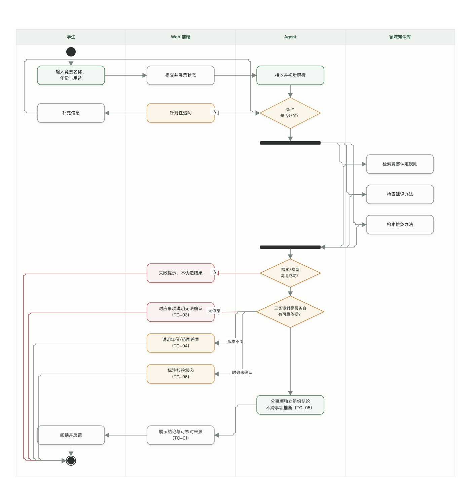{width=12.5cm}

该图体现的关键控制结构包括：条件不齐全时的追问循环（TC-02）、三类资料并行检索与汇合（TC-05）、检索或模型调用失败时的失败提示（TC-07）、依据不足时的分情况提示（TC-03、TC-04、TC-06），以及依据齐全时分事项独立组织结论（TC-01、TC-05）。

活动图与验收用例的对应关系如表 4-2 所示。

表 4-2　竞赛认定活动图与验收用例的对应关系

| 用例 | 活动图中的位置 |
|---|---|
| TC-01 资料充分 | 汇合后依据齐全，分事项组织结论并展示来源 |
| TC-02 条件不足 | 决策零与追问循环 |
| TC-03 无可靠资料 | 决策二“无依据”分支 |
| TC-04 版本不同 | 决策二“版本不同”分支 |
| TC-05 多事项分别处理 | 分叉并行检索与分事项独立组织结论 |
| TC-06 时效未确认 | 决策二“时效未确认”分支 |
| TC-07 检索或模型异常 | 决策一失败分支 |

## 4.5 业务流程与活动图的关系

业务流程图描述学生、前端、Agent、知识库之间的业务信息流转，并包含管理员侧的资料维护主线；活动图严格遵循 UML 语法，通过泳道、决策节点与同步条表达控制流，目前聚焦学生问答与竞赛场景。两组图内容同源、表达视角不同，在本文档中配合使用：第 4.1～4.3 节说明“谁在什么时候做什么”，第 4.4 节说明“控制流如何分支与汇合”。

# 5 系统结构与对象设计

## 5.1 分层结构

系统代码结构按职责分为五层，与第 2.5 节的逻辑架构对应：

- **表现层**：HTML/CSS/JavaScript 页面、组件与交互逻辑；
- **应用层**：FastAPI 路由、请求校验、异常映射、响应组织；
- **领域层**：任务识别、追问、Agent 编排、混合检索、证据核验、回答复核与组织；
- **基础设施层**：Chroma、BM25、文件与 CSV 元数据、Qwen 与 Tavily 客户端、日志与配置；
- **质量保障层**：离线测试、调用日志、失败降级与资料更新记录。

层间通过接口依赖，领域层不直接依赖具体模型供应商或索引实现，便于替换与测试。

## 5.2 类图

系统核心领域类图如图 5-1 所示。类图覆盖用户与会话、智能问答任务、领域知识库三组核心对象，实体类名与数据库详细设计中的 ORM 实体保持一致。

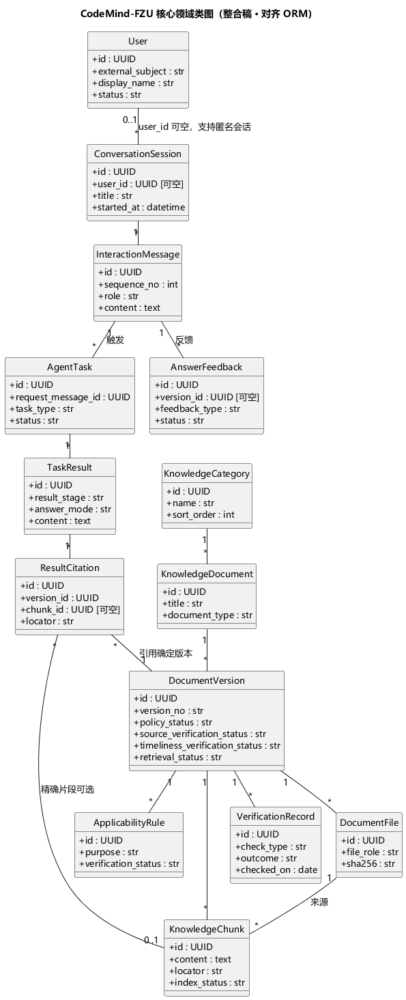{width=12cm}

类图说明：领域知识库按“分类—文档—版本”组织，版本下挂文件、适用规则、知识片段与核验记录；问答任务通过消息、任务、结果与引用形成可追溯链路，结果引用指向具体知识片段。为控制版面，图中未画出 AnswerFeedback、核验待办等业务表，其职责见表 5-1 与数据库设计说明书。

## 5.3 核心类职责

核心类及其职责如表 5-1 所示。

表 5-1　核心类职责

| 类 | 职责 | 主要关系 |
|---|---|---|
| User | 用户账号、角色与身份信息 | 一对多关联会话 |
| ConversationSession | 一次会话，维护会话状态与消息序列 | 属于 User，包含多条消息 |
| InteractionMessage | 一条消息，区分学生提问与助手回答 | 属于会话，可关联 Agent 任务 |
| AgentTask | 一次 Agent 处理任务，记录任务类型与状态 | 由消息触发，产生多条结果 |
| TaskResult | 一次任务的结果，携带 answerStatus | 属于任务，包含多条引用 |
| ResultCitation | 回答引用，指向知识片段与原文定位 | 属于结果，关联知识片段 |
| KnowledgeCategory | 知识主题分类（七类） | 一对多关联知识文档 |
| KnowledgeDocument | 政策或通知的逻辑身份 | 属于分类，包含多个版本 |
| DocumentVersion | 某一确定内容的版本与登记元数据 | 属于文档，包含文件、规则、片段与核验记录 |
| DocumentFile | 原始网页、附件、正文稿或整理稿 | 属于版本，可产生多个片段 |
| ApplicabilityRule | 某一版本的适用条件 | 属于版本 |
| KnowledgeChunk | 可供检索的正文片段 | 属于版本与文件，可被结果引用 |
| VerificationRecord | 核验记录，保存核验结论与时间 | 属于版本 |
| AnswerFeedback | 学生对回答的反馈 | 关联消息，可转入核验待办 |

## 5.4 对象协作关系

系统包含两张关键通信图：官方资料问答与知识资料维护。

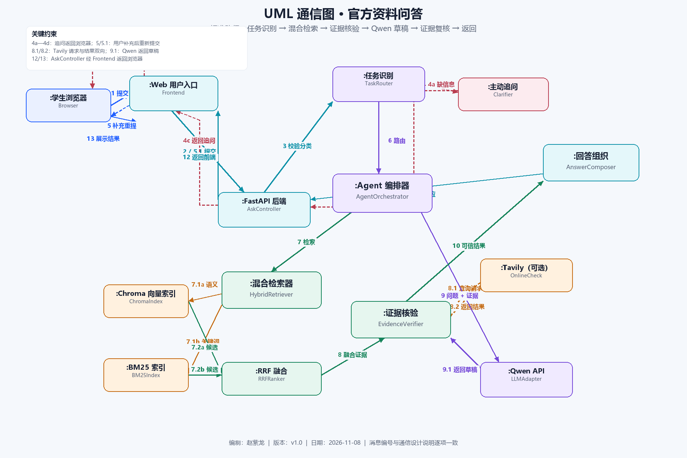{width=14cm}

问答通信的关键消息顺序为：浏览器提交问题 → 前端调用 `/api/ask` → AskController 校验 → TaskRouter 识别任务并抽取实体 → 信息不足时 Clarifier 生成追问 → AgentOrchestrator 调用 HybridRetriever → Chroma 与 BM25 双路召回 → RRF 融合 → EvidenceVerifier 核验 → Agent 将证据交给 LLMAdapter → Qwen 生成草稿 → AnswerVerifier 复核 → AnswerComposer 组织结果 → FastAPI 返回前端。主动追问与重新提交构成一条回路，用户补充信息后重新进入任务识别。

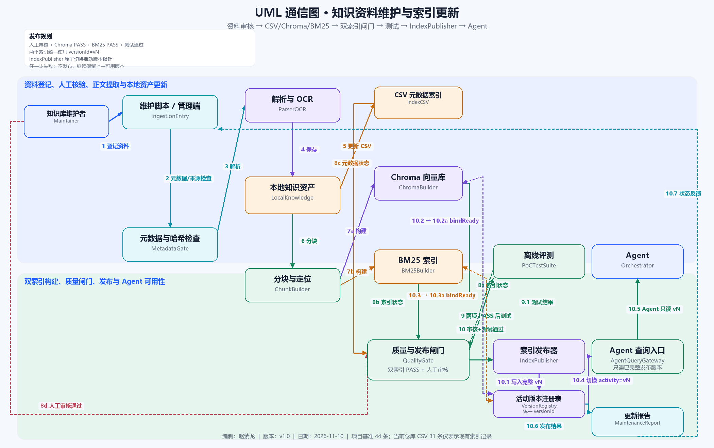{width=14cm}

知识维护通信的关键消息顺序为：维护者登记资料 → MetadataGate 校验来源与元数据 → ParserOCR 解析正文并标记 OCR 需求 → 更新本地知识与 CSV 索引 → ChunkBuilder 分块 → 双索引构建与质量检查 → IndexPublisher 发布版本 → VersionRegistry 切换活动指针 → AgentQueryGateway 读取完整发布版本。任一环节失败时不切换活动版本，查询侧继续使用上一版完整索引。

# 6 Agent 设计

## 6.1 设计目标与约束

Agent 的设计目标是在领域知识库范围内，为学生提供**可溯源、可核对、不编造**的政策咨询。其设计约束包括：

- 回答必须以知识库资料为依据，证据不足时拒答或提示核实；
- 生成前核验与生成后复核是两个独立步骤，不得合并为一次“核验证据”；
- 对同一事项的不同版本分别处理，不把历史政策当作现行政策；
- 多事项问题（如竞赛认定、综评、推免）分别检索、分别组织结论，不相互推断；
- 单次问答的响应时间应控制在可接受范围，检索与生成需要设置超时与降级策略；
- 所有检索、核验与工具调用记录可审计。

## 6.2 领域知识组织

领域知识由四部分组成：

| 资产 | 内容 | 作用 |
|---|---|---|
| 原始资料 | 官方 HTML、PDF、DOCX、XLSX 及附件 | 保存证据原件 |
| 中文整理稿 | 提取后的正文、标题、来源和适用范围 | 供检索与阅读 |
| CSV 元数据索引 | 编号、来源、日期、状态、适用对象和文件路径 | 统一登记资料 |
| 检索索引 | Chroma 向量索引与 BM25 倒排索引 | 提供混合召回 |

知识库以 44 条资料为总量基准，按政策或通知事项计数，网页与附件合并计算，共分 7 类。当前状态为：13 条已有部分核查记录但仍有待核项；31 条已完成本地文件与来源登记核查，时效仍待联网复核；44 条中 43 条已提取正文，1 条扫描版文件待 OCR。仓库中的 `知识库索引.csv` 只有 31 条现有索引记录，仅表示当前 CSV 的记录数量，不代表知识库总量。合并成果前必须由项目统筹和知识库维护者核对 CSV 条数与正文提取数量，不把“源文件存在”表述为“政策已联网复核”。

每条知识条目除正文外，还维护一组元数据：资料名称、发布单位、文号、发布日期、截止日期、适用范围（年级、专业、对象）、来源核验状态、时效核验状态、政策生命周期状态、核验记录、原文链接。三个核验维度分别记录，不互相替代。

## 6.3 Agent 处理流程

Agent 的处理流程如图 6-1 所示。

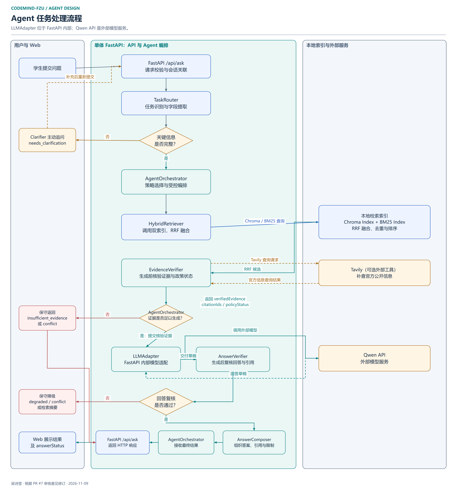{width=12.5cm}

处理流程分为六个阶段：

1. **请求与任务识别**：学生通过 Web 前端提交问题，前端调用 FastAPI 的 `/api/ask`；TaskRouter 识别任务类型并提取年级、专业、年份、用途等必要字段。
2. **信息补全**：信息不足时，Clarifier 返回一个最关键的问题和 `needs_clarification` 状态；学生补充后重新提交，重新进入任务识别。
3. **混合检索**：信息完整时，AgentOrchestrator 选择策略并调用 HybridRetriever，Chroma 与 BM25 双路召回，RRF 融合、去重与排序。
4. **生成前证据核验**：EvidenceVerifier 核验候选证据的来源、日期、适用范围、时效与政策状态；本地证据不足且允许在线核验时，按需调用 Tavily，结果必须回到 EvidenceVerifier。
5. **证据约束生成**：Agent 将问题与 `verifiedEvidence`、`citationIds`、`policyStatus` 交给 FastAPI 内部的 LLMAdapter，由适配器调用外部 Qwen API 生成回答草稿；Qwen 不直接面向用户。
6. **生成后复核与组织**：AnswerVerifier 复核草稿、引用存在性与政策状态；通过后由 AnswerComposer 组织最终答案、来源、限制与下一步建议，未通过时保守降级。

各阶段的输入输出与失败状态如表 6-1 所示。

表 6-1　Agent 阶段与输出

| 阶段 | 输入 | 输出 | 失败/异常处理 |
|---|---|---|---|
| 任务识别 | 问题、上下文 | 任务类型、实体 | 参数不合法时不进入检索 |
| 信息补全 | 缺失字段 | 追问问题、`needs_clarification` | 不调用 Qwen |
| 混合检索 | 查询计划 | 融合候选 | 单路失败时降级并标记 |
| 证据核验 | 融合候选、可选联网结果 | `verifiedEvidence`、`citationIds`、`policyStatus` | 证据不足返回 `insufficient_evidence` |
| 生成 | 问题、已核验证据 | 回答草稿、引用候选 | Qwen 超时返回检索摘要或降级 |
| 复核与组织 | 草稿、引用、政策状态 | 最终答案、来源、限制 | 引用不存在时删除结论或拒答 |

## 6.4 意图识别与信息补全

任务识别包括任务分类、实体抽取与信息完整性判断三个子任务：

- **任务分类**：区分事务咨询、机会筛选与后续预留的规划分支；v1.0 进入事务或机会查询，规划分支仅作预留。
- **实体抽取**：抽取年级、专业、政策事项、竞赛名称、年份、认定用途等关键实体。
- **完整性判断**：判断完成当前任务所必需的信息是否齐全，不齐全时进入追问。

信息补全遵循“必要且最少”的原则：只追问完成当前任务必需的信息，一次只问一个最关键的问题，避免一次索要过多信息。追问不调用 Qwen 自由判断政策事实，也不在检索前生成结论。

## 6.5 知识检索与证据核验

检索采用混合策略：Chroma 使用 Embedding 召回语义相关分块，BM25 召回规则名称、文号、年度、申请条件等关键词匹配，RRF 根据两路名次融合并去重。本地资料优先；只有问题需要当前动态信息且本地资料不足时，EvidenceVerifier 才向 Tavily 提交查询请求。

证据核验是系统可信度的关键环节，核验内容包括：

1. **来源核验**：资料是否来自学校、学院官方渠道；
2. **时效核验**：发布日期、截止日期是否在有效期内；
3. **适用范围核验**：资料适用年级、专业、对象是否与提问者条件匹配；
4. **一致性核验**：同一事项是否存在多个版本或相互矛盾的表述。

核验结论通过 `answerStatus` 表达：`grounded`（证据充分）、`needs_clarification`（信息不足）、`insufficient_evidence`（证据不足）、`conflict`（版本或规则冲突）、`degraded`（模型或联网工具不可用）。只有 `grounded` 进入正常回答流程。

## 6.6 工具调用

Agent 通过受控工具访问系统能力与外部信息，工具清单如表 6-2 所示。所有工具调用由后端编排，模型只提出建议，不直接执行外部调用。

表 6-2　Agent 工具清单

| 工具 | 作用 | 调用方 | 约束 |
|---|---|---|---|
| Chroma 语义检索 | 召回语义相近的资料分块 | HybridRetriever | 使用与索引一致的 Embedding 模型 |
| BM25 关键词检索 | 召回名称、文号、年度等精确匹配 | HybridRetriever | 保留原始名次供 RRF 融合 |
| RRF 融合 | 融合两路候选并去重 | HybridRetriever | 两路结果均返回后执行 |
| 联网核验（Tavily） | 补查当前官方公开信息 | EvidenceVerifier | 默认关闭，仅在本地证据不足时调用；结果须回到官方原文核验 |
| 证据查询 | 读取资料详情与元数据 | EvidenceVerifier | 只读，不修改知识库 |
| 模型生成（Qwen） | 基于已核验证据生成回答草稿 | LLMAdapter | 只接收生成前核验通过的证据 |

## 6.7 回答生成与来源标注

回答采用结构化组织方式，通常包含四部分：

1. **结论**：直接回答用户问题，说明适用条件；
2. **依据**：列出所依据的资料名称、发布单位、发布日期与政策状态；
3. **限制**：说明证据不足之处、版本差异或需要线下核实的环节；
4. **来源链接**：提供原文链接或资料标识，便于学生核对。

当问题涉及多个事项时，按事项分别组织结论，每个结论独立标注来源，不把一个事项的规则推断到另一个事项。引用链接必须指向官方原文或仓库中可追溯的原始资料；只有在原始链接不可用时才使用本地整理稿作为替代，并明确标记。

## 6.8 与软件系统的集成方式

Agent 与软件系统的集成关系如图 6-2 所示。

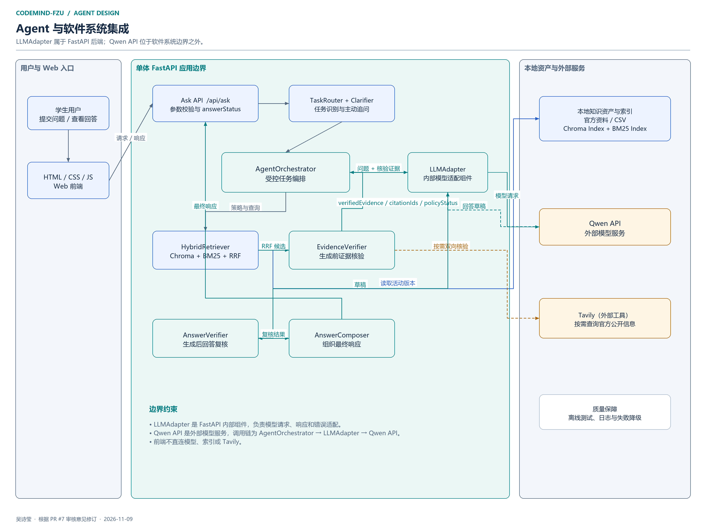{width=15cm}

v1.0 使用单体 FastAPI 应用承载 API 与 Agent 编排逻辑，不把 Agent 预设为独立微服务。HTML/CSS/JavaScript 前端只访问 FastAPI；FastAPI 内部包含 Ask API、任务路由、主动追问、Agent 编排、混合检索、证据核验、LLMAdapter、回答复核和回答组织等逻辑组件；Qwen API 是 FastAPI 边界外部的模型服务，Tavily 是可选外部工具。

这种集成方式保持清晰的调用边界：前端不持有模型密钥，也不能绕过后端直接调用 Qwen、Tavily 或本地索引。管理端发布资料后触发索引更新，使 Agent 能够检索到最新内容；应用层与 Agent 分别记录请求、检索、工具调用与回答日志，形成可追溯链路。

## 6.9 关键场景时序图

“学生提问—检索—核验—回答”关键场景的时序图如图 6-3 所示。

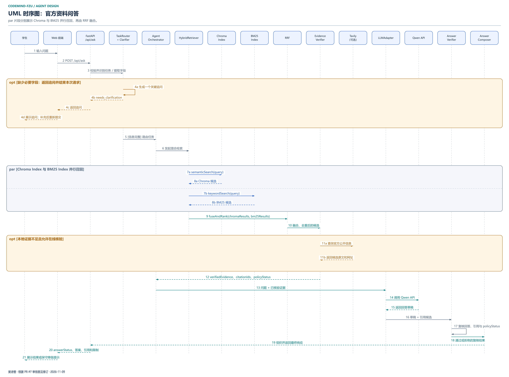{width=15.5cm}

时序图展示的主要对象和消息顺序为：学生、Web 前端与 FastAPI 负责问题提交与结果展示；TaskRouter 与 Clarifier 负责任务识别和主动追问；AgentOrchestrator 调用 HybridRetriever 发起混合检索，Chroma 与 BM25 在 `par` 片段中并行召回，两路候选返回后由 RRF 融合；EvidenceVerifier 接收融合候选并可选调用 Tavily；核验结果返回 Agent 后，Agent 调用 LLMAdapter，再由适配器调用 Qwen API 生成草稿；AnswerVerifier 复核草稿并单向交给 AnswerComposer；AnswerComposer 将结果返回 AgentOrchestrator，再经 FastAPI `/api/ask` 返回前端。

## 6.10 Agent 设计的一致性约束

为保证各图与文档一致，Agent 设计遵循以下约束：

- 前端只调用 FastAPI，不直连 Qwen、Tavily、Chroma 或 BM25；
- Agent 编排逻辑属于单体 FastAPI 应用，不描述成已部署的独立微服务；
- LLMAdapter 位于 FastAPI 内部，Qwen API 位于系统边界外部，二者不合并为同一外部组件；
- 本地检索固定为 Chroma + BM25 + RRF，不省略融合步骤；
- Tavily 结果返回 EvidenceVerifier，不直接进入 Qwen；
- Qwen 只接收生成前核验通过的证据；
- 回答草稿必须经过 AnswerVerifier，再由 AnswerComposer 返回最终结果；
- 最终响应沿 AnswerComposer → AgentOrchestrator → FastAPI `/api/ask` → Web 前端返回，不绕过 FastAPI。

# 7 接口设计

## 7.1 用户界面设计

### 7.1.1 学生端

学生端页面包括首页与导航、智能问答、政策分类查询、资料详情、个人中心。界面设计要求：

- 问答页面以对话流展示，回答中的来源以卡片或脚注形式呈现；
- 追问与澄清以独立消息展示，避免与最终回答混淆；
- 证据不足、版本冲突等提示使用醒目的提示样式，不使用确定性措辞；
- 分类浏览与搜索入口在首页可见。

学生端首页与问答结果如图 7-1、图 7-2 所示，资料不足提示如图 7-3 所示。完整页面与交互见仓库 `prototype/student/` 及 Figma 在线原型。

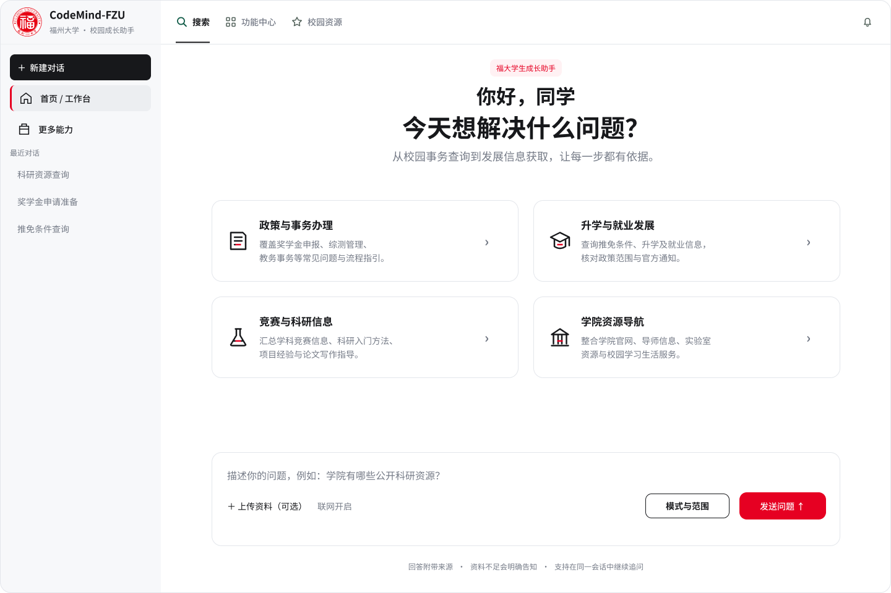{width=11.5cm}

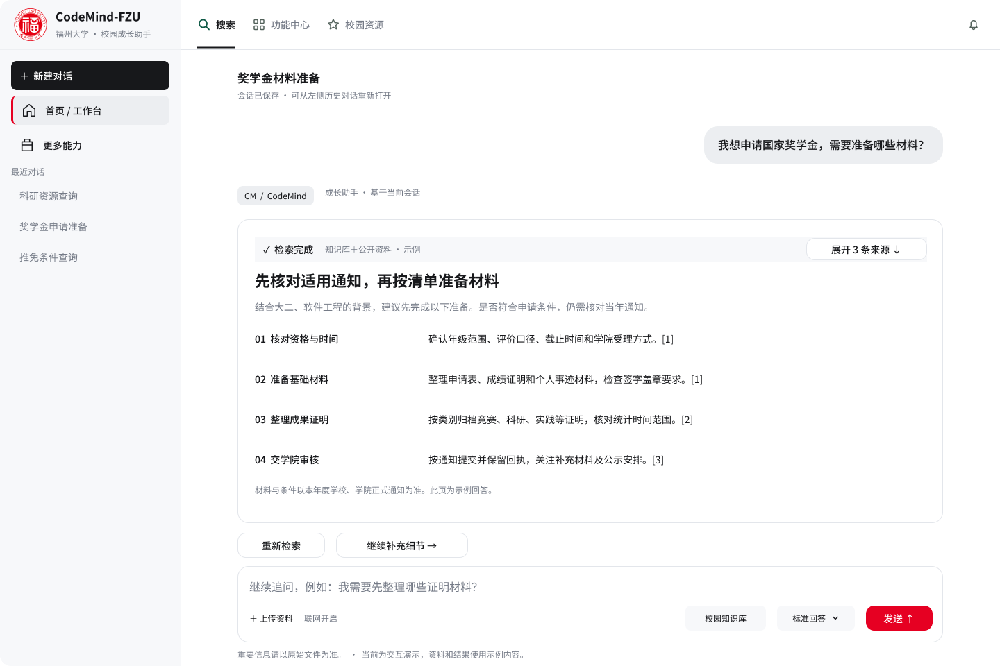{width=11.5cm}

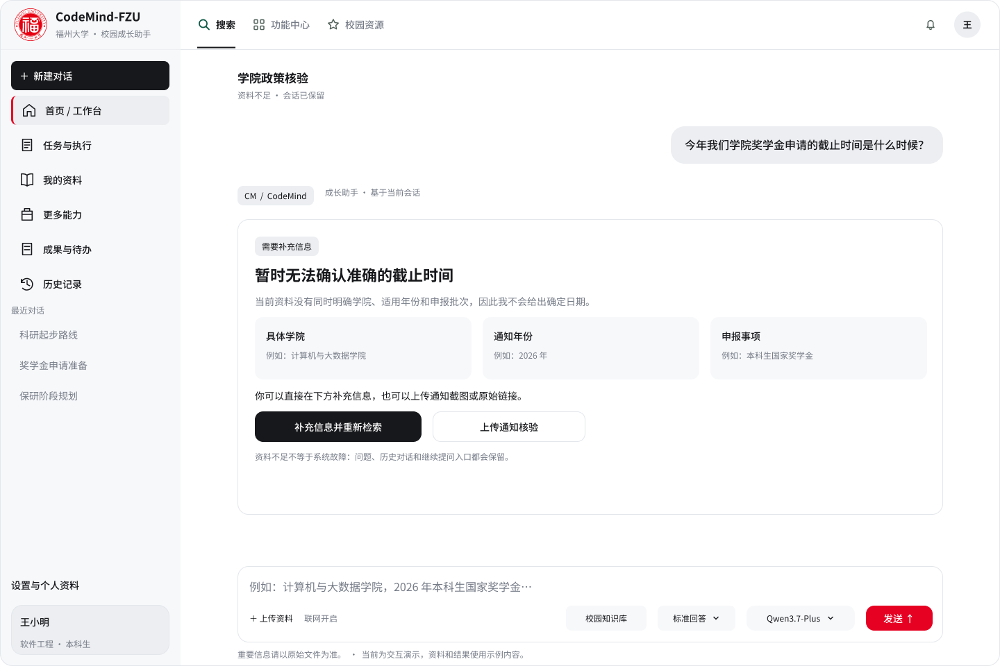{width=11.5cm}

### 7.1.2 管理端

管理端页面包括管理概览、资料审核与发布、资料编辑、用户管理、角色与权限、数据来源与索引、运行记录、反馈处理与操作审计。界面设计要求：

- 资料列表支持按标题、分类、状态、时间筛选；
- 编辑页同时展示原始资料、整理稿与元数据，便于核对；
- 审核页突出显示来源、日期、适用范围与核验状态；
- 统计看板展示问答量、热门问题、覆盖情况与反馈汇总。

管理概览与资料审核页面如图 7-4、图 7-5 所示。完整页面见仓库 `prototype/admin/screenshots/` 与 Figma 在线原型。

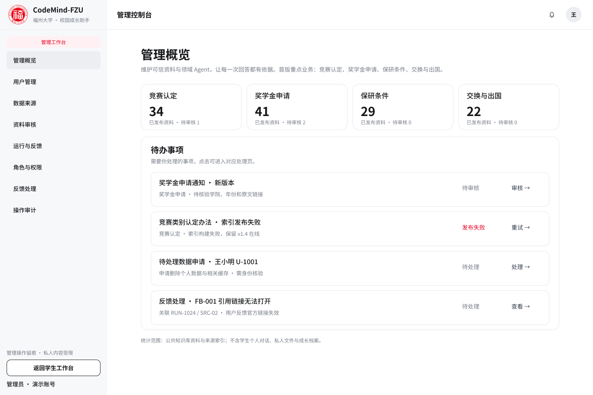{width=11.5cm}

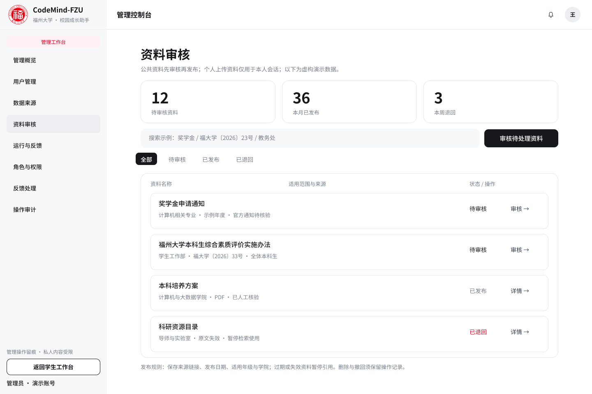{width=11.5cm}

## 7.2 外部接口

系统外部接口如表 7-1 所示。

表 7-1　外部接口

| 接口 | 提供方 | 用途 | 协议/格式 | 说明 |
|---|---|---|---|---|
| Qwen API | 模型服务商 | 基于已核验证据生成回答草稿 | HTTPS/JSON | 需要密钥与超时控制，由 LLMAdapter 封装 |
| Tavily | 联网检索服务 | 补查当前官方公开信息 | HTTPS/JSON | 默认关闭，仅在本地证据不足时调用 |
| Chroma | 本地组件 | 语义检索 | 本地调用 | 与 BM25 同一版本发布 |
| BM25 | 本地组件 | 关键词检索 | 本地调用 | 保留政策名称、文号、年度匹配 |
| 官方资料源 | 学校、学院官网 | 知识库资料采集 | 人工采集或离线脚本 | 运行时不直接抓取 |
| 文件存储 | 本地文件系统 | 保存原始资料与附件 | 文件路径 | 记录 SHA-256 校验值 |

## 7.3 内部接口

系统内部接口如表 7-2 所示，具体实现以技术架构与后端代码为准。

表 7-2　内部接口

| 接口 | 调用方 | 被调用方 | 说明 |
|---|---|---|---|
| `POST /api/ask` | Web 前端 | FastAPI | 提交问题与上下文，返回回答、状态与引用 |
| `GET /api/health` | 运维/监控 | FastAPI | 检查服务、Chroma 与 BM25 可用性，标明外部能力状态 |
| 任务识别 | AskController | TaskRouter | 校验并分类请求，抽取实体 |
| 主动追问 | TaskRouter | Clarifier | 根据缺失字段生成一个关键追问 |
| 混合检索 | AgentOrchestrator | HybridRetriever | 查询计划、Top-K 限制 |
| 证据核验 | HybridRetriever/RRF | EvidenceVerifier | 融合候选、可选联网结果 |
| 模型生成 | AgentOrchestrator | LLMAdapter | 问题与已核验证据 |
| 回答复核 | LLMAdapter | AnswerVerifier | 草稿、引用与政策状态 |
| 资料维护 | 维护脚本/管理端 | 知识库与索引 | 录入、审核、发布与索引更新 |

问答接口的请求与响应示例如下：

```json
{
  "question": "大二申请转专业需要什么条件？",
  "context": { "grade": "大二", "major": "计算机科学与技术" }
}
```

```json
{
  "requestId": "req_demo",
  "answer": "根据现行办法……",
  "answerStatus": "grounded",
  "citations": [
    {
      "documentId": "fzu-transfer-2025",
      "title": "福州大学本科生转专业管理实施办法",
      "publisher": "福州大学",
      "publishedAt": "2025-05-21",
      "applicableGrade": ["大一", "大二"],
      "policyStatus": "current_reference",
      "sourceUrl": "https://example.fzu.edu.cn/official-policy",
      "locator": "第三章"
    }
  ],
  "limitations": []
}
```

## 7.4 接口约定

（1）所有接口采用 JSON 作为数据格式，字符编码为 UTF-8。

（2）统一返回结构包含 `requestId`、`answer`、`answerStatus`、`citations` 与 `limitations`；错误码与提示语见第 10 章。

（3）接口需要设置超时与重试策略：模型调用与检索调用分别设置超时，超时后返回明确的失败提示，不返回不完整结果。

（4）首版没有登录体系时，不伪造用户身份或持久化个人信息；`context` 仅保存当前请求需要的年级、专业和目标。

（5）管理端接口（后续迭代）需要身份认证与角色校验；学生端接口按请求或会话标识隔离数据。

（6）接口变更需要同步更新本文档与前端契约，避免前后端不一致。

# 8 数据结构设计

## 8.1 数据对象与存储需求

系统数据分为知识数据与业务数据两类：

- **知识数据**：知识分类、知识文档、文档版本、文档文件、适用规则、知识片段、业务方向、核验记录与核验待办；
- **业务数据**：用户、会话、消息、Agent 任务、任务结果、结果引用、办理节点、反馈及关联记录。

存储方式上，结构化数据的关系模型以 PostgreSQL 16 + SQLAlchemy 2.0 为候选技术基线，已通过 SQLite 建表与 21 项单元测试验证，但尚未部署线上数据库；向量索引存入 Chroma，关键词索引存入 BM25，原始文件与附件存入文件系统，三类存储通过资料标识关联。数据库部署、业务服务、Agent 接入与在线迁移均未实施。

## 8.2 概念模型（ER 图）

知识库概念模型如图 8-1 所示。

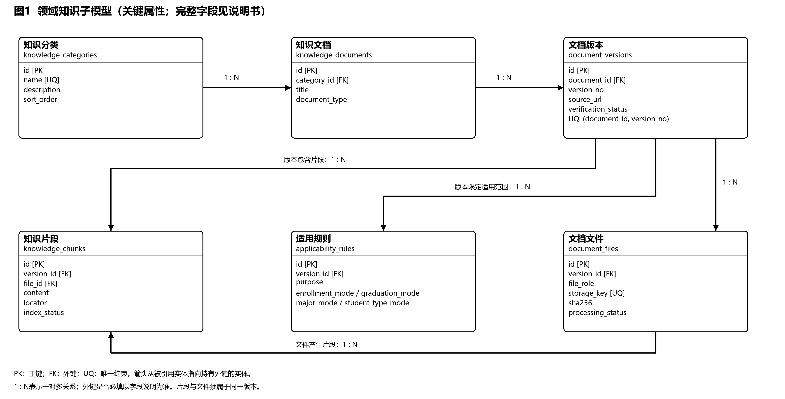{width=15cm}

知识库按“分类—文档—版本”组织，核心实体如表 8-1 所示。

表 8-1　知识库核心实体

| 实体 | 对应表名 | 保存的信息 |
|---|---|---|
| 知识分类 | knowledge_categories | 知识主题；编号、名称、说明、展示顺序 |
| 知识文档 | knowledge_documents | 政策或通知的逻辑身份；编号、分类、标题、资料类型 |
| 文档版本 | document_versions | 某一版本的内容与元数据；来源、日期、政策状态、来源核验、时效核验、提取与检索状态 |
| 文档文件 | document_files | 版本对应的原始网页、附件、正文稿或整理稿；文件角色、存储位置、校验值、处理状态 |
| 适用规则 | applicability_rules | 版本的使用条件；入学年级、毕业届别、专业、学生类别、用途 |
| 知识片段 | knowledge_chunks | 可检索的正文段落；内容、定位、索引状态、来源文件 |

实体之间的关系为：分类 1:N 文档，文档 1:N 版本，版本 1:N 文件、适用规则、知识片段与核验记录，文件 1:N 知识片段。文档登记后可以暂时没有版本，版本登记后可以暂时没有文件或片段；已存在的子记录必须关联父记录。

## 8.3 关系模型

数据库详细设计在 6 个核心实体的基础上扩展为 23 张表、233 个字段，覆盖知识库资料、版本、文件、适用规则、检索片段，以及业务方向标签、核查记录与待办、用户会话、Agent 任务、任务结果、回答引用、办理节点、文件来源链与反馈闭环。表清单如表 8-2 所示。

表 8-2　数据库表清单

| 序号 | 表名 | 实体类 | 说明 |
|---|---|---|---|
| 1 | knowledge_categories | KnowledgeCategory | 七类知识主题 |
| 2 | knowledge_documents | KnowledgeDocument | 政策或通知的逻辑身份 |
| 3 | document_versions | DocumentVersion | 版本与登记元数据 |
| 4 | document_files | DocumentFile | 原始文件、附件、正文稿与整理稿 |
| 5 | applicability_rules | ApplicabilityRule | 版本的适用规则 |
| 6 | applicability_rule_values | ApplicabilityRuleValue | 适用条件的具体取值 |
| 7 | knowledge_chunks | KnowledgeChunk | 可检索的正文片段 |
| 8 | business_directions | BusinessDirection | 五大业务方向 |
| 9 | document_business_directions | DocumentBusinessDirection | 文档与业务方向的多对多关联 |
| 10 | verification_records | VerificationRecord | 核验记录，只追加不覆盖 |
| 11 | verification_tasks | VerificationTask | 核验待办 |
| 12 | users | User | 用户账号与身份 |
| 13 | conversation_sessions | ConversationSession | 会话 |
| 14 | interaction_messages | InteractionMessage | 消息 |
| 15 | agent_tasks | AgentTask | Agent 任务 |
| 16 | task_results | TaskResult | 任务结果 |
| 17 | result_citations | ResultCitation | 结果引用与溯源 |
| 18 | document_milestones | DocumentMilestone | 办理节点与时间精度 |
| 19 | document_file_sources | DocumentFileSource | 文件派生来源链 |
| 20 | message_result_links | MessageResultLink | 消息与结果的多对多关联 |
| 21 | document_version_relations | DocumentVersionRelation | 版本替代、补充与配套关系 |
| 22 | answer_feedback | AnswerFeedback | 回答反馈 |
| 23 | feedback_review_links | FeedbackReviewLink | 反馈与核验待办的关联 |

关键约束包括：同一文档内版本号唯一；文档文件与知识片段通过 `(file_id, version_id)` 复合外键保证同版本；知识片段必须关联来源文件与文档版本；来源核验、时效核验与政策生命周期分别记录，不互相替代；反馈可转入核验待办，形成闭环。完整字段、类型、约束、索引与 DDL 见《数据库设计说明书》。

## 8.4 ORM 映射

ORM 采用 SQLAlchemy 2.0 命令式映射（`registry.map_imperatively`），`models.py` 为可导入的模型源文件，不包含数据库连接凭据。UUID 由应用层生成，`updated_at` 由业务服务显式维护，未配置自动更新时间触发器。实体类与表名一一对应，字段名与列名一致；关系属性用于对象导航，底层外键与约束为最终依据。组合主键关联类不设单独 id。时间存储采用 UTC，展示按 Asia/Shanghai 转换；政策生效等日历日期使用 DATE。禁止依赖 ORM 级联删除政策证据。

## 8.5 知识库与运行数据的存储管理

（1）**知识库版本管理**：同一事项的新旧版本分别保存，旧版本标记为历史参考或已废止，不物理删除；每次核验产生一条核验记录。

（2）**双索引版本发布**：Chroma 与 BM25 必须作为同一个知识版本共同发布。两个索引在构建时使用同一个 `versionId`，均通过质量检查后才进入离线测试；测试通过后由 IndexPublisher 提交给 VersionRegistry，确认两个索引均绑定该版本后再一次性切换活动指针；任一环节失败时不切换版本，Agent 继续使用上一版完整索引。

（3）**索引可重建**：资料正文、元数据或分块规则变化后，索引应能从本地知识资产重新构建；原始资料、整理稿和 CSV 元数据是可审计资产，索引不承担唯一事实来源的作用。

（4）**运行数据保留**：会话与消息按用户隔离，支持分页查询；审计日志按时间保留，具体保留周期待定。

（5）**备份与恢复**：数据库与文件存储定期备份，备份策略在部署阶段确定。

# 9 运行设计

## 9.1 运行模块组合

系统的主要运行场景与涉及的模块如表 9-1 所示。

表 9-1　运行场景与模块组合

| 场景 | 涉及模块 | 说明 |
|---|---|---|
| 学生提问 | 前端、FastAPI、Agent 编排、混合检索、证据核验、Qwen | 核心问答链路，同步返回回答 |
| 多轮追问 | 前端、FastAPI、TaskRouter、Clarifier | 沿用请求上下文，补充条件后重新检索 |
| 分类浏览 | 前端、FastAPI、知识库 | 按分类查询已发布资料（后续迭代） |
| 资料维护 | 维护脚本、知识库、索引 | 录入、核验、发布与索引更新 |
| 索引发布 | IndexPublisher、VersionRegistry | 双索引同版本发布与回滚 |
| 系统维护 | 运维脚本、数据库、索引 | 备份、索引重建、日志清理 |

## 9.2 运行控制

（1）系统启动时加载配置、连接本地索引、校验模型 API 可用性；Qwen 或 Tavily 不可用时，系统以降级模式启动并在健康检查中标注外部能力状态。

（2）问答请求按“校验—识别—检索—核验—生成—复核—返回”的顺序执行，任一环节失败均返回明确状态，不返回半成品回答。

（3）Qwen 超时或失败时，返回检索摘要与来源，或提示稍后重试；不生成未经验证的自由回答。

（4）Chroma 不可用时尝试 BM25，只返回有明确关键词依据的结果并标记降级；BM25 不可用时保留 Chroma 结果但降低精确匹配可信度。

（5）索引发布采用原子切换，失败时回滚，查询侧始终读取完整发布版本。

## 9.3 运行时间

（1）常规问题的响应时间目标为 P95 ≤ 10 秒，通过限制 Top-K、裁剪上下文和设置超时实现；该目标为原型验收目标，需在真实资料接入后实测。

（2）索引更新在资料发布后异步执行，允许分钟级延迟。

（3）统计看板数据按需汇总或定时预计算，具体方案待定。

> **【待补】** 并发数与响应时间上限待测试阶段实测后补充，不在设计阶段给出未经测试的数值承诺。

# 10 系统出错处理设计

## 10.1 回答状态与出错信息

系统通过 `answerStatus` 表达问答结果状态，如表 10-1 所示。

表 10-1　回答状态

| 状态 | 含义 | 用户可见提示 |
|---|---|---|
| grounded | 存在足够且适用的官方证据 | 正常展示回答、来源与限制 |
| needs_clarification | 缺少年级、专业、事项、年份或用途 | 展示一个关键追问，等待补充 |
| insufficient_evidence | 本地资料与可选在线核验均不足以支持确定结论 | 说明暂未找到可靠依据，建议线下核实 |
| conflict | 不同政策版本或规则冲突 | 并列说明版本差异，提示人工核验 |
| degraded | Qwen 或 Tavily 不可用 | 说明智能问答暂不可用，返回检索摘要或稍后重试 |

主要出错场景与处理方式如表 10-2 所示。

表 10-2　出错信息与处理

| 编号 | 场景 | 用户提示 | 系统处理 |
|---|---|---|---|
| E-01 | 问题或字段为空 | 提示补充问题 | 参数错误，不调用检索 |
| E-02 | 关键信息不足 | 追问缺失信息 | 不检索、不生成 |
| E-03 | 无候选资料 | 说明暂未找到可靠依据 | 记录未命中问题，供知识库补充 |
| E-04 | 证据不足 | 说明资料不完整或未核验 | 不给出确定性结论 |
| E-05 | 版本冲突 | 并列说明各版本年份与适用范围 | 提示进一步核实 |
| E-06 | 时效未确认 | 标注核验状态与时间范围 | 建议以官方最新通知为准 |
| E-07 | Chroma 不可用 | 提示检索能力降级 | 尝试 BM25，标记降级 |
| E-08 | BM25 不可用 | 提示精确匹配能力降级 | 保留 Chroma 结果并降低可信度 |
| E-09 | Qwen 超时或失败 | 提示智能问答暂不可用 | 返回检索摘要或稍后重试 |
| E-10 | Qwen 引用不存在 | 说明依据不足 | 删除无引用结论，必要时拒答 |
| E-11 | Tavily 失败 | 提示联网核验不可用 | 仅依据本地资料作答或提示无法确认 |
| E-12 | 权限不足（管理端） | 提示无访问权限 | 记录操作日志 |

## 10.2 补救措施

（1）**重试**：检索与模型调用设置有限次重试，重试仍失败则返回明确错误；

（2）**降级**：模型服务不可用时关闭自由生成，保留检索摘要与资料浏览；

（3）**拒答**：证据不足、版本冲突、时效未确认时，按第 4.3 节分支处理，不编造答案；

（4）**记录与告警**：所有异常写入日志，关键异常触发管理端提示；

（5）**人工兜底**：知识库管理员可查看未命中问题与低质量反馈，补充资料或调整检索策略。

## 10.3 异常处理流程

异常处理的总体流程为：捕获异常 → 判断类型（输入、检索、模型、权限、系统）→ 选择重试、降级或拒答 → 返回明确状态与提示 → 记录日志 → 必要时告警。异常处理不改变业务语义：一次查询的结局仍然只有“带来源的回答”或“明确的无法确认提示”。

# 11 系统维护设计

## 11.1 维护对象

系统维护对象包括：知识库资料与元数据、Chroma 与 BM25 索引、Embedding 与模型版本、提示词与回答规则、业务代码与接口契约、运行配置与日志。

## 11.2 维护流程

（1）**资料维护**：定期扫描官方渠道，登记新资料，核验后发布；对到期资料变更状态，保留历史版本；附件数量不增加资料登记条数。

（2）**索引维护**：资料发布或修改后更新双索引；定期重建索引并检查召回质量；索引失败时保留上一可用版本。

（3）**模型与提示词维护**：模型版本升级或提示词调整后，使用固定测试集回归，确认回答质量、引用标注与拒答行为不退化。

（4）**代码维护**：按模块与分支开发，经 Pull Request 评审后合并；接口变更同步更新文档与契约。

## 11.3 版本与配置管理

（1）代码与文档统一使用 Git 管理，主分支保持可运行，功能分支经评审合并。

（2）Qwen 密钥、Tavily 密钥等敏感配置通过环境变量注入，不写入仓库。

（3）知识库版本通过 `versionId` 与双索引活动指针管理，支持回滚。

（4）文档版本与代码版本对应，重大设计变更记录在文档修订记录中。

# 12 需求追踪与成果索引

## 12.1 用例追踪矩阵

用例与设计章节的对应关系如表 12-1 所示。

表 12-1　用例追踪矩阵

| 用例 | 设计章节 | 说明 |
|---|---|---|
| UC-01～UC-04 查询类用例 | 4.1、4.4、6.3～6.7 | 业务流程、活动图与 Agent 问答链路 |
| UC-05 维护知识库资料 | 4.2、8.5、11.2 | 维护流程、索引发布与版本管理 |
| UC-06 核验资料时效与来源 | 4.2、6.2、8.5 | 三类核验状态分别记录 |
| UC-07 补充信息追问 | 4.3、6.4、10.1 | 追问回路与 needs_clarification |
| UC-08 查看回答依据 | 6.7、7.3 | 引用结构与来源展示 |
| UC-09 反馈回答问题 | 8.3、11.2 | answer_feedback 与反馈闭环 |

## 12.2 验收用例覆盖

验收用例 TC-01～TC-07 与设计内容的对应关系如表 12-2 所示。

表 12-2　验收用例覆盖

| 用例 | 覆盖的设计内容 |
|---|---|
| TC-01 资料充分 | 4.4.2 活动图、6.5 证据核验、6.7 回答生成 |
| TC-02 条件不足 | 4.3 分支表、6.4 信息补全 |
| TC-03 无可靠资料 | 4.3 分支表、10.1 E-03 |
| TC-04 版本不同 | 4.3 分支表、6.5 一致性核验、10.1 E-05 |
| TC-05 多事项分别处理 | 4.4.2 并行检索与分事项组织、6.7 |
| TC-06 时效未确认 | 4.3 分支表、6.5 时效核验、10.1 E-06 |
| TC-07 检索或模型异常 | 9.2 运行控制、10.1 E-07～E-10 |

## 12.3 设计成果索引

本次作业各成员的设计成果与仓库位置如表 12-3 所示。

表 12-3　设计成果索引

| 成果 | 负责人 | 仓库位置 |
|---|---|---|
| 系统设计说明书（本文档） | 薛锦荣 | `system-design/`、`system-design/source/` |
| UML 用例图与用例规约 | 颜俊宇 | `system-design/diagrams/uml/use-case/` |
| 系统功能结构图与模块职责 | 林世颖 | `system-design/diagrams/function/` |
| 核心领域类图（整合稿） | 薛锦荣（依据王智洋 ORM 模型与林世颖模块职责整理） | `system-design/diagrams/uml/class/` |
| 业务流程图与产品规划 | 雷葭雨 | `system-design/diagrams/business-process/` |
| 活动图与流程说明 | 雷葭雨 | `system-design/diagrams/uml/activity/` |
| Agent 流程、集成图与时序图 | 吴诗莹 | `system-design/diagrams/agent-flow/`、`system-design/diagrams/uml/sequence/` |
| 系统技术架构图 | 赵紫龙 | `system-design/diagrams/architecture/` |
| UML 通信图（问答、知识入库） | 赵紫龙 | `system-design/diagrams/uml/communication/` |
| 数据库 ER 图与实体关系说明 | 丁晓炜 | `database-design/er/` |
| 关系模型、ORM、数据字典与数据库说明书 | 王智洋 | `database-design/relational-model/`、`orm/`、`data-dictionary/`、`source/` |
| 学生端原型与页面说明 | 吴欣键 | `prototype/student/` |
| 管理端原型与截图 | 林彦翔 | `prototype/admin/` |
| 原型交互与展示 | 洪添军 | `prototype/flows/` |

# 附录 A 图表索引

表 A-1　图索引

| 编号 | 图名 | 来源 | 所在章节 |
|---|---|---|---|
| 图 2-1 | 系统技术架构图 | 赵紫龙 | 2.5 |
| 图 2-2 | 系统功能结构图 | 林世颖 | 2.7 |
| 图 3-1 | 系统用例图 | 颜俊宇 | 3.2 |
| 图 4-1 | 学生问答业务流程图 | 雷葭雨 | 4.1 |
| 图 4-2 | 知识库维护业务流程图 | 雷葭雨 | 4.2 |
| 图 4-3 | 学生政策咨询活动图 | 雷葭雨 | 4.4.1 |
| 图 4-4 | 竞赛认定查询活动图 | 雷葭雨 | 4.4.2 |
| 图 5-1 | 核心领域类图（整合稿） | 薛锦荣（整合） | 5.2 |
| 图 5-2 | 官方资料问答通信图 | 赵紫龙 | 5.4 |
| 图 5-3 | 知识资料维护与索引更新通信图 | 赵紫龙 | 5.4 |
| 图 6-1 | Agent 任务处理流程图 | 吴诗莹 | 6.3 |
| 图 6-2 | Agent 与软件系统集成图 | 吴诗莹 | 6.8 |
| 图 6-3 | 官方资料问答时序图 | 吴诗莹 | 6.9 |
| 图 7-1 | 学生端首页 | 吴欣键 | 7.1.1 |
| 图 7-2 | 学生端问答结果与来源展示 | 吴欣键 | 7.1.1 |
| 图 7-3 | 学生端资料不足提示 | 吴欣键 | 7.1.1 |
| 图 7-4 | 管理端管理概览 | 林彦翔 | 7.1.2 |
| 图 7-5 | 管理端资料审核 | 林彦翔 | 7.1.2 |
| 图 8-1 | 知识库 ER 图 | 丁晓炜 | 8.2 |

表 A-2　表索引

| 编号 | 表名 | 所在章节 |
|---|---|---|
| 表 1-1 | 术语与缩略语 | 1.3 |
| 表 2-1 | 业务方向与首版范围 | 2.3.1 |
| 表 2-2 | 运行环境 | 2.4 |
| 表 2-3 | 逻辑分层与职责 | 2.5 |
| 表 2-4 | 技术选型 | 2.6 |
| 表 2-5 | 功能模块划分 | 2.7 |
| 表 2-6 | 角色与权限 | 2.8 |
| 表 3-1 | 用例清单 | 3.2 |
| 表 4-1 | 业务流程的分支与退回 | 4.3 |
| 表 4-2 | 竞赛认定活动图与验收用例的对应关系 | 4.4.2 |
| 表 5-1 | 核心类职责 | 5.3 |
| 表 6-1 | Agent 阶段与输出 | 6.3 |
| 表 6-2 | Agent 工具清单 | 6.6 |
| 表 7-1 | 外部接口 | 7.2 |
| 表 7-2 | 内部接口 | 7.3 |
| 表 8-1 | 知识库核心实体 | 8.2 |
| 表 8-2 | 数据库表清单 | 8.3 |
| 表 9-1 | 运行场景与模块组合 | 9.1 |
| 表 10-1 | 回答状态 | 10.1 |
| 表 10-2 | 出错信息与处理 | 10.1 |
| 表 12-1 | 用例追踪矩阵 | 12.1 |
| 表 12-2 | 验收用例覆盖 | 12.2 |
| 表 12-3 | 设计成果索引 | 12.3 |
