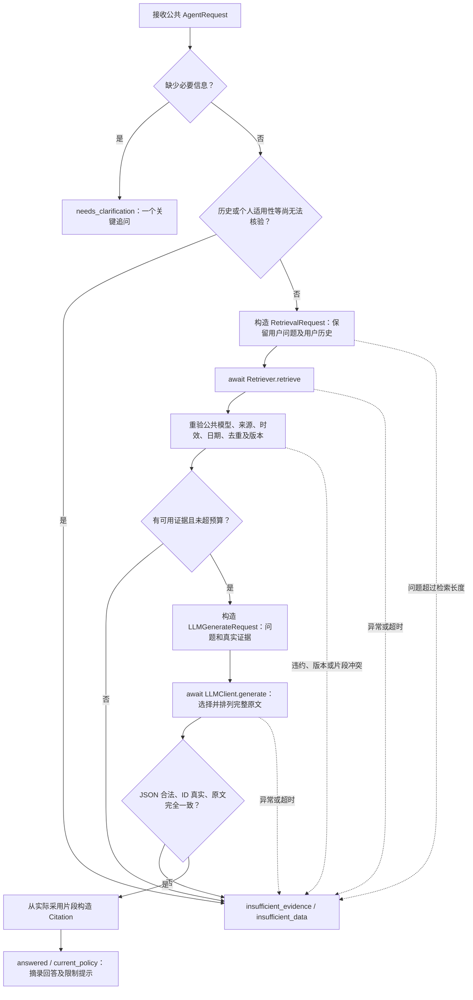

# Alpha Agent 工作流交付说明

> 本文保留 PR #24 的历史交付说明。2026-11-19 本轮真实模块组装、模型异常处理和最新测试/阻塞情况，以 [Alpha Agent 核心模块集成记录](agent-integration.md) 为准。

负责人：吴诗莹  
日期：2026-11-18（根据同学最新提交复核）  
基线：`main` 的 `3baee665b1fded80b20e4926c0132e0fb7c086b9`  
开发分支：`feat/alpha-agent-workflow-wushiying`

## 1. 交付范围与运行状态

本次实现独立的 `AgentWorkflow`，遵循公共 `AgentService.run()` 异步协议，返回现有 `AgentResult`。公共模型、Protocol、HTTP 路径和 `backend/app/main.py` 均未修改。

最小闭环已实现：问题 → 必要信息检查 → 追问或检索 → 证据门禁 → 模型选择并组织证据 → 输出复核 → 统一结果。三种状态均有测试和离线演示。

**真实检索模块与付费 Qwen 服务尚未联通。** 赵紫龙的 `QwenLLMClient` 已随 PR #20 合并，本版已通过 `httpx.MockTransport` 验证该现有适配器与工作流、HTTP 入口的完整调用链。演示和测试使用明确命名的替身及合成资料，网址为 `example.invalid`，不是福州大学政策。测试中的 `verified/enabled` 只是构造测试输入，未修改知识库资料，也不代表完成真实审核。

Alpha 采用**摘录式回答**：模型只负责选择、排列已检索证据，代码逐字复核完整片段，再组织答案及引用。暂不接受自由改写的政策结论，避免模型自行补充条件、阈值、网址或引用。

## 2. 文件索引

| 成果 | 路径 |
| --- | --- |
| 工作流代码 | `backend/services/agent_workflow.py` |
| 工作流单元测试 | `tests/test_agent_workflow.py` |
| 现有后端注入验证 | `tests/test_agent_workflow_api.py` |
| 已合并 Qwen 适配器组合验证 | `tests/test_agent_workflow_qwen.py` |
| 三状态离线演示 | `examples/agent_workflow_demo.py` |
| 流程图源码 | `docs/assignment-03/alpha/agent-workflow.mmd` |
| 可复现验证脚本 | `scripts/verify_agent_workflow.py` |
| 实际运行记录 | `docs/assignment-03/alpha/evidence/` |
| PR 描述草稿 | `docs/assignment-03/alpha/agent-workflow-pr.md` |
| 同学提交及上传前对齐核查 | `docs/assignment-03/alpha/agent-workflow-alignment.md` |

## 3. 流程图



这里只使用规范中的三种 `status`。旧设计稿中的 `grounded/conflict/degraded` 不作为本版输出状态；冲突和失败通过 `insufficient_evidence` 加 `warnings` 表达。

## 4. 公共接口使用

| 边界 | 本版调用 |
| --- | --- |
| 后端 → Agent | `await workflow.run(AgentRequest(...)) -> AgentResult` |
| Agent → 检索器 | `await retriever.retrieve(RetrievalRequest(...)) -> list[RetrievedChunk]` |
| Agent → 模型客户端 | `await llm_client.generate(LLMGenerateRequest(...)) -> LLMResult` |

检索默认 `top_k=5`，由公共模型校验 1–20 范围。没有自造业务方向代码，`business_direction_code/category_name` 保持 null。`score` 只作为检索排序信息，不按概率解释，也不设置假设归一化的阈值。

`AgentRequest.query` 最长 4000 字符，`RetrievalRequest.query` 最长 2000 字符。用户历史与当前问题合计超过 2000 字符时返回 `RETRIEVAL_QUERY_TOO_LONG`，不静默截断。完整上下文需要后续由团队统一确定压缩方案。

## 5. 追问规则（待雷葭雨确认的初版）

规则通过 `clarification_rule(request) -> str | None` 注入，可替换，不改变公共字段。

| 情况 | 初版行为 |
| --- | --- |
| 未识别具体业务主题，如“怎么办？” | 询问学校政策或办理事项 |
| 奖学金、综评问题缺学年 | 询问评定学年 |
| 包含“我、本人、能否”等个人资格表达且缺年级 | 询问入学年级 |
| 同时缺多个必要项 | 每轮只追问一个，按事项、学年、年级顺序 |

“2024级”不当成“2024学年”。补充内容可以从后端提供的历史 **user** 消息继承；assistant/system 历史不填充必要条件、不作为政策依据，也不会传给模型当作已核验证据。

当前规则是小范围关键词规则，不是完整意图识别；学院、专业、培养类别、竞赛类型等业务规则尚需负责人细化。调用方可注入已确认的规则。工作流无会话内可变状态，调用方负责读取历史；现有 HTTP 入口仍传空历史，因此当前 HTTP 联调时应重发完整问题，不能只发“2026学年”期待后端自动记住前文。

## 6. 证据门禁与引用

生成前要求：

1. 结果必须为 `list[RetrievedChunk]`，并重新经过公共模型验证，防止 `model_copy/model_construct` 绕过校验。
2. `retrieval_status=enabled`、`source_verification_status=verified`、`timeliness_verification_status=current`。
3. 已知发布日期和生效日期不得在未来；标题非空；分数必须为有限数。
4. 相同片段去重；同片段 ID 内容不一致则拒绝；同文档多个当前版本则停止生成。
5. 最多接受配置的 `top_k` 个去重后有效片段，正文总长默认不超过 24000 字符；超限停止本轮生成，不截断政策正文。
6. 可通过 `evidence_check(request, chunk)` 增加适用范围、附件或业务核验，只能收紧门禁，不能绕过来源/时效要求。

`blocked/review_only` 会因违反公共检索结果契约导致本轮拒绝；未核验、失效、历史、未来生效等不合格资料被过滤。没有合格资料时不调用模型。

生成后只接受以下 **内部输出格式**（不是新增公共 DTO，也不改变 `LLMResult`）：

```json
{"evidence": [{"chunk_id": "本轮提供的片段 UUID", "quote": "该片段完整 content"}]}
```

`LLMResult.content` 必须是这个 JSON。证据不足或无关时模型应返回 `{"evidence": []}`，工作流降级为证据不足。模型自由回答、未知/重复 ID、额外 answer/url 字段、改写或局部截取原文均被拒绝。最终 `Citation` 的标题、网址、文档 ID、版本 ID、定位、核验状态和 excerpt 全部由实际采用的检索片段构造，未选中片段不出现在引用中，未知定位保留 null。

对答案的逐字校验只能证明可追溯，**不能证明完整政策适用性或语义相关性**。相关性由检索器及模型选择共同处理，仍需真实资料人工验收。当前仅提供来源原文，不推断个人资格；历史版本、截止时间、办理窗口以及显式冲突咨询默认保守拒答。对个人问题先补齐必要信息，再提示未接入适用性核验。公共 `RetrievedChunk` 尚无适用范围、审核附件、截止节点、版本替代关系等字段，本版不伪造这些能力。跨文档政策冲突尚不能自动识别，需业务核验接入后补齐。

## 7. 后端集成方式（由组长协调）

真实依赖准备好后，在应用组装层使用已有入口：

```python
from backend.app.main import create_app
from backend.contracts.protocols import AgentService, LLMClient, Retriever
from backend.services.agent_workflow import AgentWorkflow

def build_app(retriever: Retriever, llm_client: LLMClient):
    agent: AgentService = AgentWorkflow(retriever, llm_client)
    return create_app(agent_service=agent)
```

工作流不构造 HTTP Response，不负责生成 request/conversation ID；后端现有入口负责包装 `AskResponse`。默认 `app` 仍不会自动启用任何替身。

检索及模型分别默认 30 秒超时。检索异常及未分类模型异常降级为证据不足；Qwen 适配器抛出的已脱敏 `ServiceError` 原样交给后端处理，保留 `MODEL_TIMEOUT`、`RATE_LIMITED`、`MODEL_UNAVAILABLE` 等统一错误码与 HTTP 状态。工作流自身模型等待超时转换为已有 `LLMTimeoutError`，由后端返回 504；取消任务继续向外传播。日志仅记录请求 ID 和失败阶段，不输出用户原文、模型响应、资料正文或异常中的凭证。

赵紫龙的客户端默认单次超时 20 秒、最多重试一次；工作流 30 秒是整体等待上限，可能在第二次请求结束前取消。这是有意限定总等待；部署组装时可以通过 `timeout_seconds` 与模型的重试/超时配置统一调整。

## 8. 协作交接清单

以下是**待确认事项，未声称已经与同学沟通完成**：

| 对接人 | 已按规范准备 | 需确认 |
| --- | --- | --- |
| 雷葭雨 | 可替换的追问规则与适用性核验函数 | 场景必填项、追问文案、年级/学院/专业规则及冲突判定 |
| 王智洋 | 异步 `Retriever.retrieve`，原样复用公共返回类型 | enabled 筛选、相关性质量、完整正文与附件、版本一致性；真实验收样例 |
| 赵紫龙 | 已合并 `QwenLLMClient` 的模拟 HTTP 组合验证、已有 `create_app` 注入与统一模型错误码验证 | 付费端点 JSON 输出质量、超时/重试预算、历史加载与部署组装 |

无需改公共模型即可开始联调；若业务必须新增字段，应先由组长协调统一接口变更。

2026-11-18 已检查可见远程分支及 PR：尚未找到雷葭雨的 Alpha 追问规则或王智洋的真实 Retriever 实现。此结论仅限本次可见仓库状态，不表示同学没有本地开发。详细证据见 [对齐核查](agent-workflow-alignment.md)。

## 9. 复现测试与演示

在仓库根目录执行（Windows PowerShell）：

```powershell
python -m venv .venv
.venv\Scripts\python.exe -m pip install -r backend/requirements-dev.txt
.venv\Scripts\python.exe scripts/verify_agent_workflow.py
```

验证脚本运行 `unittest discover -s tests -v`，包含工作流、API 注入和原有接口测试，并运行 `python -m examples.agent_workflow_demo`。真实输出、执行命令、退出码、北京时间及依赖版本写入 `evidence/`。也可单独执行这两个命令。没有真实模型密钥也可以运行。

本轮实际执行结果见 [测试记录](evidence/test-record.md)、[完整测试输出](evidence/unittest.txt) 和 [三状态演示输出](evidence/demo.txt)。这些记录验证工作流逻辑及接口兼容性，不能作为真实 Qwen、向量检索或生产政策正确性的验收记录。
